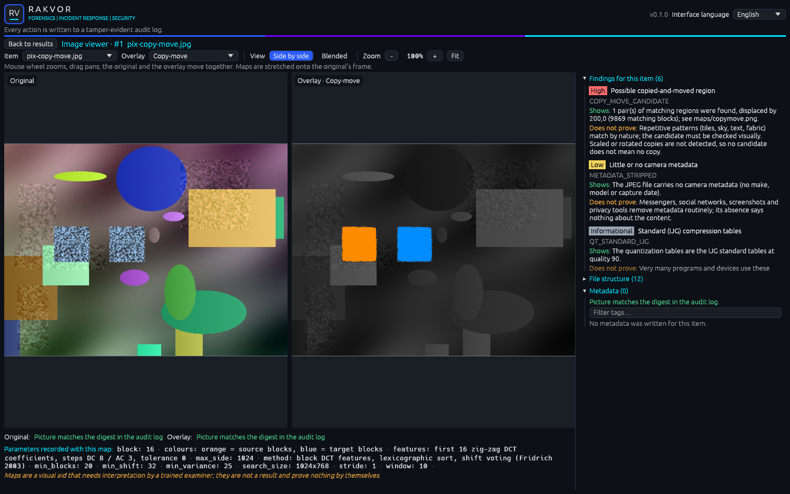
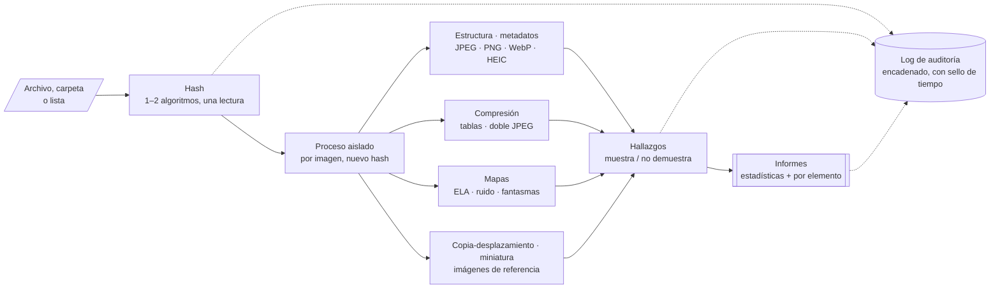
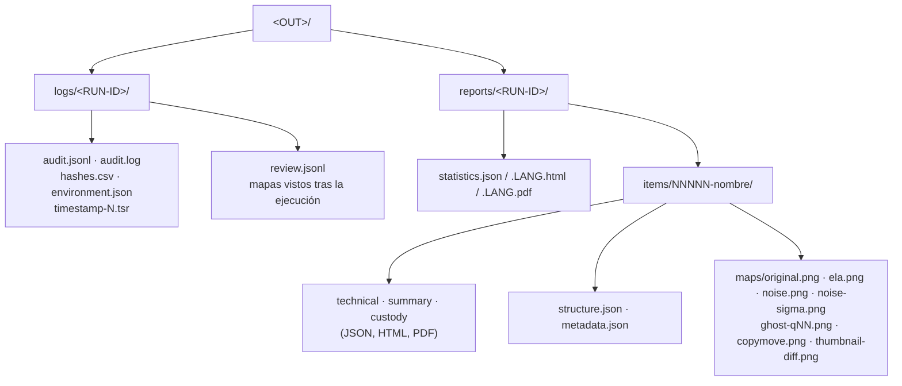

> La versión de referencia es la inglesa ([README.md](README.md)); esta traducción la sigue.

<p align="center"></p>

# RV ImgAuth

[English](README.md) · **Español** · [Français](README.fr.md)

<!-- forge:description -->
**Encuentra las señales de modificación en fotos y capturas de pantalla.** RV ImgAuth examina imágenes JPEG, HEIC/HEIF, PNG y WebP (estructura del archivo, metadatos, huellas de compresión, doble compresión, mapas visuales (ELA, ruido, fantasmas JPEG), copia-desplazamiento, la miniatura incrustada e imágenes de referencia conocidas) e informa de lo que muestra cada señal y de lo que no demuestra. Nunca da un veredicto.
<!-- /forge:description -->

[](https://github.com/Panacota96/rv-imgauth/actions/workflows/ci.yml)






## Contenido

- [Qué hace y qué no hace](#qué-hace-y-qué-no-hace)
- [Análisis](#análisis)
- [Instalación](#instalación)
- [Inicio rápido](#inicio-rápido)
- [Parte del conjunto de herramientas Rakvor](#parte-del-conjunto-de-herramientas-rakvor)
- [Salidas y códigos de salida](#salidas-y-códigos-de-salida)
- [Documentación](#documentación)
- [Estructura del proyecto](#estructura-del-proyecto)
- [Contribuir, seguridad, licencia](#contribuir-seguridad-licencia)
- [Licencia](#licencia)

## Qué hace y qué no hace

| Hace | No hace |
| --- | --- |
| Informa de **señales** de que una imagen se volvió a guardar, se editó o se montó, cada una con lo que muestra y lo que no demuestra | Decir que una imagen es auténtica, falsa o manipulada: esa es la conclusión del perito |
| Escribe mapas visuales (ELA, ruido, fantasmas JPEG, copia-desplazamiento, diferencia con la miniatura) con todos sus parámetros registrados | Puntuar los mapas: son ayudas visuales para un perito capacitado |
| Compara una imagen con originales conocidos del dispositivo que se afirma | Identificar un dispositivo o una persona |
| Calcula el hash de cada archivo que lee y escribe y lleva un log de auditoría encadenado y con sello de tiempo, más un registro de revisión de los mapas que vio el perito | Demostrar nada sobre la imagen antes de su recepción, ni que un resultado limpio significa una imagen sin alterar |
| Examina la estructura y los metadatos de HEIC | Decodificar los píxeles HEIC (sin mapas ni copia-desplazamiento para HEIC en esta versión) |

Las tasas de error de los análisis **todavía no se han medido** en un corpus de validación; cada informe lo indica
([admissibility.md](docs/admissibility.md#consolidated-gap-list), en inglés).

| | |
| --- | --- |
| **Dos formas de usarlo** | `rv-imgauth` (línea de comandos) y `rv-imgauth-gui` (aplicación de escritorio de Windows 10/11 con un visor de imágenes). Mismo motor, mismos resultados. |
| **Individual o masivo** | Un archivo, muchos archivos, carpetas completas (`--recursive`) o un archivo de lista (`--input-list`). |
| **Hash** | 1 o 2 de md5, sha1, sha256, sha512, sha3-256, blake3, en una lectura; el proceso de análisis vuelve a calcular el hash de los bytes que analiza. |
| **Auditable** | `logs/<RUN-ID>/audit.jsonl` (cada entrada lleva el hash de la anterior), sello de tiempo RFC 3161, `review.jsonl` para la visualización posterior; `verify-log` detecta cualquier edición. |
| **Informes** | Estadísticas por ejecución; por imagen una revisión técnica, un resumen para el cliente y un formato de custodia (Colombia o Francia), en HTML, PDF (opcionalmente firmado) y JSON, en inglés, español o francés. |

## Análisis

| Análisis | Formatos | Qué examina | Hallazgos principales |
| --- | --- | --- | --- |
| Estructura | todos | Marcadores JPEG y orden de los segmentos, tablas duplicadas, tramas progresivas, bytes tras EOI; orden de chunks PNG (PNG 3.ª ed.), chunks privados, datos tras IEND; banderas VP8X de WebP frente a los chunks; boxes HEIF, grafo de ítems, cuadrícula, bytes sin referencia | `JPEG_MARKER_ORDER_UNUSUAL`, `DATA_AFTER_END_MARKER`, `PNG_CHUNK_ORDER_INVALID`, `WEBP_FLAGS_MISMATCH`, `HEIF_STRUCTURE_ANOMALY` |
| Metadatos | todos | EXIF, XMP (CreatorTool, `xmpMM:History`), IPTC, texto PNG; editores, fechas, tamaños, metadatos eliminados, rastro de Facebook, MakerNote | `EXIF_SOFTWARE_EDITOR`, `XMP_EDIT_HISTORY`, `METADATA_DATES_INCONSISTENT`, `METADATA_STRIPPED` |
| Tablas de cuantización | JPEG | Estándar IJG q=N o no estándar (q más cercano, nunca un % de calidad); hash de las tablas en las bases de huellas | `QT_STANDARD_IJG`, `QT_NON_STANDARD`, `QT_MATCHES_*`, `QT_UNKNOWN` |
| Doble compresión | JPEG baseline | Periodicidad de los histogramas de coeficientes DCT (Popescu y Farid; Lin et al.) | `DOUBLE_COMPRESSION_SIGNS` |
| Mapa ELA | JPEG | Nuevo guardado a q=95 (ganancia fija 15, 4:4:4) y diferencia (Krawetz) | `ELA_MAP_WRITTEN` (info) |
| Mapas de ruido | JPEG, PNG, WebP | Residuo de mediana 3×3; σ de Mahdian–Saic por bloque db8 HH1 de 40×40 | `NOISE_INCONSISTENCY_MAP` (info) |
| Fantasmas JPEG (`--maps ghosts`) | JPEG ≤ 24 MP | Nuevo guardado a q 50–90 (Farid 2009) | `JPEG_GHOST_REGION` |
| Copia-desplazamiento | JPEG, PNG, WebP | Rasgos DCT de bloques 16×16, ordenación lexicográfica, votación por vector de desplazamiento (Fridrich et al.) | `COPY_MOVE_CANDIDATE` |
| Miniatura | con miniatura EXIF | Vista previa incrustada frente a la imagen principal redimensionada | `THUMBNAIL_MISMATCH` |
| Imágenes de referencia (`--reference`) | todos | Tablas, marcadores, conjunto de etiquetas EXIF, miniatura, resolución, ICC, submuestreo, chunks PNG, ítems HEIF frente a originales conocidos | `REFERENCE_CONSISTENT`, `REFERENCE_INCONSISTENT` |

Cómo funciona cada uno, con parámetros exactos y referencias: [docs/theory.md](docs/theory.md) (en inglés).

## Instalación

**Windows 10/11**: archivos de la versión:

- `rv-imgauth-<version>-windows-x64-setup.exe`: instalador por usuario (acceso directo en el menú Inicio, entrada opcional en el PATH), o
- `rv-imgauth-<version>-windows-x64.zip`: portable; descomprima y ejecute.

Compruebe la descarga antes de usarla (`SHA256SUMS`, atestación de procedencia y la firma Authenticode frente al
certificado raíz de Rakvor), paso a paso en [docs/installation.es.md](docs/installation.es.md).

> **Actualización desde 0.2.0.** Si instaló RV ImgAuth 0.2.0 en una máquina que también tiene RV PdfAuth, reinstale RV PdfAuth: 0.2.0 compartía su identidad de instalador. (Su instalador usaba el AppId de RV PDFAuth, así que instalar o
> desinstalar uno podía actualizar o quitar el otro; las versiones posteriores tienen el suyo propio.)

**Desde el código fuente** (Rust 1.88+ para la CLI, 1.95+ para la GUI; las versiones usan la cadena de herramientas
fijada en `rust-toolchain.toml`):

```bash
cargo build --release --locked
# binarios: target/release/rv-imgauth y target/release/rv-imgauth-gui
```

## Inicio rápido

```powershell
# Compruebe la compilación: cada algoritmo de hash contra vectores de prueba publicados
rv-imgauth self-test

# Una foto con los análisis por defecto (ELA, ruido, copia-desplazamiento, miniatura)
rv-imgauth analyze -i evidence\IMG_0042.jpg

# Una carpeta, todos los mapas incluidos los fantasmas JPEG, SHA-256 + MD5, informes en español
rv-imgauth analyze -i D:\evidence -r --maps ela,noise,ghosts --hash sha256,md5 --lang es --case CASE-2026-014 --actor "Examiner"

# Comparar con originales conocidos del teléfono que se afirma
rv-imgauth analyze -i IMG_0042.jpg --reference ref\IMG_0040.jpg --reference ref\IMG_0041.jpg

# Enseñar a la herramienta un dispositivo a partir de originales que usted hizo con él (base local, no se envía nada)
rv-imgauth fingerprints learn originals\*.jpg --label "Phone X camera" --category camera

# Demostrar que el log (y el registro de revisión) no se alteró
rv-imgauth verify-log rakvor-out\logs\<RUN-ID>
```

Las tareas habituales, paso a paso: [docs/quick-guide.es.md](docs/quick-guide.es.md).
Cada opción: [docs/usage-cli.md](docs/usage-cli.md) (generado a partir de `--help`, en inglés). La aplicación de
escritorio y su visor de imágenes: [docs/usage-gui.es.md](docs/usage-gui.es.md). Una muestra sintética lista para usar:
[examples/](examples/README.md) (en inglés).

## Parte del conjunto de herramientas Rakvor

Las herramientas Rakvor comparten una **carpeta del caso**. RV HashInv (`rv-hashinv`) es la herramienta de recepción:
calcula el hash de cada archivo de evidencia y lo registra (`E0001`, …). RV ImgAuth es una herramienta de análisis: con
`--case-dir` vuelve a calcular el hash de cada imagen y la verifica contra ese registro antes de analizarla.
`--intake hashinv` hace la recepción por usted, en un solo paso:

```powershell
rv-imgauth analyze -i D:\export\photos -r --case-dir E:\CASE-014 --case CASE-014 --intake hashinv
rv-imgauth verify-case E:\CASE-014
```

Detalles: [docs/case-folder.md](docs/case-folder.md) (en inglés).

## Salidas y códigos de salida



| Código de salida | Significado |
| :-: | --- |
| 0 | Terminado, sin hallazgos de severidad alta |
| 1 | Error de ejecución |
| 2 | Error de uso (p. ej. tres algoritmos de hash) |
| 3 | Terminado con hallazgos de severidad alta, o un log de auditoría / de revisión o una carpeta del caso rotos |
| 130 | Cancelado (se escriben informes parciales) |

## Documentación

| Página | Para |
| --- | --- |
| [docs/quick-guide.es.md](docs/quick-guide.es.md) | Las seis tareas habituales (analyze, carpeta del caso, verify-log, verify-case, timestamp, fingerprints), cada botón de la GUI, códigos de salida |
| [docs/theory.md](docs/theory.md) | Por qué funciona cada análisis: lenguaje sencillo para clientes, abogados y jueces; algoritmos, parámetros y referencias para peritos (en inglés) |
| [docs/admissibility.md](docs/admissibility.md) | Requisitos de Colombia, Francia/UE, ISO, SWGDE, EE. UU./Reino Unido frente a las funciones; brechas; lista de control del perito (borrador pendiente de revisión jurídica; en inglés) |
| [docs/installation.es.md](docs/installation.es.md) | Instalación en Windows 10/11, verificación de la versión, compilación desde el código fuente |
| [docs/usage.es.md](docs/usage.es.md) | Recorrido de un caso, opciones, interpretación de cada hallazgo, huellas, referencias, verificación de una ejecución |
| [docs/usage-cli.md](docs/usage-cli.md) | Cada comando y opción (generado a partir de `--help`; en inglés) |
| [docs/usage-gui.es.md](docs/usage-gui.es.md) | La aplicación de escritorio y el visor de imágenes |
| [docs/reports.md](docs/reports.md) | Secciones de los informes, salidas por elemento, cada código de hallazgo (en inglés) |
| [docs/architecture.md](docs/architecture.md) | Crates, flujo de datos, proceso de análisis, modelo de imagen, registro de revisión (en inglés) |
| [docs/case-folder.md](docs/case-folder.md) | Carpeta compartida del caso y recepción en un paso (en inglés) |
| [docs/forensic-audit.md](docs/forensic-audit.md) | Log de auditoría, registro de revisión, sello de tiempo, informes firmados, formatos de custodia (en inglés) |
| [docs/development.md](docs/development.md) · [docs/release-process.md](docs/release-process.md) | Compilación, pruebas, publicación (en inglés) |
| [docs/adr/](docs/adr/) | Decisiones de arquitectura (en inglés) |

El README, la guía rápida, la guía de uso, la guía de la aplicación de escritorio y la guía de instalación existen
también en español (`.es.md`) y en francés (`.fr.md`); las páginas en inglés son la referencia.

## Estructura del proyecto

```text
rv-imgauth/
├── src/
│   ├── img/       capa de imagen: analizadores, metadatos, análisis (sin código unsafe, sin E/S)
│   ├── core/      motor: entrada, hash, proceso de análisis, análisis de cada imagen, logs de auditoría y de revisión, informes
│   ├── cli/       línea de comandos rv-imgauth (clap)
│   └── gui/       aplicación de escritorio rv-imgauth-gui (egui) con el visor de imágenes
├── fingerprints/  base de huellas starter incluida
├── templates/     plantillas HTML de los informes
├── i18n/          textos de los informes y catálogo de hallazgos: en.json, es.json, fr.json
├── schemas/       esquemas JSON de los informes y de la carpeta del caso
├── docs/          documentación (los diagramas Mermaid se muestran en GitHub)
├── tests/         generadores de muestras, oráculos (Pillow, ExifTool, numpy), verificador de la cadena
├── fuzz/          objetivos de cargo-fuzz para los analizadores
├── scripts/       comprobaciones de la documentación (las traducciones mantienen la forma de las páginas en inglés)
├── examples/      evidencia de muestra sintética, scripts de ejecución, hallazgos y hashes esperados
├── packaging/     instalador de Windows (Inno Setup), raíz de firma de código de Rakvor
└── .github/       flujos de CI, fuzzing y publicación
```

## Contribuir, seguridad, licencia

- Cómo contribuir: [CONTRIBUTING.md](CONTRIBUTING.md) · Cambios: [CHANGELOG.md](CHANGELOG.md)
- Informe de una vulnerabilidad en privado: [SECURITY.md](SECURITY.md)
- Licencia: ver [Licencia](#licencia). Avisos de terceros: [NOTICE](NOTICE).

## Licencia

Código disponible, no comercial: [PolyForm Noncommercial 1.0.0](LICENSE). Cualquiera puede usar, estudiar, modificar
y compartir RV ImgAuth con fines no comerciales. Se exige el crédito en todo uso: "RV ImgAuth by Rakvor", y conservar
la línea `Required Notice:` de [LICENSE](LICENSE). El uso comercial (venderlo, servicios de pago, uso en el trabajo
remunerado de una empresa con ánimo de lucro) requiere una licencia escrita de Rakvor: ver
[COMMERCIAL.md](COMMERCIAL.md). Rakvor conserva todos los derechos comerciales como titular de los derechos de autor.
Los textos de licencia de Rakvor ([COMMERCIAL.md](COMMERCIAL.md), [NOTICE](NOTICE), esta sección) son borradores,
pendientes de verificación por un abogado (*to be verified*; Colombia, Francia), y no constituyen asesoría legal. Los
componentes de terceros conservan sus propias licencias: [NOTICE](NOTICE).
