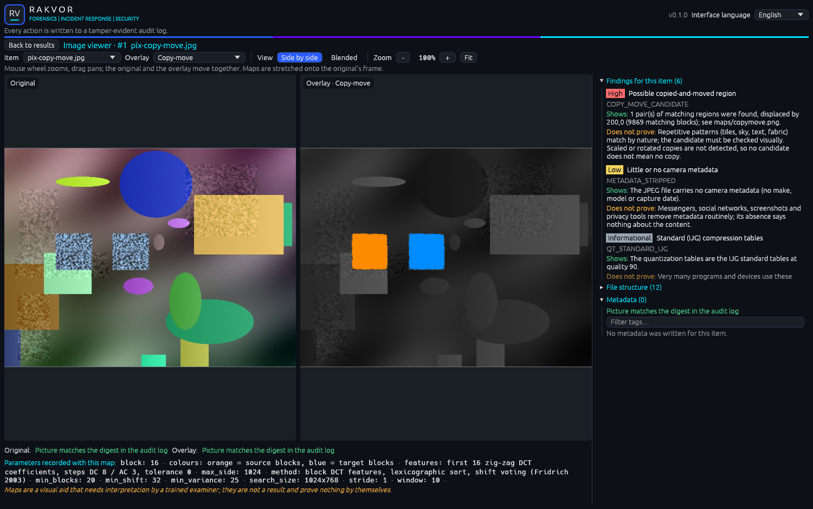
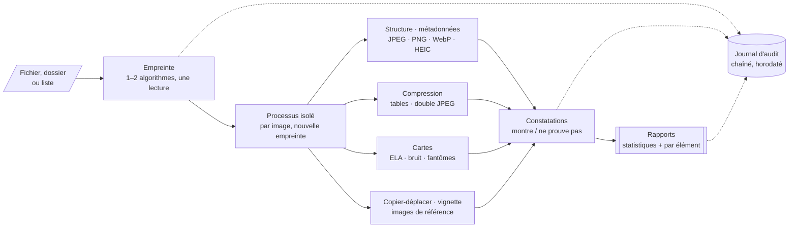
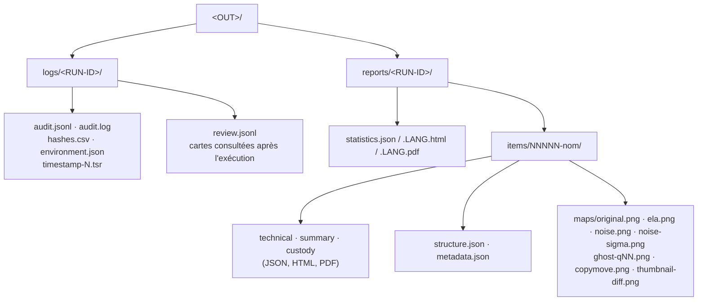

> La version de référence est la version anglaise ([README.md](README.md)) ; cette traduction la suit.

<p align="center"></p>

# RV ImgAuth

[English](README.md) · [Español](README.es.md) · **Français**

<!-- forge:description -->
**Repère les signaux de modification dans les photos et les captures d'écran.** RV ImgAuth examine les images JPEG, HEIC/HEIF, PNG et WebP (structure du fichier, métadonnées, empreintes de compression, double compression, cartes visuelles (ELA, bruit, fantômes JPEG), copier-déplacer, la vignette incorporée et des images de référence connues) et indique ce que montre chaque signal et ce qu'il ne prouve pas. Il ne rend jamais de verdict.
<!-- /forge:description -->

[](https://github.com/Panacota96/rv-imgauth/actions/workflows/ci.yml)






## Sommaire

- [Ce qu'il fait et ne fait pas](#ce-quil-fait-et-ne-fait-pas)
- [Analyses](#analyses)
- [Installation](#installation)
- [Démarrage rapide](#démarrage-rapide)
- [Membre de la suite Rakvor](#membre-de-la-suite-rakvor)
- [Sorties et codes de sortie](#sorties-et-codes-de-sortie)
- [Documentation](#documentation)
- [Organisation du projet](#organisation-du-projet)
- [Contribuer, sécurité, licence](#contribuer-sécurité-licence)
- [Licence](#licence)

## Ce qu'il fait et ne fait pas

| Il fait | Il ne fait pas |
| --- | --- |
| Signaler des **signaux** qu'une image a été réenregistrée, modifiée ou assemblée, chacun avec ce qu'il montre et ce qu'il ne prouve pas | Dire qu'une image est authentique, fausse ou manipulée : c'est la conclusion de l'expert |
| Écrire des cartes visuelles (ELA, bruit, fantômes JPEG, copier-déplacer, différence avec la vignette) avec tous leurs paramètres consignés | Noter les cartes : ce sont des aides visuelles pour un expert formé |
| Comparer une image à des originaux connus de l'appareil allégué | Identifier un appareil ou une personne |
| Calculer l'empreinte de chaque fichier lu et écrit et tenir un journal d'audit chaîné et horodaté, plus un journal de revue des cartes consultées par l'expert | Prouver quoi que ce soit sur l'image avant son entrée, ni qu'un résultat sans constat signifie une image non modifiée |
| Examiner la structure et les métadonnées des HEIC | Décoder les pixels HEIC (pas de cartes ni de copier-déplacer pour les HEIC dans cette version) |

Les taux d'erreur des analyses n'ont **pas encore été mesurés** sur un corpus de validation ; chaque rapport le dit
([admissibility.md](docs/admissibility.md#consolidated-gap-list), en anglais).

| | |
| --- | --- |
| **Deux façons de l'utiliser** | `rv-imgauth` (ligne de commande) et `rv-imgauth-gui` (application de bureau Windows 10/11 avec une visionneuse d'images). Même moteur, mêmes résultats. |
| **Unitaire ou en masse** | Un fichier, plusieurs fichiers, des dossiers entiers (`--recursive`) ou un fichier de liste (`--input-list`). |
| **Empreintes** | 1 ou 2 parmi md5, sha1, sha256, sha512, sha3-256, blake3, en une lecture ; le processus d'analyse recalcule l'empreinte des octets qu'il analyse. |
| **Auditable** | `logs/<RUN-ID>/audit.jsonl` (chaque entrée porte l'empreinte de la précédente), horodatage RFC 3161, `review.jsonl` pour la consultation ultérieure ; `verify-log` détecte toute modification. |
| **Rapports** | Statistiques par exécution ; par image un examen technique, une synthèse pour le client et une fiche de traçabilité (Colombie ou France), en HTML, PDF (signé en option) et JSON, en anglais, espagnol ou français. |

## Analyses

| Analyse | Formats | Ce qu'elle examine | Constatations principales |
| --- | --- | --- | --- |
| Structure | tous | Marqueurs JPEG et ordre des segments, tables en double, trames progressives, octets après EOI ; ordre des chunks PNG (PNG 3e éd.), chunks privés, données après IEND ; drapeaux VP8X de WebP contre les chunks ; boxes HEIF, graphe des items, grille, octets non référencés | `JPEG_MARKER_ORDER_UNUSUAL`, `DATA_AFTER_END_MARKER`, `PNG_CHUNK_ORDER_INVALID`, `WEBP_FLAGS_MISMATCH`, `HEIF_STRUCTURE_ANOMALY` |
| Métadonnées | tous | EXIF, XMP (CreatorTool, `xmpMM:History`), IPTC, texte PNG ; éditeurs, dates, tailles, métadonnées supprimées, trace Facebook, MakerNote | `EXIF_SOFTWARE_EDITOR`, `XMP_EDIT_HISTORY`, `METADATA_DATES_INCONSISTENT`, `METADATA_STRIPPED` |
| Tables de quantification | JPEG | Standard IJG q=N ou non standard (q le plus proche, jamais un % de qualité) ; empreinte des tables dans les bases d'empreintes | `QT_STANDARD_IJG`, `QT_NON_STANDARD`, `QT_MATCHES_*`, `QT_UNKNOWN` |
| Double compression | JPEG baseline | Périodicité des histogrammes de coefficients DCT (Popescu et Farid ; Lin et al.) | `DOUBLE_COMPRESSION_SIGNS` |
| Carte ELA | JPEG | Réenregistrement à q=95 (gain fixe 15, 4:4:4) et différence (Krawetz) | `ELA_MAP_WRITTEN` (info) |
| Cartes de bruit | JPEG, PNG, WebP | Résidu médian 3×3 ; σ de Mahdian–Saic par bloc db8 HH1 de 40×40 | `NOISE_INCONSISTENCY_MAP` (info) |
| Fantômes JPEG (`--maps ghosts`) | JPEG ≤ 24 MP | Réenregistrement à q 50–90 (Farid 2009) | `JPEG_GHOST_REGION` |
| Copier-déplacer | JPEG, PNG, WebP | Caractéristiques DCT de blocs 16×16, tri lexicographique, vote par vecteur de déplacement (Fridrich et al.) | `COPY_MOVE_CANDIDATE` |
| Vignette | avec vignette EXIF | Aperçu incorporé contre l'image principale redimensionnée | `THUMBNAIL_MISMATCH` |
| Images de référence (`--reference`) | tous | Tables, marqueurs, ensemble des balises EXIF, vignette, résolution, ICC, sous-échantillonnage, chunks PNG, items HEIF contre des originaux connus | `REFERENCE_CONSISTENT`, `REFERENCE_INCONSISTENT` |

Fonctionnement de chacune, avec les paramètres exacts et les références : [docs/theory.md](docs/theory.md) (en anglais).

## Installation

**Windows 10/11** : fichiers de la version :

- `rv-imgauth-<version>-windows-x64-setup.exe` : programme d'installation par utilisateur (raccourci dans le menu Démarrer, entrée PATH facultative), ou
- `rv-imgauth-<version>-windows-x64.zip` : portable, à décompresser et lancer.

Vérifiez le téléchargement avant usage (`SHA256SUMS`, attestation de provenance et signature Authenticode par rapport
au certificat racine Rakvor), étape par étape dans [docs/installation.fr.md](docs/installation.fr.md).

> **Mise à niveau depuis la 0.2.0.** Si vous avez installé RV ImgAuth 0.2.0 sur une machine qui a aussi RV PdfAuth, réinstallez RV PdfAuth : la 0.2.0 partageait son identité d'installation. (Son programme d'installation utilisait l'AppId de RV PDFAuth, si bien qu'installer ou
> désinstaller l'un pouvait mettre à jour ou retirer l'autre ; les versions suivantes ont le leur.)

**Depuis les sources** (Rust 1.88+ pour la CLI, 1.95+ pour la GUI ; les versions utilisent la chaîne de compilation
fixée dans `rust-toolchain.toml`) :

```bash
cargo build --release --locked
# binaires : target/release/rv-imgauth et target/release/rv-imgauth-gui
```

## Démarrage rapide

```powershell
# Vérifiez la version : chaque algorithme d'empreinte avec des vecteurs de test publiés
rv-imgauth self-test

# Une photo avec les analyses par défaut (ELA, bruit, copier-déplacer, vignette)
rv-imgauth analyze -i evidence\IMG_0042.jpg

# Un dossier, toutes les cartes y compris les fantômes JPEG, SHA-256 + MD5, rapports en espagnol
rv-imgauth analyze -i D:\evidence -r --maps ela,noise,ghosts --hash sha256,md5 --lang es --case CASE-2026-014 --actor "Examiner"

# Comparer avec des originaux connus du téléphone allégué
rv-imgauth analyze -i IMG_0042.jpg --reference ref\IMG_0040.jpg --reference ref\IMG_0041.jpg

# Apprendre un appareil à l'outil à partir d'originaux que vous avez faits avec lui (base locale, rien n'est envoyé)
rv-imgauth fingerprints learn originals\*.jpg --label "Phone X camera" --category camera

# Prouver que le journal (et le journal de revue) n'a pas été modifié
rv-imgauth verify-log rakvor-out\logs\<RUN-ID>
```

Les tâches courantes, étape par étape : [docs/quick-guide.fr.md](docs/quick-guide.fr.md).
Chaque option : [docs/usage-cli.md](docs/usage-cli.md) (généré à partir de `--help`, en anglais). L'application de
bureau et sa visionneuse d'images : [docs/usage-gui.fr.md](docs/usage-gui.fr.md). Un exemple synthétique prêt à
l'emploi : [examples/](examples/README.md) (en anglais).

## Membre de la suite Rakvor

Les outils Rakvor partagent un **dossier de l'affaire**. RV HashInv (`rv-hashinv`) est l'outil d'entrée : il calcule
l'empreinte de chaque élément de preuve et l'enregistre (`E0001`, …). RV ImgAuth est un outil d'analyse : avec
`--case-dir`, il recalcule l'empreinte de chaque image et la vérifie par rapport à ce registre avant de l'analyser.
`--intake hashinv` fait l'entrée pour vous, en une étape :

```powershell
rv-imgauth analyze -i D:\export\photos -r --case-dir E:\CASE-014 --case CASE-014 --intake hashinv
rv-imgauth verify-case E:\CASE-014
```

Détails : [docs/case-folder.md](docs/case-folder.md) (en anglais).

## Sorties et codes de sortie



| Code de sortie | Signification |
| :-: | --- |
| 0 | Terminé, aucune constatation de gravité élevée |
| 1 | Erreur d'exécution |
| 2 | Erreur d'utilisation (par ex. trois algorithmes d'empreinte) |
| 3 | Terminé avec des constatations de gravité élevée, ou un journal d'audit / de revue ou un dossier de l'affaire rompu |
| 130 | Annulé (rapports partiels écrits) |

## Documentation

| Page | Pour |
| --- | --- |
| [docs/quick-guide.fr.md](docs/quick-guide.fr.md) | Les six tâches courantes (analyze, dossier de l'affaire, verify-log, verify-case, timestamp, fingerprints), chaque bouton de la GUI, codes de sortie |
| [docs/theory.md](docs/theory.md) | Pourquoi chaque analyse fonctionne : langage courant pour les clients, avocats et juges ; algorithmes, paramètres et références pour les experts (en anglais) |
| [docs/admissibility.md](docs/admissibility.md) | Exigences de la Colombie, de la France/UE, de l'ISO, du SWGDE et des États-Unis/Royaume-Uni rapprochées des fonctions ; écarts ; liste de contrôle de l'expert (projet en attente de revue juridique ; en anglais) |
| [docs/installation.fr.md](docs/installation.fr.md) | Installation sous Windows 10/11, vérification de la version, compilation depuis les sources |
| [docs/usage.fr.md](docs/usage.fr.md) | Parcours d'une affaire, options, interprétation de chaque constatation, empreintes, références, vérification d'une exécution |
| [docs/usage-cli.md](docs/usage-cli.md) | Chaque commande et option (généré à partir de `--help` ; en anglais) |
| [docs/usage-gui.fr.md](docs/usage-gui.fr.md) | L'application de bureau et la visionneuse d'images |
| [docs/reports.md](docs/reports.md) | Sections des rapports, sorties par élément, chaque code de constatation (en anglais) |
| [docs/architecture.md](docs/architecture.md) | Crates, flux de données, processus d'analyse, modèle d'image, journal de revue (en anglais) |
| [docs/case-folder.md](docs/case-folder.md) | Dossier partagé de l'affaire et entrée en une étape (en anglais) |
| [docs/forensic-audit.md](docs/forensic-audit.md) | Journal d'audit, journal de revue, horodatage, rapports signés, fiches de traçabilité (en anglais) |
| [docs/development.md](docs/development.md) · [docs/release-process.md](docs/release-process.md) | Compilation, tests, publication (en anglais) |
| [docs/adr/](docs/adr/) | Décisions d'architecture (en anglais) |

Le README, le guide rapide, le guide d'utilisation, le guide de l'application de bureau et le guide d'installation
existent aussi en espagnol (`.es.md`) et en français (`.fr.md`) ; les pages en anglais font référence.

## Organisation du projet

```text
rv-imgauth/
├── src/
│   ├── img/       couche image : analyseurs, métadonnées, analyses (sans code unsafe, sans E/S)
│   ├── core/      moteur : entrées, empreintes, processus d'analyse, analyse de chaque image, journaux d'audit et de revue, rapports
│   ├── cli/       ligne de commande rv-imgauth (clap)
│   └── gui/       application de bureau rv-imgauth-gui (egui) avec la visionneuse d'images
├── fingerprints/  base d'empreintes starter fournie
├── templates/     modèles HTML des rapports
├── i18n/          libellés des rapports et catalogue des constatations : en.json, es.json, fr.json
├── schemas/       schémas JSON des rapports et du dossier de l'affaire
├── docs/          documentation (les diagrammes Mermaid s'affichent sur GitHub)
├── tests/         générateurs d'exemples, oracles (Pillow, ExifTool, numpy), vérificateur de la chaîne
├── fuzz/          cibles cargo-fuzz pour les analyseurs
├── scripts/       contrôles de la documentation (les traductions gardent la forme des pages anglaises)
├── examples/      éléments d'exemple synthétiques, scripts d'exécution, constatations et empreintes attendues
├── packaging/     programme d'installation Windows (Inno Setup), racine de signature de code Rakvor
└── .github/       workflows de CI, de fuzzing et de publication
```

## Contribuer, sécurité, licence

- Comment contribuer : [CONTRIBUTING.md](CONTRIBUTING.md) · Modifications : [CHANGELOG.md](CHANGELOG.md)
- Signaler une vulnérabilité en privé : [SECURITY.md](SECURITY.md)
- Licence : voir [Licence](#licence). Mentions de tiers : [NOTICE](NOTICE).

## Licence

Code source disponible, usage non commercial : [PolyForm Noncommercial 1.0.0](LICENSE). Chacun peut utiliser, étudier,
modifier et partager RV ImgAuth à des fins non commerciales. La mention est obligatoire dans tout usage : « RV ImgAuth
by Rakvor », en conservant la ligne `Required Notice:` de [LICENSE](LICENSE). L'usage commercial (le vendre, des
services payants, l'utiliser dans le travail rémunéré d'une entreprise à but lucratif) exige une licence écrite de
Rakvor : voir [COMMERCIAL.md](COMMERCIAL.md). Rakvor conserve tous les droits commerciaux en tant que titulaire du droit
d'auteur. Les textes de licence de Rakvor ([COMMERCIAL.md](COMMERCIAL.md), [NOTICE](NOTICE), cette section) sont des
projets, à faire vérifier par un avocat (*to be verified* ; Colombie, France), et ne constituent pas un avis
juridique. Les composants tiers conservent leurs propres licences : [NOTICE](NOTICE).
