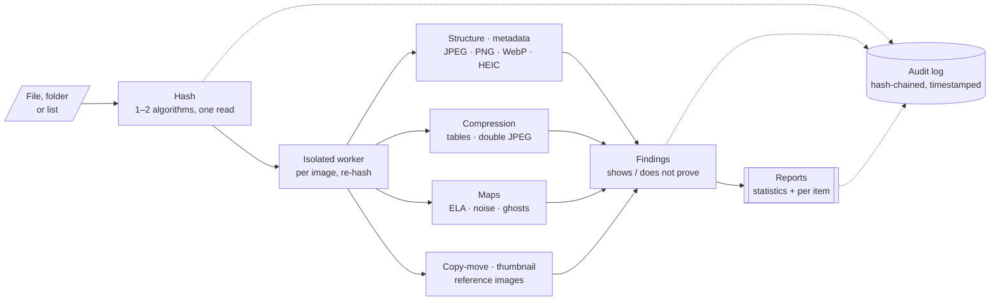
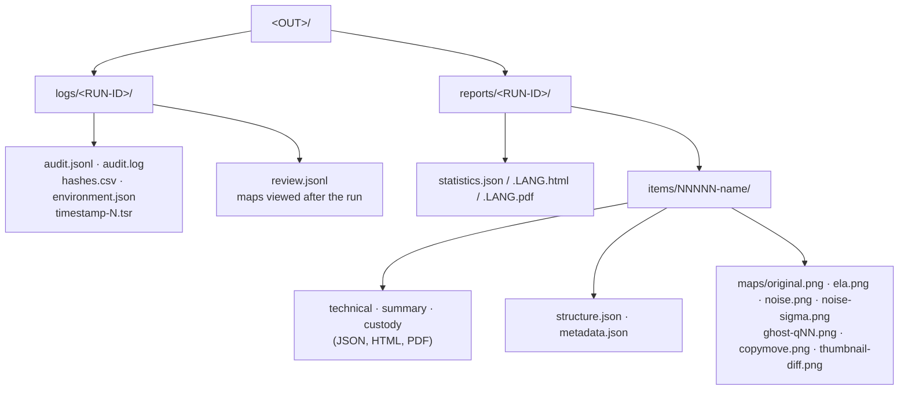

<p align="center"></p>

# RV ImgAuth

<!-- forge:description -->
**Finds the signals of modification in photos and screenshots.** RV ImgAuth examines JPEG, HEIC/HEIF, PNG and WebP images — file structure, metadata, compression fingerprints, double compression, visual maps (ELA, noise, JPEG ghosts), copy-move, the embedded thumbnail and known reference images — and reports what each signal shows and what it does not prove. It never gives a verdict.
<!-- /forge:description -->

[](https://github.com/Panacota96/rv-imgauth/actions/workflows/ci.yml)




## Contents

- [What it does and does not do](#what-it-does-and-does-not-do)
- [Analyses](#analyses)
- [Install](#install)
- [Quick start](#quick-start)
- [Part of the Rakvor toolkit](#part-of-the-rakvor-toolkit)
- [Outputs and exit codes](#outputs-and-exit-codes)
- [Documentation](#documentation)
- [Project layout](#project-layout)
- [Contributing, security, licence](#contributing-security-licence)

## What it does and does not do

| It does | It does not |
| --- | --- |
| Report **signals** that an image was re-saved, edited or assembled, each with what it shows and what it does not prove | Say that an image is authentic, fake or manipulated — that is the examiner's conclusion |
| Write visual maps (ELA, noise, JPEG ghosts, copy-move, thumbnail difference) with every parameter recorded | Score the maps: they are visual aids for a trained examiner |
| Compare an image with known originals from the claimed device | Identify a device or a person |
| Hash every file it reads and writes and keep a hash-chained, timestamped audit log, plus a review log of the maps the examiner viewed | Prove anything about the image before intake, or that a clean result means an unaltered image |
| Examine HEIC structure and metadata | Decode HEIC pixels (no maps or copy-move for HEIC in this version) |

Error rates of the analyses have **not yet been measured** on a validation corpus; every report says so
([admissibility.md](docs/admissibility.md#consolidated-gap-list)).

| | |
| --- | --- |
| **Two ways to use it** | `rv-imgauth` (command line) and `rv-imgauth-gui` (Windows 10/11 desktop app with an image viewer). Same engine, same results. |
| **Single or bulk** | One file, many files, whole folders (`--recursive`) or a list file (`--input-list`). |
| **Hashing** | 1 or 2 of md5, sha1, sha256, sha512, sha3-256, blake3, in one read; the worker re-hashes the bytes it analyses. |
| **Auditable** | `logs/<RUN-ID>/audit.jsonl` (each entry carries the hash of the previous one), RFC 3161 timestamp, `review.jsonl` for later viewing; `verify-log` detects any edit. |
| **Reports** | Statistics per run; per image a technical review, a customer summary and a custody form (Colombia or France) — HTML, PDF (optionally signed) and JSON, in English, Spanish or French. |

## Analyses

| Analysis | Formats | What it looks at | Main findings |
| --- | --- | --- | --- |
| Structure | all | JPEG markers and segment order, duplicate tables, progressive frames, bytes after EOI; PNG chunk order (PNG 3rd ed.), private chunks, data after IEND; WebP VP8X flags vs chunks; HEIF boxes, item graph, grid, unreferenced bytes | `JPEG_MARKER_ORDER_UNUSUAL`, `DATA_AFTER_END_MARKER`, `PNG_CHUNK_ORDER_INVALID`, `WEBP_FLAGS_MISMATCH`, `HEIF_STRUCTURE_ANOMALY` |
| Metadata | all | EXIF, XMP (CreatorTool, `xmpMM:History`), IPTC, PNG text; editors, dates, sizes, stripped metadata, Facebook trace, MakerNote | `EXIF_SOFTWARE_EDITOR`, `XMP_EDIT_HISTORY`, `METADATA_DATES_INCONSISTENT`, `METADATA_STRIPPED` |
| Quantization tables | JPEG | IJG standard q=N or non-standard (nearest q, never a quality %); table hash in the fingerprint databases | `QT_STANDARD_IJG`, `QT_NON_STANDARD`, `QT_MATCHES_*`, `QT_UNKNOWN` |
| Double compression | baseline JPEG | Periodicity of DCT-coefficient histograms (Popescu & Farid; Lin et al.) | `DOUBLE_COMPRESSION_SIGNS` |
| ELA map | JPEG | Re-save at q=95 (fixed gain 15, 4:4:4) and difference (Krawetz) | `ELA_MAP_WRITTEN` (info) |
| Noise maps | JPEG, PNG, WebP | Median 3×3 residual; Mahdian–Saic σ per 40×40 db8 HH1 block | `NOISE_INCONSISTENCY_MAP` (info) |
| JPEG ghosts (`--maps ghosts`) | JPEG ≤ 24 MP | Re-save at q 50–90 (Farid 2009) | `JPEG_GHOST_REGION` |
| Copy-move | JPEG, PNG, WebP | 16×16 block DCT features, lexicographic sort, shift-vector voting (Fridrich et al.) | `COPY_MOVE_CANDIDATE` |
| Thumbnail | with EXIF thumbnail | Embedded preview vs resized main image | `THUMBNAIL_MISMATCH` |
| Reference images (`--reference`) | all | Tables, markers, EXIF tag set, thumbnail, resolution, ICC, subsampling, PNG chunks, HEIF items vs known originals | `REFERENCE_CONSISTENT`, `REFERENCE_INCONSISTENT` |

How each one works, with exact parameters and references: [docs/theory.md](docs/theory.md).

## Install

**Windows 10/11** — release assets:

- `rv-imgauth-<version>-windows-x64-setup.exe` — per-user installer (Start-menu shortcut, optional PATH entry), or
- `rv-imgauth-<version>-windows-x64.zip` — portable: unzip and run.

Check the download before use — `SHA256SUMS`, provenance attestation, and the Authenticode signature against the
Rakvor root certificate — step by step in [docs/installation.md](docs/installation.md).

> **Upgrading from 0.2.0.** If you installed RV ImgAuth 0.2.0 on a machine that also has RV PdfAuth, reinstall RV PdfAuth: 0.2.0 shared its installer identity. (Its installer used RV PDFAuth's AppId, so installing or
> uninstalling one could upgrade or remove the other; later versions have their own.)

**From source** (Rust 1.88+ for the CLI, 1.95+ for the GUI; releases use the toolchain pinned in
`rust-toolchain.toml`):

```bash
cargo build --release --locked
# binaries: target/release/rv-imgauth and target/release/rv-imgauth-gui
```

## Quick start

```powershell
# Check the build: every hash algorithm against published test vectors
rv-imgauth self-test

# One photo with the default analyses (ELA, noise, copy-move, thumbnail)
rv-imgauth analyze -i evidence\IMG_0042.jpg

# A folder, every map including JPEG ghosts, SHA-256 + MD5, Spanish reports
rv-imgauth analyze -i D:\evidence -r --maps ela,noise,ghosts --hash sha256,md5 --lang es --case CASE-2026-014 --actor "Examiner"

# Compare with known originals from the claimed phone
rv-imgauth analyze -i IMG_0042.jpg --reference ref\IMG_0040.jpg --reference ref\IMG_0041.jpg

# Teach the tool a device from originals you made with it (local DB, nothing is sent anywhere)
rv-imgauth fingerprints learn originals\*.jpg --label "Phone X camera" --category camera

# Prove the log (and the review log) was not altered
rv-imgauth verify-log rakvor-out\logs\<RUN-ID>
```

Every option: [docs/usage-cli.md](docs/usage-cli.md) (generated from `--help`). The desktop app and its image
viewer: [docs/usage-gui.md](docs/usage-gui.md). A ready-made synthetic sample: [examples/](examples/README.md).

## Part of the Rakvor toolkit

Rakvor tools share one **case folder**. RV HashInv (`rv-hashinv`) is the intake tool: it hashes and registers each
evidence file (`E0001`, …). RV ImgAuth is an analysis tool: with `--case-dir` it re-hashes every image and verifies
it against that registry before analysing it. `--intake hashinv` runs the intake for you, in one step:

```powershell
rv-imgauth analyze -i D:\export\photos -r --case-dir E:\CASE-014 --case CASE-014 --intake hashinv
rv-imgauth verify-case E:\CASE-014
```

Details: [docs/case-folder.md](docs/case-folder.md).

## Outputs and exit codes



| Exit code | Meaning |
| :-: | --- |
| 0 | Completed, no high-severity finding |
| 1 | Runtime error |
| 2 | Usage error (e.g. three hash algorithms) |
| 3 | Completed with high-severity findings, or a broken audit/review log or case folder |
| 130 | Cancelled (partial reports written) |

## Documentation

| Page | For |
| --- | --- |
| [docs/theory.md](docs/theory.md) | Why each analysis works: plain language for clients, lawyers and judges; algorithms, parameters and references for examiners |
| [docs/admissibility.md](docs/admissibility.md) | Colombia, France/EU, ISO, SWGDE, US/UK requirements mapped to features; gaps; examiner checklist (draft pending legal review) |
| [docs/installation.md](docs/installation.md) | Installing on Windows 10/11, verifying the release, building from source |
| [docs/usage.md](docs/usage.md) | Case walkthrough, options, interpreting each finding, fingerprints, references, verifying a run |
| [docs/usage-cli.md](docs/usage-cli.md) | Every command and option (generated from `--help`) |
| [docs/usage-gui.md](docs/usage-gui.md) | The desktop app and the image viewer |
| [docs/reports.md](docs/reports.md) | Report sections, per-item outputs, every finding code |
| [docs/architecture.md](docs/architecture.md) | Crates, data flow, worker, image model, review log |
| [docs/case-folder.md](docs/case-folder.md) | Shared case folder and one-step intake |
| [docs/forensic-audit.md](docs/forensic-audit.md) | Audit log, review log, timestamp, signed reports, custody forms |
| [docs/development.md](docs/development.md) · [docs/release-process.md](docs/release-process.md) | Building, testing, releasing |
| [docs/adr/](docs/adr/) | Architecture decisions |

## Project layout

```text
rv-imgauth/
├── src/
│   ├── img/       image layer: parsers, metadata, analyses (no unsafe code, no I/O)
│   ├── core/      engine: input, hashing, worker, image item analysis, audit and review logs, reports
│   ├── cli/       rv-imgauth command line (clap)
│   └── gui/       rv-imgauth-gui desktop app (egui) with the image viewer
├── fingerprints/  bundled starter fingerprint database
├── templates/     HTML report templates
├── i18n/          report wording and finding catalogue: en.json, es.json, fr.json
├── schemas/       JSON Schemas of the reports and the case folder
├── docs/          documentation (Mermaid diagrams render on GitHub)
├── tests/         samples generators, oracles (Pillow, ExifTool, numpy), chain verifier
├── fuzz/          cargo-fuzz targets for the parsers
├── examples/      synthetic sample evidence, run scripts, expected findings and hashes
├── packaging/     Windows installer (Inno Setup), Rakvor code-signing root
└── .github/       CI, fuzzing and release workflows
```

## Contributing, security, licence

- How to contribute: [CONTRIBUTING.md](CONTRIBUTING.md) · Changes: [CHANGELOG.md](CHANGELOG.md)
- Report a vulnerability privately: [SECURITY.md](SECURITY.md)
- Licence: Rakvor Source-Auditable Licence ([LICENSE](LICENSE), proprietary, draft pending legal review): used
  locally by Rakvor; customers, courts and their experts may inspect and rebuild the source for audit; no
  redistribution. Third-party notices: [NOTICE](NOTICE).
