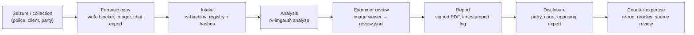
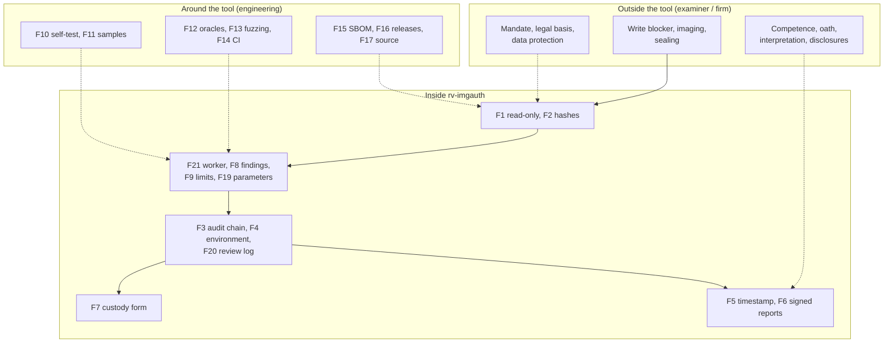

# Admissibility and reliability

> **DRAFT — pending review by a lawyer. Not legal advice.** This page maps legal and technical requirements to
> what RV ImgAuth actually does, so that an examiner, a lawyer or an opposing expert can see where the tool helps
> and where it does not. It reuses the sourced legal research note of 2026-10-21 prepared for the Rakvor toolkit
> (rv-pdfauth) and the image-authentication research brief of 2026-10-28. **It must be reviewed by counsel in each
> jurisdiction before it is relied on or quoted.** Anything marked **[to verify]** must not be cited before a
> lawyer or engineer has checked it against the primary source.

## Contents

- [1. Purpose and how to read this page](#1-purpose-and-how-to-read-this-page)
- [2. Evidence lifecycle and where each control sits](#2-evidence-lifecycle-and-where-each-control-sits)
- [3. The reliability argument for image authentication](#3-the-reliability-argument-for-image-authentication)
- [4. Colombia](#4-colombia)
- [5. France and the European Union](#5-france-and-the-european-union)
- [6. International standards and professional guidance](#6-international-standards-and-professional-guidance)
- [7. United States and United Kingdom](#7-united-states-and-united-kingdom)
- [Limitations stated in every report](#limitations-stated-in-every-report)
- [Consolidated gap list](#consolidated-gap-list)
- [Examiner checklist before filing a report](#examiner-checklist-before-filing-a-report)
- [Sources](#sources)

## 1. Purpose and how to read this page

RV ImgAuth is used **locally** by Rakvor; it is not distributed. Clients, courts and opposing experts may audit
its source ([LICENSE](../LICENSE)). Its results are **signals for an examiner, never a verdict**
([theory.md](theory.md#a1-what-the-tool-is-and-is-not)). Admissibility and weight are decided by a court about the
**examiner's evidence**, of which the tool's output is one part.

| Status | Meaning |
| --- | --- |
| **met** | A tool feature satisfies or directly supports the requirement (the file or command is named) |
| **partial** | Supported, with a named shortfall |
| **examiner** | An obligation of the examiner or of Rakvor as a firm, not a tool feature |
| **gap** | Not met today; listed in the [consolidated gap list](#consolidated-gap-list) |
| **context** | Background that frames the other rows |

| Mark | Meaning |
| --- | --- |
| **[V]** | Article or clause number and substance checked against the primary text in the research note (official gazette, project document or faithful mirror) |
| **[S]** | Checked against a secondary source; the number is reliable, check the wording before quoting |
| **[to verify]** | Not verified against the primary text; do not cite before checking |

Research limits that still apply: the Colombian project PDFs (`Ley_906_de_2004.pdf`, `Ley_1564_de_2012.pdf`,
`manualcadena2.pdf`) were verified against official web copies, not the project files — re-check quoted fragments
against them; only the free preview of ISO/IEC 27037 was read; ISO/IEC 27041/27042 clause text is paywalled
[to verify]; Légifrance refused automated access (French texts read from the Pappers LEGI mirror).

### Tool features referred to in the tables

| Key | Feature | Where it is implemented |
| --- | --- | --- |
| F1 | Read-only evidence access; modification time compared around hashing | [src/core/src/run.rs](../src/core/src/run.rs) (`mtime_unchanged` in `item_hashed`) |
| F2 | Hashing with 1 or 2 algorithms; second read re-hashed by the worker (`EVIDENCE_CHANGED_DURING_ANALYSIS`) | [src/core/src/hash.rs](../src/core/src/hash.rs), [src/core/src/imgscan.rs](../src/core/src/imgscan.rs); `hashes.csv` |
| F3 | SHA-256 hash-chained audit log + independent verifier | [src/core/src/audit.rs](../src/core/src/audit.rs); `verify-log`; [tests/verify_chain.py](../tests/verify_chain.py) |
| F4 | `environment.json`: tool, compiler and every dependency version (incl. `jpeg-encoder`, `zune-jpeg`), OS, host, user, command line | [src/core/src/env.rs](../src/core/src/env.rs) |
| F5 | RFC 3161 timestamp of the audit chain head | [src/core/src/trust.rs](../src/core/src/trust.rs); `--tsa-url`, `--no-timestamp`, `timestamp` |
| F6 | PDF reports signed with the examiner's certificate (CMS `adbe.pkcs7.detached`) | `--sign-cert`; [src/core/src/report/pdf.rs](../src/core/src/report/pdf.rs) |
| F7 | Per-item chain-of-custody form: Colombia (Fiscalía style) or France (scellés), plus English | `--jurisdiction`; `custody.json/.html/.pdf` |
| F8 | Findings state what they show **and** what they do not prove; no verdict, no score | [i18n/en.json](../i18n/en.json) (`findings`), es, fr |
| F9 | Six image limitations printed in every report (incl. `NO_VALIDATED_ERROR_RATES_YET`) | [i18n/en.json](../i18n/en.json) (`limitations`); [src/core/src/report/mod.rs](../src/core/src/report/mod.rs) |
| F10 | Known-answer self-test (hash algorithms only) | `rv-imgauth self-test` |
| F11 | 15 synthetic sample images with exact expected findings; reproducibility of maps checked | [examples/](../examples/README.md); [tests/run_samples.py](../tests/run_samples.py) |
| F12 | Independent oracles in CI: Pillow (quantization tables), ExifTool (metadata), numpy/PyWavelets (ELA, residual, σ maps); Python chain verifier | [tests/oracle_qt.py](../tests/oracle_qt.py), [tests/oracle_exiftool.py](../tests/oracle_exiftool.py), [tests/oracle_maps.py](../tests/oracle_maps.py) |
| F13 | Fuzzing of the JPEG, PNG, WebP and HEIF parsers; malformed sample `crash.jpg` | `fuzz/`, [.github/workflows/fuzz.yml](../.github/workflows/fuzz.yml) |
| F14 | CI on Windows and Linux | [.github/workflows/ci.yml](../.github/workflows/ci.yml) |
| F15 | SBOM and build provenance | [.github/workflows/release.yml](../.github/workflows/release.yml) |
| F16 | Versioned releases with `SHA256SUMS`, signed with the internal Rakvor certificate | [installation.md](installation.md) |
| F17 | Source auditable by customers and opposing experts; local use only | [LICENSE](../LICENSE) |
| F18 | One-step intake by RV HashInv (`--intake hashinv`); case-folder verification (`--case-dir`, `verify-case`) | [case-folder.md](case-folder.md) |
| F19 | Every analysis parameter recorded with its output (quality, gain, encoder and version, block sizes, thresholds) | `technical.json` → `image.maps[].params`, `image.options` |
| F20 | Review log: maps viewed after the run, hash-chained and anchored to `run_finished`; checked by `verify-log` and `verify-case` | [src/core/src/review.rs](../src/core/src/review.rs); `review.jsonl` |
| F21 | Worker isolation: time and memory limits, no network code, pixel-size caps | [src/core/src/worker.rs](../src/core/src/worker.rs); `--worker-timeout`, `--worker-memory`, `--max-pixels` |
| F22 | Reference comparison against known originals, "consistent / inconsistent with the reference set (n=…)" | `--reference`; [src/img/src/analysis/reference.rs](../src/img/src/analysis/reference.rs) |
| F23 | Hashed derived files: `structure.json`, `metadata.json`, `maps/original.png`, every map | `output_written` in `audit.jsonl` |

## 2. Evidence lifecycle and where each control sits

## 3. The reliability argument for image authentication

Courts ask, in different words, whether the method is **reliable** and whether it was **reliably applied** here.
For image authentication the professional reference is **SWGDE 18-I-001 v2.0 (2025)** [V]: an examination goes
through analysis, interpretation and conclusion, weighs competing propositions, "should take care not to
overstate results", recognises that it is "impossible to prove a negative result", gives no numerical
probabilities without a scientific foundation, distinguishes authentication from integrity (hashing) and
recommends independent review. SWGDE 23-I-001 v1.0 (2025) [V] collects the US case law on image examinations
and notes that no error rates are published for ELA, quantization tables or copy-move. No court ruling
specifically on ELA, quantization tables or copy-move was found [to verify; negative search result].

| Factor | What RV ImgAuth offers | Status |
| --- | --- | --- |
| **Testability** | Deterministic outputs ([theory.md B21](theory.md#b21-determinism-and-reproducibility)); 15 synthetic samples with exact expected findings (F11); oracles (F12); fuzzing (F13); every parameter recorded (F19) | met |
| **Known or potential error rate** | Thresholds and their synthetic calibration published ([theory.md](theory.md#part-b--for-examiners-and-opposing-experts)); published rates of the underlying papers quoted as such. **No error rates measured for this implementation on a documented corpus** (G5); stated in every report (F9) | gap |
| **Peer review / independent checks** | Methods from peer-reviewed literature (Popescu & Farid; Lin et al.; Farid; Mahdian & Saic; Fridrich et al.); source auditable (F17); independent oracles for tables, metadata and maps (F12). No external review of this implementation (G7) | partial |
| **Standards controlling the operation** | SWGDE 18-I-001 wording rules built into the findings (F8, F9); fixed parameters (F19); release verification ([installation.md](installation.md)); examiner checklist below | partial |
| **General acceptance** | Metadata, structure and quantization-table analysis are standard practice; ELA is contested in the literature (Krawetz himself: it "only identifies 'a' change") — hence maps are info-only with fixed wording | partial |
| **Validation for intended use** (ISO/IEC 27041; ISO/IEC 17025 §7.2.2 [V]) | Inputs exist (F10–F14) but no per-release validation report (G6) | gap |
| **Reliable application in this case** (FRE 702(d) [V]) | Audit chain of every step (F3), environment (F4), parameters per map (F19), maps the examiner looked at (F20), timestamp (F5), signed report (F6) | met |

## 4. Colombia

### 4.1 Ley 906 de 2004 (Código de Procedimiento Penal)

Context: adversarial criminal procedure; data messages are *elementos materiales probatorios / evidencia física*
(art. 275 lit. g [V]); authenticity rests on the chain of custody (arts. 254–266, 277 [V]); expert evidence is
tested orally (arts. 405–423 [V]); a novel technique must meet at least one of the criteria of art. 422 [V]
(the image brief marked art. 422 as unverified; the 2026-10-21 note verified it against the Colpensiones
normograma mirror).

| # | Requirement | Source | How rv-imgauth meets it | Status |
| --- | --- | --- | --- | --- |
| CO-P1 | Data messages are EMP/EF and enter the custody regime | Art. 275 lit. g [V] | F7 per-item form; F2 identity by hash | met |
| CO-P2 | *Cadena de custodia* shows identity, original state, collection, preservation, packaging, sending, places, dates, custodians | Art. 254 [V] | F2, F3, F7, F18; physical packaging by the examiner | met (digital) / examiner (physical) |
| CO-P3 | Custodians record full name, cédula and position | Art. 264 [V] | F7 persons and transfer rows filled in by hand | partial (G9) |
| CO-P4 | Each custodian prevents destruction, substitution, alteration | Art. 261 [V] | F1, F2 (second-read re-hash), F3 | met |
| CO-P5 | Authenticity = detected, fixed, collected, packed and kept in custody | Art. 277 [V] | F3, F7, F18 (`--case-dir` re-verifies every image against the intake registry) | met |
| CO-P6 | Evidence legal only if collected lawfully | Art. 276 [V] | None | examiner |
| CO-P7 | Lab report describes procedures, instruments and their state, scientific principles, interpretation | Art. 210 [V] | F4, F10, F19; technical report "Method"; F8, F9; [theory.md](theory.md) | met |
| CO-P8 | Perito holds recognised competence; party report with *certificación de idoneidad* | Arts. 408, 413 [V] | None | examiner |
| CO-P9 | Summary report disclosed ≥ 5 days before the hearing | Art. 415 [V] | F6 produces the report | examiner |
| CO-P10 | Perito examined on instruments, principles, methods and corroboration by other experts | Art. 417 [V] | F4, F12, F17, F19; [theory.md](theory.md) Part B; validation dossier missing (G6) | partial |
| CO-P11 | Court weighs competence, acceptance of principles, instruments, consistency | Art. 420 [V] | F12, F16, F17; ELA acceptance contested; no error rates (G5) | partial |
| CO-P12 | Novel technique: verifiable; published and peer-reviewed; reliability level established; academic acceptance | Art. 422 [V] | Verifiable (F11, F12, F19) and published methods (literature in [theory.md B23](theory.md#b23-references)); reliability level of this implementation not measured (G5) | partial |
| CO-P13 | Peritos have access to the EMP referred to | Art. 416 [V] | F17, F11, F16; maps and previews hashed (F23) | met |
| CO-P14 | Data messages authenticated by certification or "informe de experto" | Art. 424 #7, art. 426 [V] | F6 expert report route | met (expert route) |
| CO-P15 | Documentary appraisal: "Que no haya sido alterado en su forma ni en su contenido" | Art. 432 #1 [V] | Signals of modification (F8); the tool never concludes on this point | partial (examiner opinion) |
| CO-P16 | Best evidence: original required where part of custody or technical study | Arts. 433–434 [V] | F1; analyse the native file (not a screenshot of it) | examiner |

### 4.2 Ley 1564 de 2012 (Código General del Proceso)

| # | Requirement | Source | How rv-imgauth meets it | Status |
| --- | --- | --- | --- | --- |
| CO-C1 | *Dictamen* "claro, preciso, exhaustivo y detallado", explaining exams, methods, technical bases | Art. 226 [V] | F6, F8, F9, F19; [theory.md](theory.md) | met (template) / examiner |
| CO-C2 | Ten disclosures, incl. whether methods differ from earlier reports (#8, #9) and attaching documents used (#10) | Art. 226 #1–10 [V]; look-back periods [to verify] | #8–#9: F4, F16 pin the method version; #10: F3, `hashes.csv`, registry | met (#8–#10) / examiner |
| CO-C3 | Expert declares independence; specialised institution or professional | Arts. 226, 227 [V] | None | examiner |
| CO-C4 | Opposing party may summon the expert or file a competing dictamen | Art. 228 [V] | F11, F12, F16, F17, F19 make reproduction possible | met (support) |
| CO-C5 | *Sana crítica* on soundness, foundations, competence | Art. 232 [V] | F8, F9; validation dossier missing (G6) | partial |
| CO-C6 | No fees contingent on the outcome | Art. 235 [V] | None | examiner |
| CO-C7 | Data messages count only in native format or exact reproduction | Art. 247 [V] | F1; F2 proves exactness; analyse the original file, not a re-saved copy | met / examiner |
| CO-C8 | Data-message documents presumed authentic; disowned ones need authenticity established | Arts. 244, 272 [V] | Signals only (F8) | met (support) |

### 4.3 Ley 527 de 1999 (data messages)

| # | Requirement | Source | How rv-imgauth meets it | Status |
| --- | --- | --- | --- | --- |
| CO-L1 | Evidential effect not denied solely because information is a data message | Arts. 5, 10 [V] | None | context |
| CO-L2 | "Original": reliable guarantee that integrity was kept since the information was first generated in final form | Art. 8 lit. a [V] | F2 from intake onward; integrity **before** intake is exactly what image authentication examines — signals only (F8, F9) | partial |
| CO-L3 | Integrity = "completa e inalterada", except changes inherent to communication, storage, display | Art. 9 [V] | Double compression, stripped metadata and messenger traces are worded as typical of ordinary sharing (F8): they may be changes "inherent to communication" — for counsel to argue | met (support) |
| CO-L4 | Weight by *sana crítica*: reliability of generation, archiving, communication, integrity, originator | Art. 11 [V] | Integrity: F2, F3, F5. Generation: metadata, tables, reference comparison (signals). Originator: not attributed | partial |
| CO-L5 | Retention in a format that "reproduce con exactitud", with origin and date | Art. 12 [V] | F1; `metadata.json` keeps every source tag | met |
| CO-L6 | *Firma digital* presumption needs an authorised *entidad de certificación* | Art. 28 parágrafo, arts. 29–30 [V] | F6 uses the examiner's own certificate | gap (G3) |
| CO-L7 | Trusted time-stamping is a service of authorised certification entities | Art. 30 #5 [V] | F5 uses an RFC 3161 TSA (default DigiCert) | gap (G2) |

### 4.4 Fiscalía chain-of-custody manual

The project document `manualcadena2.pdf` is the earlier *Manual de Procedimientos para Cadena de Custodia*; the
current one is *Manual del Sistema de Cadena de Custodia* v4 (2018) [S]. Neither has a procedure specific to
digital evidence; ISO/IEC 27037 and the Rama Judicial cartilla fill that.

| # | Requirement | Source | How rv-imgauth meets it | Status |
| --- | --- | --- | --- | --- |
| CO-F1 | Validity requirements: autenticidad, capacidad demostrativa, identidad, integridad, preservación, seguridad, almacenamiento, continuidad, registro | Manual 2018 §5.3 [S] | identidad, integridad: F2; continuidad, registro: F3, F7, F18, F20; preservación: F1 | met / examiner |
| CO-F2 | One *Registro de Cadena de Custodia* per EMP/EF | Manual 2018 §6 [S] | F7 is an internal record, not the official form | partial (G9) |
| CO-F3 | Minimum fields: dates, NUNC, EMP/EF identifier, description, parties and ID | Manual 2018 §7.3 [S] | F7 has case id, description, transfer rows; persons table filled by hand; EMP/EF code generated, not the official one | partial (G9) |
| CO-F4 | Receiver inspects; only the designated perito opens | Manual 2018 §6 [S] | F2 re-hash; F3 logs each run; F20 logs each later viewing | met / examiner |

### 4.5 Ley 1581 de 2012 (personal data)

Photos are personal data (faces, places, GPS coordinates in EXIF) and often sensitive (art. 5 [V]).

| # | Requirement | Source | How rv-imgauth meets it | Status |
| --- | --- | --- | --- | --- |
| CO-D1 | Principles incl. *acceso y circulación restringida*, *seguridad*, *confidencialidad* | Art. 4 [V] | Local processing, no telemetry; only a 32-byte hash leaves the machine (optional timestamp) | met (tool) / examiner |
| CO-D2 | Sensitive data for the "defensa de un derecho en un proceso judicial" | Art. 6 lit. d [V] | None | examiner |
| CO-D3 | Security conditions; breach reporting | Arts. 17, 18 [V] | Outputs contain full-resolution copies of the evidence pixels (`maps/original.png`, maps) and every metadata tag incl. GPS (`metadata.json`); no encryption at rest | examiner / gap (G13) |
| CO-D4 | International transfers only to adequate countries | Art. 26 [V] | Local processing | examiner |

### 4.6 Judicial-school criteria

The Escuela Judicial cartilla (project file) reproduces CSJ Sala Civil, 16 Dec. 2010 (exp.
11001-3110-005-2004-01074-01) [S], separating *autenticidad* from *veracidad*, and recalls the INTERPOL 2008 finding
on the Raúl Reyes computers (timestamps changed by direct access without write-blocking) [S].

| # | Requirement | Source | How rv-imgauth meets it | Status |
| --- | --- | --- | --- | --- |
| CO-J1 | *Integralidad*, *inalterabilidad* | CSJ Civ. 16-12-2010 via cartilla [S] | F2, F3, F5 | met (from intake) |
| CO-J2 | *Rastreabilidad* | Same [S] | F7, F18 | partial (depends on intake) |
| CO-J3 | *Autenticidad*: identify the author and link them to the content | Same [S] | Not attributed; reference comparison (F22) is "consistent / inconsistent", never identification | partial (examiner) |
| CO-J4 | Never access original media without write-blocking; clocks synchronised | Cartilla §9.4, §9.5 [V] | F1 is software read-only, not a hardware blocker; host clock not recorded | partial (G10, G12) |
| CO-J5 | Tested procedures, known tool error rates, two tools to cross-check | Cartilla §9.10.1 [V] | F12 (Pillow, ExifTool, numpy); error rates not measured (G5) | partial |

## 5. France and the European Union

### 5.1 Code de procédure pénale (CPP)

Evidence is free in criminal matters (art. 427 [to verify]); expertise on "une question d'ordre technique" (arts.
156 ff. [S]). **Recodification:** ordonnance n° 2025-1091 of 19 Nov. 2025 rewrote the legislative part of the CPP;
the articles below are shown as repealed on **1 January 2029** [S]; a concordance table is needed then (G14).

| # | Requirement | Source | How rv-imgauth meets it | Status |
| --- | --- | --- | --- | --- |
| FR-P1 | Data seized as the medium or a copy made in the presence of those attending; inventoried and sealed | Arts. 56, 97 [V] | F2 hash of the copy; F7 FR form (internal record) | partial (G9) / examiner |
| FR-P2 | Qualified person copies data "sans porter atteinte à leur intégrité", reports under arts. 163, 166 | Art. 60-3 [V] | F1, F2, F3, F6 | met |
| FR-P3 | Expertise limited to technical questions | Arts. 156, 158 [S] | F8: technical signals only, no verdict, no legal conclusion | met |
| FR-P4 | Experts from the national or cour d'appel lists; others swear at each appointment | Arts. 157, 160 [V] | None | examiner (G8) |
| FR-P5 | Experts may open and re-seal; mention it in the report | Art. 163 [V] | F7, F3 | partial |
| FR-P6 | Report describes operations and conclusions, signed; divergent opinions reasoned | Art. 166 [V] | F6, F3, F19, F20 (which maps were examined) | partial (assistants only in the custody form) |
| FR-P7 | Parties may request a *complément d'expertise ou contre-expertise* | Art. 167 [S] | F11, F12, F16, F17, F19 make counter-expertise reproducible | met (support) |

### 5.2 Civil side

C. civ. art. 1366 [V]: an electronic writing has probative force if its author is identifiable and its integrity
guaranteed — applies to Rakvor's reports (F6, F2, F3, F5). Art. 1367 and décret 2017-1416 [V]: the presumption of
reliability needs a **qualified** electronic signature (G3). CPC arts. 16, 233, 237, 238, 276 (adversarial
principle, technician's personal and impartial work) [to verify].

### 5.3 eIDAS — Regulation (EU) 910/2014 as amended by (EU) 2024/1183 (time stamps)

Verified [V] against the EUR-Lex consolidated text (CELEX 02014R0910-20241018).

| # | Requirement | Source | How rv-imgauth meets it | Status |
| --- | --- | --- | --- | --- |
| EU-1 | A time stamp is not denied legal effect solely because it is electronic or not qualified | Art. 41(1) [V] | F5 | met (no presumption) |
| EU-2 | A **qualified** time stamp enjoys a presumption of accurate date/time and integrity | Art. 41(2) [V] | F5 with the default non-qualified TSA | gap (G2) |
| EU-3 | Qualified ETS requirements; compliance presumed when the standards of CIR (EU) 2025/1929 are met | Art. 42(1), (1a) [V]; CIR 2025/1929 [S; annex to verify] | `--tsa-url` pointed at a QTSP on an EU Trusted List | gap (configure a QTSP) |
| EU-4 | Advanced electronic signature: uniquely linked, under sole control, changes detectable | Art. 26 [V] | F6 (key in a `.p12` file) | met technically; not qualified (G3) |

What a non-qualified RFC 3161 token gives: cryptographic proof that the audit chain head existed no later than
the TSA time, admissible under art. 41(1). What it does not give: the art. 41(2) presumption; any proof about the
image before intake.

### 5.4 GDPR (Regulation (EU) 2016/679)

| # | Requirement | Source | How rv-imgauth meets it | Status |
| --- | --- | --- | --- | --- |
| EU-D1 | Lawful basis; special categories (biometric data from faces processed for identification) only under an exception such as legal claims | Arts. 6, 9(2)(f) [V] | The tool does no face recognition | examiner |
| EU-D2 | Data minimisation and storage limitation | Art. 5(1)(c), (e) [V] | Maps and the preview reproduce the evidence; `--maps none` reduces them, but `maps/original.png` and `metadata.json` (incl. GPS) are always written when the image decodes | gap (G13) / examiner |
| EU-D3 | Processor contract, security, breach notification, DPIA | Arts. 28, 32, 33, 35 [V] | Local processing, no telemetry; F3 | met (tool) / examiner |
| EU-D4 | Data protection by design and by default | Art. 25 [V] | Local; only a hash leaves the machine | met |
| EU-D5 | Transfers to Colombia need art. 46 safeguards (Colombia not on the adequacy list, checked 2026-10-21) | Art. 46 [V] | Local processing | examiner |
| EU-D6 | Criminal matters for a judicial authority may fall under Directive (EU) 2016/680 | [to verify] | None | examiner (counsel) |

## 6. International standards and professional guidance

### 6.1 ISO/IEC 27037:2012 — identification, collection, acquisition and preservation

| # | Requirement | Source | How rv-imgauth meets it | Status |
| --- | --- | --- | --- | --- |
| ISO-1 | Auditability | §5.3.2 [V title / S content] | F3, F20, F4, F6 | met |
| ISO-2 | Repeatability (same environment) | §3.17 [V] | Deterministic maps and findings (F11 checks byte-identical maps on a second run) | met |
| ISO-3 | Reproducibility (different environment, operator) | §3.18 [V] | CI on Windows and Linux (F14); oracles (F12); releases not bit-reproducible (G22) | met / partial |
| ISO-4 | Justifiability | §5.3.5 [V title] | F8, F9, F19; method-selection rationale in the examiner's report | partial |
| ISO-5 | A copy includes verification means; hash at intake, work on a copy | §3.6 [V] | F2, F18 | met |
| ISO-6 | Verification function must be collision-resistant | §3.25 [V] | `md5,sha1` accepted without SHA-2/3 | gap (G11) |
| ISO-7 | Avoid spoliation and tampering | §3.19, §3.21 [V] | F1, F2 | met (logical) / partial (G10) |
| ISO-8 | Chain of custody, documentation of all actions | §6.1, §6.6 [V titles] | F7, F3, F20 | met |

### 6.2 ISO/IEC 27041:2015 (assurance of methods) and ISO/IEC 27042:2015 (analysis and interpretation)

Editions verified on iso.org [V]; ISO/IEC 27042:2015 confirmed in 2021 [V]; clause text [to verify].

| # | Requirement | Source | How rv-imgauth meets it | Status |
| --- | --- | --- | --- | --- |
| ISO-9 | Validate each method for its intended use before use, with documented requirements, tests and results | 27041 [to verify clauses]; 17025:2017 §7.2.2 [V] | Synthetic calibration per analysis and oracles (F11, F12); **no validation dossier per method and release; no error rates** | gap (G5, G6) |
| ISO-10 | Re-validate after changes to the tool or its dependencies | 27041 [to verify]; 17025 §7.11.2 [V] | F14 CI, F15 SBOM; encoder/decoder versions recorded in every map (F19) | partial (G6) |
| ISO-11 | Verification by the user before casework | 27041 [to verify]; 17025 §7.2.1 [V title] | `self-test` + sample run ([installation.md](installation.md#7-first-run-self-test-and-sample)) | met |
| ISO-12 | Repeatability and reproducibility of analysis | 27042 [V title; to verify clauses] | F11, F14, F19 | met |
| ISO-13 | Interpretation states limitations and alternative explanations | 27042 [to verify] | F8 ("does not prove" = alternative explanations), F9 | met |
| ISO-14 | Competence of the examiner in interpretation | 27042 [to verify] | Maps are info-only and require a trained examiner (`VISUAL_MAPS_REQUIRE_INTERPRETATION`) | examiner |
| ISO-15 | Laboratory accreditation | 17025:2017 [V] | None | gap (G1) |

### 6.3 SWGDE 18-I-001 v2.0 (2025), Best Practices for Image Authentication

| # | Requirement | Source | How rv-imgauth meets it | Status |
| --- | --- | --- | --- | --- |
| SW-1 | Analysis → interpretation → conclusion; the conclusion is the examiner's | 18-I-001 [V] | The tool stops at analysis signals (F8); maps are aids (info) | met |
| SW-2 | Do not overstate results | 18-I-001 [V] | Fixed wording: "re-encoded at least twice", "candidate", "consistent with"; never "fake", "manipulated", "authentic" | met |
| SW-3 | Impossible to prove a negative | 18-I-001 [V] | `NO_FINDING_IS_NOT_AUTHENTICITY` in every report | met |
| SW-4 | No numerical probability without scientific foundation | 18-I-001 [V] | No score anywhere; strengths of double compression are labels of the measured periodicity, not probabilities | met |
| SW-5 | Authentication is distinct from integrity verification | 18-I-001 [V] | Hashes (F2) and authentication signals are reported separately | met |
| SW-6 | Competing propositions considered | 18-I-001 [V] | "Does not prove" texts give alternative explanations; examiner frames the propositions | partial / examiner |
| SW-7 | Independent review / verification | 18-I-001 [V] | Outputs, parameters (F19) and the review log (F20) let a second examiner repeat and see what was examined | met (support) / examiner |

SWGDE 18-I-001 does not name ELA, quantization tables, double compression or copy-move [V]; their use rests on the
literature in [theory.md B23](theory.md#b23-references).

## 7. United States and United Kingdom

None of these binds a Colombian or French court; opposing experts use them as the vocabulary of reliability.

| # | Requirement | Source | How rv-imgauth meets it | Status |
| --- | --- | --- | --- | --- |
| US-1 | Opinion based on sufficient facts and data | FRE 702(b) [V] | F3, F2, F19 | met |
| US-2 | Product of reliable principles and methods | FRE 702(c) [V] | Published methods; F11–F13; validation report missing | partial (G6) |
| US-3 | Reliable application to the facts (2023 amendment) | FRE 702(d) [V] | F3, F4, F19, F20 | met |
| US-4 | Daubert: testability | *Daubert v. Merrell Dow*, 509 U.S. 579 (1993) [to verify citation] | F11, F12, F13 | met |
| US-5 | Daubert: peer review and publication | Daubert | Methods published; this implementation not reviewed externally | partial (G7) |
| US-6 | Daubert: known or potential error rate | Daubert; SWGDE 23-I-001 [V] notes none published for ELA/QT/copy-move | Not measured | gap (G5) |
| US-7 | Daubert: standards controlling operation | Daubert | F19, F16, checklist below | partial |
| US-8 | Daubert: general acceptance; Kumho extends the gatekeeping to technical expertise | Daubert; *Kumho Tire v. Carmichael*, 526 U.S. 137 (1999) [to verify citation] | Metadata and table analysis accepted practice; ELA contested | partial |
| US-9 | Process producing an accurate result | FRE 901(b)(9) [V] | F10–F12 | met |
| US-10 | Self-authentication by hash certification | FRE 902(14) [V] | F2; no certification template | partial |
| UK-1 | Expert's overriding duty to the court; report contents, statement of truth, range of opinion | CPR Part 35 and PD 35 [to verify rule numbers] | F8, F9 support stating limits and alternatives; the statement of truth and declarations are the expert's | examiner |
| UK-2 | Methods validated before use; accreditation for regulated forensic activities | FSR Code of Practice v2 (in force 2 Oct. 2025) §24 [V]; image-authentication activity code [to verify] | F11–F14 | gap (G1, G6) if UK work is in scope |

## Limitations stated in every report

| Code | Text (en.json) |
| --- | --- |
| `NO_FINDING_IS_NOT_AUTHENTICITY` | An image without findings is not proven authentic: careful edits can leave none of the traces these checks look for, and it is impossible to prove a negative (SWGDE 18-I-001). |
| `VISUAL_MAPS_REQUIRE_INTERPRETATION` | Error level, noise and ghost maps are visual aids for a trained examiner; the tool gives them no score and draws no conclusion from them. |
| `DOUBLE_COMPRESSION_IS_NOT_MANIPULATION` | Double JPEG compression shows the image was saved more than once; ordinary sharing and exporting do this. |
| `FINGERPRINT_DB_COVERAGE` | The compression-table database covers few devices and apps (built from Rakvor's own captures plus local learning); an absent or matching entry is weak evidence on its own. |
| `COPY_MOVE_SCALE_ROTATION_NOT_DETECTED` | Copy-move detection compares blocks at the same scale and orientation on a downscaled image: scaled, rotated or small copies are not found. |
| `NO_VALIDATED_ERROR_RATES_YET` | Error rates of these checks have not yet been measured on a documented validation corpus; the findings are signals to be weighed by the examiner. |

## Consolidated gap list

Owners: **Eng.** = engineering, **Counsel**, **Examiner**, **Firm** = Rakvor management.

| ID | Gap | Affected | Mitigation now | Remedy | Owner |
| --- | --- | --- | --- | --- | --- |
| G1 | No ISO/IEC 17025 accreditation (COFRAC / ONAC) | ISO-15, UK-2 | State "not accredited" | Accreditation roadmap | Firm |
| G2 | TSA not qualified (eIDAS 41(2)) and not a Colombian ECD (Ley 527 art. 30 #5) | EU-2, EU-3, CO-L7 | `--tsa-url` to a QTSP or ONAC-accredited ECD | Dual stamping for cross-border cases | Eng. + Counsel |
| G3 | Reports signed with the examiner's own certificate: not a QES or *firma digital* | CO-L6, EU-4 | Publish the certificate fingerprint | Qualified certificates on a QSCD | Eng. + Examiner |
| G5 | **No validated error rates** for any image analysis; no Rakvor-owned validation corpus (public datasets cannot be redistributed or used commercially) | CO-P11, CO-P12, CO-J5, ISO-9, US-6 | `NO_VALIDATED_ERROR_RATES_YET` in every report; findings as signals only | Build a documented Rakvor corpus (own captures, controlled edits); publish per-check detection and false-positive rates per release | Eng. |
| G6 | No per-release validation record (plan, criteria, results, sign-off) | ISO-9, ISO-10, US-2, CO-P10, CO-C5 | Keep CI logs, oracle results and the sample run with the case | CI-generated signed validation report per tag | Eng. + Firm |
| G7 | No external review of this implementation | CO-P12, US-5 | Offer source review to opposing experts | White paper; external review | Firm |
| G8 | Examiner status (French lists, oath; Colombian idoneidad, CGP art. 226 disclosures) | FR-P4, CO-P8, CO-C2 | Examiner prepares them | Report fields for art. 226 and CPP art. 166 | Examiner + Eng. |
| G9 | Custody forms are internal records, not the official Fiscalía *Registro* or scellés | CO-F2, CO-F3, CO-P3, FR-P1 | Use the official forms alongside | Map to the official forms | Eng. + Counsel |
| G10 | Software read-only, not a hardware write blocker | CO-J4, ISO-7 | Work on images or write-blocked copies | Record blocker details in the case folder | Examiner + Eng. |
| G11 | `md5,sha1` accepted without SHA-2/3 | ISO-6 | Always select sha256 or sha512 | Enforce the policy | Eng. |
| G12 | Host clock; only the chain head is stamped | CO-J4 | Check time sync before the run | Record clock source and offset | Eng. |
| G13 | Personal data: outputs reproduce evidence pixels and every tag (incl. GPS); no encryption at rest or retention tooling | CO-D3, EU-D2 | Encrypted case volume; `--maps none` when maps are not needed | Retention and secure-deletion tooling; option to omit the preview | Firm + Eng. |
| G14 | CPP renumbering on 1 Jan. 2029 | FR section | Cite with the version date | Concordance table | Counsel |
| G17 | Source access without a defined protocol; LICENSE is a draft pending legal review | CO-P13, FR-P7 | Provide the tagged source on request | NDA / inspection protocol | Firm + Counsel |
| G18 | `verify-log` does not check TSA revocation, policy OID or accuracy | EU-2 | `openssl ts -verify` as a second tool | Revocation and policy checks | Eng. |
| G19 | No command re-verifies report and map files against the audited digests (the GUI viewer re-checks the maps it shows) | ISO-1 | Script in [usage.md](usage.md#8-verifying-a-run) | `verify-run` command | Eng. |
| G22 | Release binaries not bit-for-bit reproducible | ISO-3 | Provenance attestation + functional equivalence | Path remapping, deterministic packaging | Eng. |
| G23 | Windows: no OS-level network block for the worker | CO-D1 | Offline workstation or firewall rule | AppContainer / WFP | Eng. |
| G-IMG1 | **Fingerprint starter DB is empty** (`rakvor-starter` version 0, 0 entries): every JPEG gives `QT_UNKNOWN` unless the local DB was taught | CO-L4, US-8 | Learn known originals per case (`fingerprints learn`) and disclose the DB (`fingerprints export`) | Seed the starter DB from Rakvor's own captures | Eng. |
| G-IMG2 | **HEIC/HEIF pixels not decoded**: no maps, copy-move or thumbnail comparison for HEIC (`HEIC_PIXELS_NOT_DECODED`) | ISO-9 | Obtain another version, or convert with a documented tool and analyse the conversion as a derived item | Optional OS codec (Windows HEIF extension) after legal review of HEVC licensing | Eng. + Counsel |
| G-IMG3 | `--max-pixels` accepts up to 2 000 MP but the image layer refuses anything above 120 MP: a larger cap silently has no effect (no finding; `pixel_decode_error` only) | ISO-4 | Keep `--max-pixels` ≤ 120 000 000 | Align the CLI range with the hard cap or raise a finding | Eng. |
| G-IMG4 | A pixel-decoding failure (e.g. `bad-order.png`, `photo.webp` in the sample) is recorded only as `image.pixel_decode_error`: no finding says that ELA, noise, copy-move and the thumbnail check were not run | ISO-4, SW-3 | Check `pixel_decode_error` in `technical.json` | Emit a finding (info) for a skipped pixel analysis | Eng. |
| G-IMG5 | Method simplifications: ghosts on grid offset (0,0) only; no Lin per-block posterior map; no Mahdian–Saic block merging; copy-move translation only (no keypoints) | CO-P11, US-8 | Stated in [theory.md](theory.md) and in the limitations | Implement the full methods, keypoint screening | Eng. |
| G-IMG6 | Reference comparison of a PNG/WebP/HEIC item against JPEG references reports `REFERENCE_INCONSISTENT` (medium) on format alone | CO-J3 | Give references of the same format | Treat a different format as not applicable | Eng. |

G4, G15, G16, G20, G21, G24–G26 of the rv-pdfauth list do not apply to images or are closed in code (the
second-read re-hash, G20, is implemented here too: F2).

## Examiner checklist before filing a report

1. **Mandate and legal basis** documented (order, contract, consent; Ley 1581 / GDPR basis). Fees not contingent.
2. **Competence documents** ready (Colombia: idoneidad, CGP art. 226; France: list status or oath).
3. **The installed tool was verified**: `SHA256SUMS`, provenance, Authenticode against the Rakvor root;
   `self-test` passed; the sample run gave the expected summary ([installation.md](installation.md)).
4. **The image analysed is the native file** (not a screenshot, a re-saved copy or a messenger re-download unless
   that is the question), from a verified copy registered at intake (`--case-dir`, rv-hashinv).
5. **Hash policy**: one of the algorithms is sha256 or sha512.
6. **Workstation clock** synchronised; time source noted.
7. **The run is complete** (`run_finished`) and `rv-imgauth verify-log <log folder>` prints OK, including the review
   entries; `python tests/verify_chain.py <log folder>` exits 0.
8. **Timestamp** obtained and checked (`verify-log --tsa-ca`, `openssl ts -verify`).
9. **No `PARSER_FAILED`, `ANALYSIS_SKIPPED_SIZE_CAP`, `COEFFICIENTS_UNAVAILABLE` or `pixel_decode_error` left
   unexplained**; HEIC items are declared as structure-only.
10. **Every map relied on was examined by the examiner** in the viewer (recorded in `review.jsonl`) and is described
    with its recorded parameters; no map is presented as a result.
11. **Every finding relied on** is presented with what it does **not** prove; alternative explanations (messenger,
    export, rotation, crop) were considered.
12. **Fingerprint databases** used are listed (name, version, SHA-256); the local DB was exported for disclosure.
13. **Reference images**: their origin is documented and their SHA-256 (recorded in the report) disclosed.
14. **Limitations** kept, plus case-specific ones; the absence of validated error rates is stated (G5).
15. **Custody**: official forms completed alongside the internal form (G9).
16. **Report signed** (`--sign-cert`); certificate fingerprint stated.
17. **Case file kept together**: evidence copy, `logs/<RUN-ID>/` (incl. `review.jsonl`, `.tsr`), `reports/<RUN-ID>/`,
    tool release and this page's version (git commit).
18. **Counsel reviewed** the legal statements for the jurisdiction and date.

## Sources

Legal sources (Colombian, French, EU, ISO, US/UK) are those of the Rakvor research note of 2026-10-21, with the
same marks. Main entries:

Project documents (claude.ai Project "Bussiness idea"): `Ley_527_de_1999.pdf`; `ISOIEC270372012.pdf` (iTeh
preview); `ISO27037_DigitalEvidenceforDEFR.pdf`; `22_cartilla_evidencia_digital__procedimientos_teicnicos.pdf`;
`Ley_906_de_2004.pdf`; `Ley_1564_de_2012.pdf`; `manualcadena2.pdf`.

Colombia

- Ley 906/2004: <https://www.secretariasenado.gov.co/senado/basedoc/ley_0906_2004_pr005.html>,
  <https://www.secretariasenado.gov.co/senado/basedoc/ley_0906_2004_pr006.html>,
  <https://normativa.colpensiones.gov.co/colpens/docs/ley_0906_2004_pr009.htm>,
  <https://normativa.colpensiones.gov.co/colpens/docs/ley_0906_2004_pr010.htm>
- Ley 1564/2012 (CGP): <https://normativa.colpensiones.gov.co/colpens/docs/ley_1564_2012_pr005.htm>,
  <https://normativa.colpensiones.gov.co/colpens/docs/ley_1564_2012_pr006.htm>
- Ley 1581/2012: <https://www.secretariasenado.gov.co/senado/basedoc/ley_1581_2012.html>
- Fiscalía manuals: <https://www.fiscalia.gov.co/colombia/wp-content/uploads/2012/01/manualcadena2.pdf>,
  <https://www.fiscalia.gov.co/colombia/wp-content/uploads/MANUAL-DEL-SISTEMA-DE-CADENA-DE-CUSTODIA.pdf>

France and EU

- CPP arts. 56, 60, 60-3, 97, 157, 160, 163, 166 via justice.pappers.fr (LEGI mirror) [V]; ordonnance n° 2025-1091
  [S]; Code civil arts. 1366–1368 and décret 2017-1416 [V].
- eIDAS consolidated: <https://eur-lex.europa.eu/legal-content/EN/TXT/HTML/?uri=CELEX:02014R0910-20241018>;
  CIR (EU) 2025/1929: <https://eur-lex.europa.eu/eli/reg_impl/2025/1929/oj/eng>
- GDPR: <https://eur-lex.europa.eu/eli/reg/2016/679/oj>; adequacy decisions:
  <https://commission.europa.eu/law/law-topic/data-protection/international-dimension-data-protection/adequacy-decisions_en>

Standards and guidance

- ISO/IEC 27037 <https://www.iso.org/standard/44381.html>, 27041 <https://www.iso.org/standard/44405.html>,
  27042 <https://www.iso.org/standard/44406.html>, 17025 <https://www.iso.org/standard/66912.html>
- SWGDE 18-I-001 v2.0 (2025-03-03) [V]:
  <https://www.swgde.org/wp-content/uploads/2025/03/2025-03-03-Best-Practices-for-Image-Authentication-18-I-001-2.0.pdf>
- SWGDE 23-I-001 v1.0 (2025-11-20) [V]:
  <https://swgde.org/wp-content/uploads/2025/12/2025-11-20-Legal-and-Scientific-Support-Relating-to-the-Admissibility-of-Image-Examinations-23-I-001-1.0.pdf>
- N. Krawetz, Black Hat USA 2007 [V]:
  <https://www.blackhat.com/presentations/bh-usa-07/Krawetz/Whitepaper/bh-usa-07-krawetz-WP.pdf>

US and UK

- FRE 702 <https://www.law.cornell.edu/rules/fre/rule_702>, 901 <https://www.law.cornell.edu/rules/fre/rule_901>,
  902 <https://www.law.cornell.edu/rules/fre/rule_902> [V]
- Daubert v. Merrell Dow Pharmaceuticals, 509 U.S. 579 (1993); Kumho Tire Co. v. Carmichael, 526 U.S. 137 (1999)
  [to verify citations]
- UK Civil Procedure Rules Part 35 and Practice Direction 35 [to verify]:
  <https://www.justice.gov.uk/courts/procedure-rules/civil/rules/part35>
- UK FSR Code of Practice v2 [V]:
  <https://www.gov.uk/government/publications/forensic-science-activities-statutory-code-of-practice-version-2/forensic-science-activities-statutory-code-of-practice-version-2-accessible>
