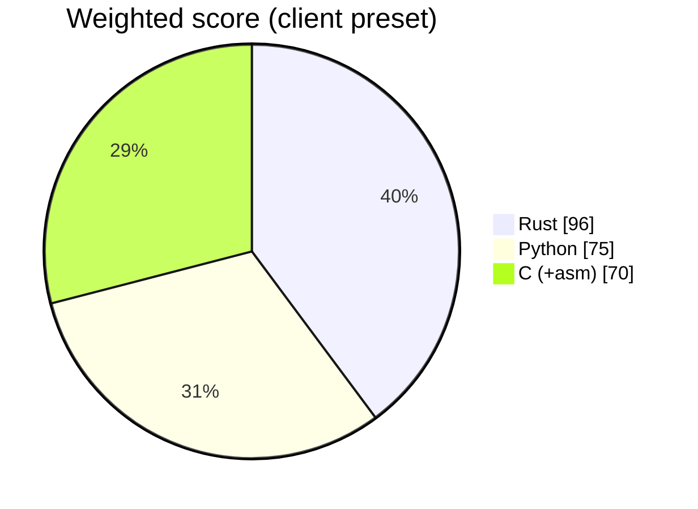

# ADR 0001 — Implementation language: Rust (Profile A)

- Status: accepted
- Date: 2026-10-28
- Deciders: language council (Rust, Python and C/assembly advocates + rebuttal round), approved by the project owner

## Context

Reports signals of modification in JPEG, HEIC/HEIF, PNG and WebP images (metadata and structure, quantization-table fingerprints and double compression, ELA and noise maps, copy-move detection, comparison with reference images) for clients and courts; bulk folders on 8 GB Windows laptops without GPU; joins the Rust toolkit (rv-hashinv, rv-pdfauth, rv-rsmf).

Weight preset: **client**. Score overrides argued by the council:

- Rust · Team velocity: 3 → 2 (no pure-Rust crate exposes JPEG DCT coefficients or ORB/SIFT; forensic algorithms written in-house)
- Rust · DFIR library ecosystem: 4 → 2 (image-forensics reference code (CMFD benchmarks, jpegio, OpenCV keypoints) is Python)
- Rust · Packaging, signing, antivirus false positives: 4 → 3 (mozjpeg-sys needs nasm+cmake; libheif/libde265 must ship as LGPL DLLs next to the exe)
- Python · Hardware / RAM (8 GB laptops, VMs without GPU): 3 → 2 (NumPy/SciPy/scikit-image promote to float64; a 100 MP image grows to ~2.4 GB per worker)
- Python · Windows GUI maturity: 4 → 5 (PySide6 QGraphicsView gives synced zoom/pan and overlay opacity on large images)
- C (+asm) · Memory safety / court auditability: 2 → 1 (memory-unsafe parsing of hostile images (libexif CVE history))
- C (+asm) · Team velocity: 3 → 2 (ELA, noise and copy-move hand-written in C)
- C (+asm) · DFIR library ecosystem: 4 → 3 (Exiv2 is GPL; OpenCV has no C API in 4.x)

## Options scored (1–5, weighted)

| Criterion | Weight | Rust | Python | C (+asm) |
| --- | :-: | :-: | :-: | :-: |
| Speed (throughput, startup) | 3 | 5 | 3 | 5 |
| Transferability (Win10/11 x64 + ARM64, Linux) | 3 | 5 | 4 | 3 |
| Storage (executable / installer size) | 2 | 4 | 2 | 5 |
| Hardware / RAM (8 GB laptops, VMs without GPU) | 2 | 5 | 2 | 5 |
| Windows GUI maturity | 2 | 4 | 5 | 2 |
| CLI --help quality | 2 | 5 | 5 | 2 |
| Packaging, signing, antivirus false positives | 2 | 3 | 2 | 4 |
| Memory safety / court auditability | 3 | 5 | 3 | 1 |
| Team velocity | 2 | 2 | 5 | 2 |
| CI/CD complexity (5 = simple) | 1 | 5 | 3 | 3 |
| **Weighted total** (max 110) | | **96** | 75 | 70 |

## Decision

Profile A (Rust workspace: core + clap CLI + egui GUI). 

## Consequences

- Two static executables (CLI + GUI), no runtime to install; one core library powers both.
- Contributors need Rust; Windows binaries are built on GitHub's `windows-latest` runners.
- No hand-written assembly: hash and parsing crates already use SIMD/CPU intrinsics.

## Rebuttal round

| Proposal | Outcome |
| --- | --- |
| rust.velocity 3→2, rust.dfir_ecosystem 4→2 (no crate exposes JPEG DCT coefficients or ORB/SIFT; reference code is Python/OpenCV) | Accepted |
| rust.packaging 4→3 (native decoders need nasm/cmake; LGPL HEIF DLLs) | Accepted (v1 avoids both: own coefficient decoder, HEIC structure only) |
| rust.gui 4→3 (overlay viewer by hand) | Rejected: rv-pdfauth's synced side-by-side viewer with overlays is reused |
| rust.auditability 5→4 (unsafe FFI) | Rejected: applies equally to Python's C libraries; v1 parsers are `#![forbid(unsafe_code)]` |
| python.hardware 3→2 (float64 promotion), python.gui 4→5 (QGraphicsView) | Accepted |
| python.auditability 3→4 (short readable algorithms) | Rejected: dynamic typing and frozen-binary packaging remain |
| c.auditability 2→1, c.velocity 3→2, c.dfir_ecosystem 4→3 | Accepted; C stays a wrapper-only option |

## Consequences

- Rust workspace from the Rakvor template; worker process per item and the synced overlay viewer ported from rv-pdfauth.
- In-house, `#![forbid(unsafe_code)]`, fuzzed: JPEG marker parser + baseline Huffman decoder to DCT coefficients, IPTC-IIM, HEIF/ISOBMFF box walker, PNG and WebP chunk walkers.
- Crates: zune-jpeg, png, image-webp (pixels), jpeg-encoder (deterministic re-encoding for ELA/ghosts), kamadak-exif, quick-xml, rustfft, rayon; `windows` (WIC) for optional HEIC pixels. No GPL/AGPL (cargo-deny allow-list).
- Main risk: in-house forensic algorithms. Mitigation: independent oracles in CI (Pillow quantization tables, ExifTool, numpy reference maps), synthetic ground truth, fuzzing.
