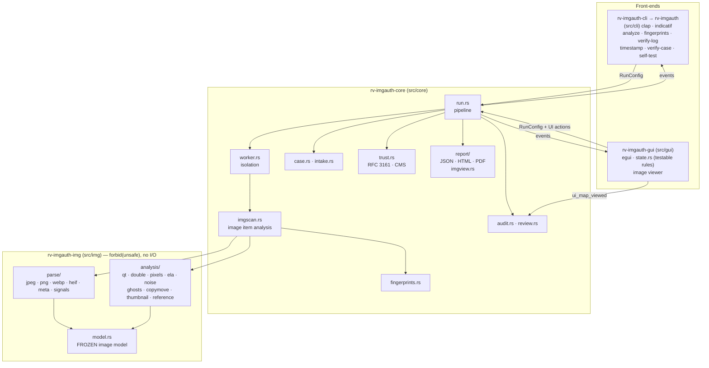
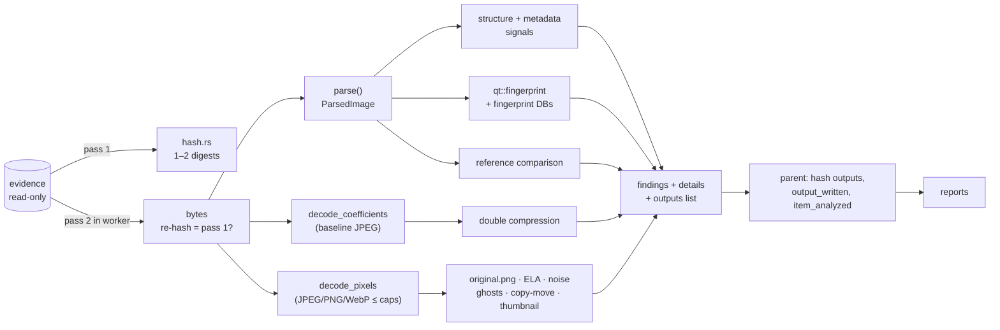
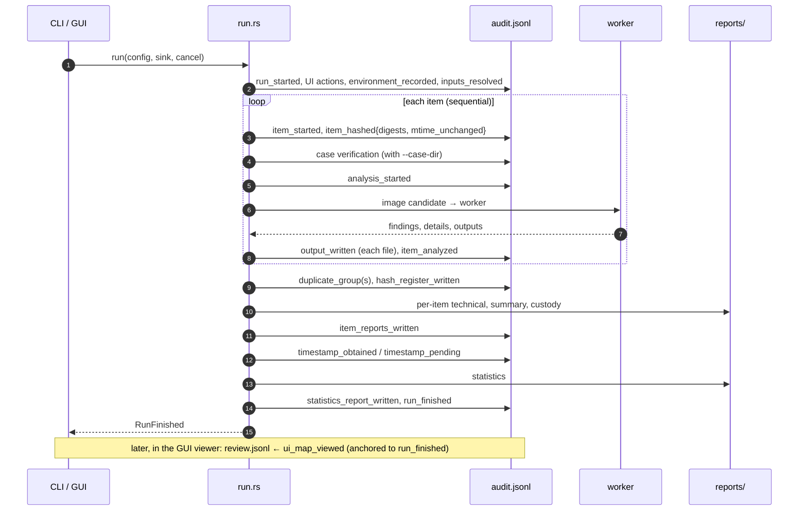
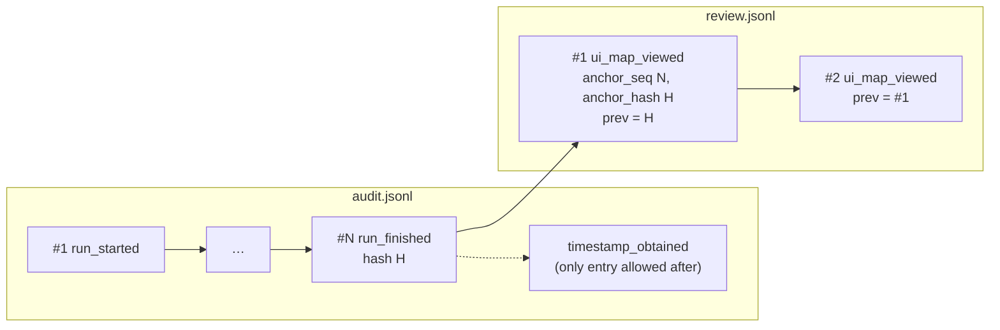
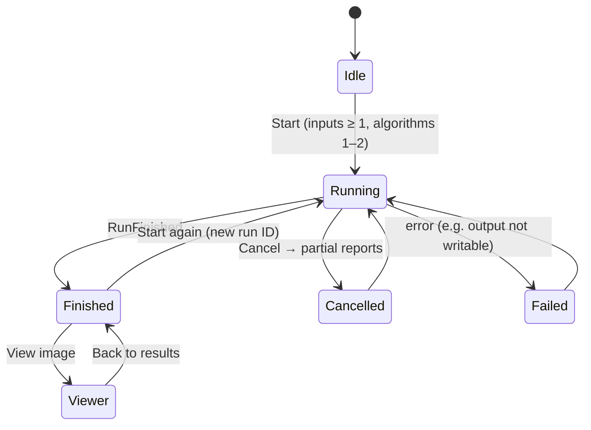

# Architecture

One engine, two front-ends. The engine (`src/core`) does all the work and never prints; the CLI and the GUI only
turn user input into a `RunConfig` and render the `Event`s the engine emits, so both interfaces produce identical
logs and reports. The image layer (`src/img`) parses and analyses bytes and pixels; it does no I/O and writes
nothing.

## Crates



| Crate / module | Responsibility |
| --- | --- |
| `src/img` `parse::jpeg` | JPEG marker parser (T.81), segment tree without gaps, MPF/trailer detection; baseline Huffman decoder to quantized DCT coefficients |
| `src/img` `parse::png`, `webp`, `heif`, `inflate` | PNG chunk walker (own zlib inflater for text chunks), WebP RIFF walker, HEIF/ISOBMFF box walker with item graph and extents |
| `src/img` `parse::meta`, `signals` | EXIF (kamadak-exif), XMP (quick-xml) with `xmpMM:History`, IPTC-IIM, PNG text; structure and metadata signals |
| `src/img` `analysis::*` | Pixel decoding (zune-jpeg, png, image-webp), quantization tables, double compression, ELA, noise maps, JPEG ghosts, copy-move, thumbnail and reference comparison |
| `src/core` `imgscan.rs` | One item: second read and re-hash, parse, signals → findings, fingerprint lookup, maps written into the item folder, reference comparison |
| `src/core` `analyzer.rs` | Dispatch: image candidates to `imgscan` (in the worker), other files to inventory findings |
| `src/core` `worker.rs` | Child-process isolation, limits, reply protocol `rv-imgauth-worker/1`, `PARSER_FAILED` |
| `src/core` `fingerprints.rs` | Starter, local and extra fingerprint databases; identity (name, version, SHA-256) for the audit |
| `src/core` `audit.rs`, `review.rs` | Hash-chained `audit.jsonl`; post-run `review.jsonl` anchored to `run_finished`; verification |
| `src/core` `case.rs`, `intake.rs` | Case folder (`rakvor.case/1`), registry verification, `--intake hashinv` |
| `src/core` `trust.rs` | RFC 3161 timestamp of the chain head; CMS signing of PDF reports (parent only; the only network code) |
| `src/core` `report/` | View models → minijinja HTML, built-in PDF writer, schema-versioned JSON; `imgview.rs` turns image details into report sections |
| `src/core` `run.rs`, `input.rs`, `hash.rs`, `env.rs`, `events.rs` | Orchestration, inputs, hashing, `environment.json`, typed events and ETA |
| `src/cli` | Commands, long help (also the source of [usage-cli.md](usage-cli.md)), `fingerprints learn/list/export` |
| `src/gui` | egui window; `state.rs` holds every rule (options, viewer model, audit of views) and is unit-tested; `app.rs` draws |

## Data flow of one image



## The frozen image model

`src/img/src/model.rs` is **frozen**: fields may be added with a default, never renamed or removed. The parsers
and the analyses were written in parallel against it, and the core depends only on it.

```text
bytes ──► parse()                ──► ParsedImage { format, width, height, structure: [Segment tree],
                                                   metadata { tags, xmp, xmp_history, makernote_present,
                                                   icc_sha256, problems }, jpeg | png | webp | heif info,
                                                   thumbnail, signals }
      ──► decode_coefficients()  ──► Vec<ComponentCoefficients>   (baseline JPEG only)
      ──► decode_pixels()        ──► Pixels (RGB8)                (JPEG/PNG/WebP; never HEIF)
analyses(ParsedImage, coefficients, pixels) ──► Vec<Signal { code, severity, params }> + Vec<MapImage { name, png, params }>
```

`Signal`s carry only a code, a severity and parameters; the core maps them to findings and the wording comes from
`i18n/*.json`. `MapImage`s carry their parameters, which go into the report next to the map.

## One run, step by step



Items are processed sequentially so that the order of audit entries equals the order of work; inside one image the
heavy analyses (noise wavelet strips, residual rows, copy-move DCT planes) use `rayon`. Cancellation is checked
after every hashing chunk and between items; partial reports and `run_cancelled` are written.

## Worker process

```text
run.rs ──► analyzer::analyze_item ── not an image ──► inventory analysis (in process)
                    │ image candidate (signature or extension)
                    ▼
      worker::analyze_in_worker ── spawn `<exe> worker --in … --item-dir … --opts <json> --expect-digest <algo>:<hex>`
        limits first (Unix RLIMIT_AS, no core dump, empty network namespace when permitted;
        Windows Job Object), then "RV-WORKER-GO" on stdin
                    ▼
      child: imgscan::analyze_image ─► rv_imgauth_img ─► structure.json, metadata.json, maps/*.png
                    │ one JSON reply on stdout {"protocol":"rv-imgauth-worker/1","analysis":…}
                    ▼
      parent: validate output paths ─► hash + audit each file ─► item_analyzed
```

Failure (timeout, crash, memory limit, bad reply) → `PARSER_FAILED` (high) and `details.worker`; the run continues.
Files left by a failed worker are kept as `partial_output` and audited. Details: [theory.md B19](theory.md#b19-worker-isolation).

## The review log

The run's audit chain is closed at `run_finished`. What the examiner looks at **afterwards** (maps opened in the
GUI viewer) goes into `review.jsonl` in the same log folder: a second hash chain whose first entry quotes the
`run_finished` hash. `verify-log` and `verify-case` verify it when present. If it cannot be written, the GUI falls
back to recording the view in the next run's audit log.



## Run states (as the GUI sees them)



## Why Rust

See [ADR 0001](adr/0001-language.md).

## Further reading

| Page | Covers |
| --- | --- |
| [theory.md](theory.md) | Every analysis, with exact parameters, at two levels |
| [admissibility.md](admissibility.md) | Legal requirements mapped to features; gaps; checklist |
| [reports.md](reports.md) | Report sections, per-item outputs, finding codes |
| [forensic-audit.md](forensic-audit.md) | Audit log, review log, timestamp, signed reports |
| [case-folder.md](case-folder.md) | Shared case folder and intake |
