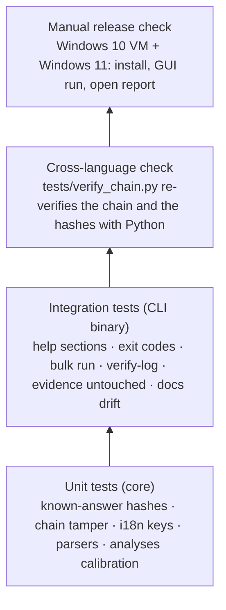
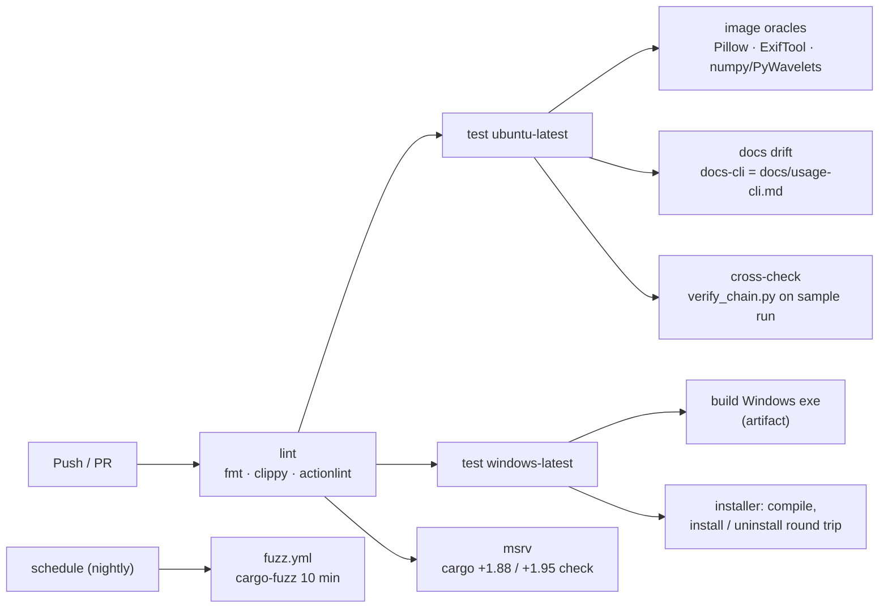
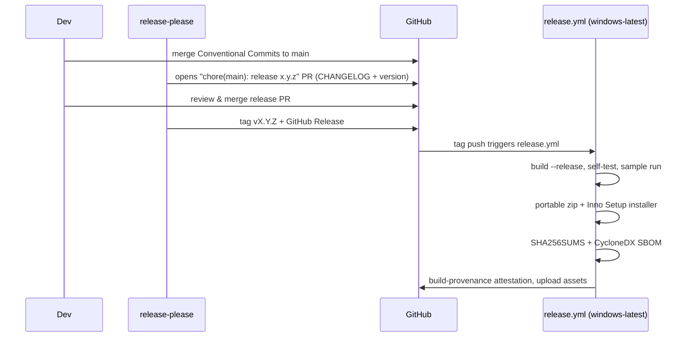

# Development, CI/CD and releases

## Build and test locally

```bash
cargo build --workspace                 # debug build of core, CLI and GUI
cargo test  --workspace                 # unit + integration tests (GUI tests are headless)
cargo clippy --workspace --all-targets -- -D warnings
cargo fmt --all -- --check
cargo run -p rv-imgauth-cli -- analyze -i examples/sample/evidence --lang all
cargo run -p rv-imgauth-gui
```

Linux needs no system packages to build. On Windows use the MSVC toolchain (`rustup default stable-msvc`);
binaries are linked with the static C runtime (`.cargo/config.toml`), so they run on a clean Windows 10/11.

### Toolchain

`rust-toolchain.toml` pins the compiler (1.97.0 with rustfmt and clippy); rustup selects it automatically, and
both workflows read their channel from that file (`dtolnay/rust-toolchain@master` with
`toolchain: <channel of rust-toolchain.toml>`), so local builds, CI and release binaries use one compiler. Bump it
deliberately in that one file. The *minimum* versions are separate: `rust-version` is 1.88 for the CLI, core and
image crates (edition 2024 `let` chains) and 1.95 for the GUI (egui/eframe 0.37); the CI job `msrv` runs
`cargo +1.88.0 check` and `cargo +1.95.0 check -p rv-imgauth-gui` to keep those numbers true.

### Image libraries

No native library is needed: JPEG decoding (`zune-jpeg`, SIMD disabled), PNG (`png`), WebP (`image-webp`), the
JPEG re-encoder for ELA and ghosts (`jpeg-encoder`), EXIF (`kamadak-exif`), XMP (`quick-xml`) and FFT (`rustfft`)
are pure-Rust crates; the JPEG marker parser and Huffman decoder, IPTC, the PNG/WebP/HEIF walkers are in-house in
`src/img` (`#![forbid(unsafe_code)]`). (The plan calls for a `cargo-deny` licence allow-list against GPL/AGPL crates; it is not configured yet — no `deny.toml`, no CI step.) Upgrading `jpeg-encoder` or
`zune-jpeg` changes the maps: update `JPEG_ENCODER` / `JPEG_DECODER` in `src/img/src/analysis/util.rs` (the
versions recorded in every report) and re-bless the sample maps.

`RV_WORKER_TEST_FAULT=crash|hang|oom` (and `RV_WORKER_TEST_TIMEOUT_S`) make the worker misbehave on purpose in
**debug builds only** (`src/cli/tests/worker.rs`); release builds ignore them.

### Samples, oracles and fuzzing

The synthetic samples are generated by `tests/samples/make_structure.py` and `tests/samples/make_pixels.py`
(Pillow and numpy only; nothing real). `python tests/run_samples.py <binary>` checks the exact findings of every
sample (`examples/sample/expected_findings.json`, `--bless` to update after a deliberate change), `verify-log`, the
evidence digests and byte-identical maps on a second run. Oracles (CI, Linux; `pip install pillow==12.3.0
numpy==2.5.3 PyWavelets==1.10.0`, ExifTool from `libimage-exiftool-perl`): `tests/oracle_qt.py` (Pillow
quantization tables), `tests/oracle_exiftool.py` (metadata tags), `tests/oracle_maps.py --reports <dir>` (ELA,
residual and σ maps recomputed with numpy/PyWavelets). Fuzzing: `cargo +nightly fuzz run parse` (see `fuzz/`),
nightly in `.github/workflows/fuzz.yml`.
Mermaid blocks are checked with `npx -y @mermaid-js/mermaid-cli@11 -i <block.mmd> -o <out.svg>`.

## Test pyramid



## Continuous integration



`ci.yml` runs on every push and pull request with read-only permissions; `fuzz.yml` runs nightly and on demand.

## Releasing



| Artifact | Built by |
| --- | --- |
| `rv-imgauth-X.Y.Z-windows-x64.zip` | portable: both exes + README + LICENSE + NOTICE + examples |
| `rv-imgauth-X.Y.Z-windows-x64-setup.exe` | Inno Setup (`packaging/windows/installer.iss`), per-user install, adds CLI to PATH |
| `SHA256SUMS` | `sha256sum` over the assets |
| `sbom.cdx.json` | `cargo cyclonedx` |
| Attestation | `actions/attest-build-provenance` |

### Code signing

Unsigned executables trigger SmartScreen warnings. Options (decide per legal entity):

| Option | Notes |
| --- | --- |
| Azure Artifact Signing (Trusted Signing) | Low cost, integrates with GitHub Actions; available to organisations in eligible countries (the French entity qualifies, the Colombian one currently does not). |
| OV code-signing certificate (HSM/cloud key) | Works for either entity; slower reputation build-up. |

Signing is a step in `release.yml` guarded by `if: secrets…` so unsigned builds still work for testing.

Full procedure (secrets, signing certificate, test packages, rebuilding a release, manual packaging): [release-process.md](release-process.md).

### Release checklist (manual)

- [ ] `rv-imgauth self-test` on the released exe passes on Windows 10 **and** Windows 11
- [ ] GUI opens, runs the sample, *Open report* works
- [ ] `SHA256SUMS` matches the downloaded files; `gh attestation verify` passes
- [ ] CHANGELOG entry reviewed by a human
