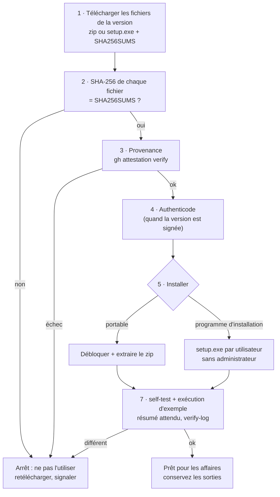

> La version de référence est la version anglaise ([installation.md](installation.md)) ; cette traduction la suit.

# Installation et vérification (Windows 10/11)

RV ImgAuth s'exécute **localement** sur le PC Windows 10 ou 11 de l'expert (x64). Il n'a besoin ni de droits
d'administrateur, ni d'environnement d'exécution (runtime C statique), ni de réseau, sauf pour l'horodatage RFC 3161 facultatif et la vérification des versions facultative. Cette page couvre :
obtenir une version, **prouver qu'il s'agit de la compilation authentique** (SHA256SUMS, provenance, Authenticode par
rapport au certificat racine Rakvor), l'installer (zip portable ou programme d'installation par utilisateur),
SmartScreen, l'autotest et l'exemple de la première exécution, l'usage hors ligne, la compilation depuis les sources
pour les auditeurs, l'emplacement des fichiers et la désinstallation.

RV ImgAuth n'a besoin d'**aucune bibliothèque tierce à l'exécution** : le décodage JPEG, PNG et WebP et le
réencodeur JPEG sont compilés dans les exécutables. Les pixels HEIC/HEIF ne sont pas décodés (aucun codec n'est fourni
ni chargé).

Pourquoi la vérification compte : un tribunal peut demander comment vous savez que le programme exécuté est celui dont
un expert a examiné le code source. Les étapes 2–4 et 7 apportent cette réponse ; conservez leur sortie avec le
dossier ([admissibility.md](admissibility.md#examiner-checklist-before-filing-a-report), étape 3, en anglais).



## Prérequis

| Élément | Exigence |
| --- | --- |
| Système d'exploitation | Windows 10 ou 11, x64 (`MinVersion=10.0` dans le programme d'installation). Linux/macOS : compiler depuis les sources. |
| Droits | Utilisateur standard. Le programme d'installation est par utilisateur (`PrivilegesRequired=lowest`). |
| Disque | Les deux exécutables et la documentation. Les sorties sont plus volumineuses que les éléments de preuve : par image un aperçu sans perte (`maps/original.png`, environ 3 octets par pixel avant la compression PNG) et un PNG par carte (ELA, bruit, σ, jusqu'à cinq cartes de fantômes, copier-déplacer, différence avec la vignette). Prévoyez plusieurs fois la taille des éléments, ou utilisez `--maps none` / `--item-reports flagged` pour les gros lots. |
| Mémoire | Chaque image est analysée dans un processus d'analyse limité par défaut à 2048 Mio (`--worker-memory`) ; les images au-delà de `--max-pixels` (100 MP) ne sont pas décodées. Une machine de 8 Go suffit ; augmentez `--worker-memory` pour les images de 50 à 120 MP. |
| Graphisme | Rien n'est requis : la GUI se rabat sur le rendu logiciel (WARP) sur les machines virtuelles sans pilote GPU. |
| Réseau | Aucun, sauf la demande d'horodatage facultative (voir l'[étape 8](#8-usage-hors-ligne-et-sur-poste-isolé)). |
| Vérification des versions | Facultative, simple notification : l'application de bureau au démarrage et `rv-imgauth update-check` lisent la page publique de la dernière version sur github.com ([Vérification des versions](#vérification-des-versions)) ; `RV_NO_UPDATE_CHECK=1` la désactive. |

## 1. Téléchargement

Les fichiers de la version sont sur la page Releases GitHub du dépôt (`Panacota96/rv-imgauth` à ce commit) :

| Fichier | Ce que c'est |
| --- | --- |
| `rv-imgauth-X.Y.Z-windows-x64.zip` | Portable : `rv-imgauth.exe`, `rv-imgauth-gui.exe`, README, LICENSE, COMMERCIAL.md, NOTICE, CHANGELOG, `docs/`, `examples/` (éléments d'exemple, résultats attendus et scripts d'exécution) |
| `rv-imgauth-X.Y.Z-windows-x64-setup.exe` | Programme d'installation Inno Setup, par utilisateur |
| `SHA256SUMS` | SHA-256 du zip, du programme d'installation et du SBOM (format `sha256sum` : `<hash>  ./<file>`) |
| `sbom.cdx.json` | Nomenclature logicielle CycloneDX (chaque dépendance Rust et sa version) |

Placez-les dans un même dossier, par ex. `C:\Rakvor\downloads\rv-imgauth-0.1.0\`.

## 2. Vérifier le téléchargement

```powershell
cd C:\Rakvor\downloads\rv-imgauth-0.1.0
Get-Content .\SHA256SUMS | ForEach-Object {
    $hash, $name = $_ -split '\s+', 2
    $name = $name.TrimStart('*').Replace('./', '')
    if (Test-Path $name) {
        $actual = (Get-FileHash -Algorithm SHA256 $name).Hash.ToLower()
        if ($actual -eq $hash) { "OK    $name" } else { "FAIL  $name  (got $actual)" }
    } else { "skip  $name (not downloaded)" }
}
```

Chaque fichier téléchargé doit afficher `OK`. Un fichier à la fois :

```powershell
Get-FileHash .\rv-imgauth-0.1.0-windows-x64.zip -Algorithm SHA256
```

`SHA256SUMS` lui-même n'est protégé qu'indirectement par l'étape 3 (il est produit par le même workflow) ;
l'attestation de l'étape 3 est le contrôle le plus fort.

## 3. Vérifier la provenance de la compilation

Chaque zip et programme d'installation porte une attestation de provenance de compilation GitHub
(`actions/attest-build-provenance`) : une déclaration signée que ce fichier exact a été compilé par le workflow de
publication du dépôt à partir d'un commit donné. Sur une machine avec accès à internet et la CLI GitHub :

```powershell
gh attestation verify .\rv-imgauth-0.1.0-windows-x64.zip --repo Panacota96/rv-imgauth
gh attestation verify .\rv-imgauth-0.1.0-windows-x64-setup.exe --repo Panacota96/rv-imgauth
```

La sortie nomme le workflow (`.github/workflows/release.yml`) et le commit source ; consignez les deux. Pour un
laboratoire isolé, vérifiez sur une machine connectée et transportez les fichiers vérifiés sur un support protégé en
écriture (la CLI GitHub peut aussi télécharger le paquet d'attestation et la racine de confiance pour une vérification
hors ligne ; voir `gh attestation verify --help`). `SHA256SUMS` et le SBOM ne sont pas attestés eux-mêmes.

## 4. Vérifier la signature Authenticode (versions signées)

Le workflow de publication signe `rv-imgauth.exe`, `rv-imgauth-gui.exe` et le programme d'installation **seulement
quand un certificat de signature de code est configuré** pour le dépôt. Les versions sont signées avec le certificat de
signature de code **interne** de Rakvor (« Rakvor Code Signing (internal) », émis par « Rakvor Internal Code Signing
Root CA »). Ce n'est pas un certificat public : Windows ne lui fait confiance que sur les machines où la racine Rakvor
est installée (les portables de Rakvor, puisque l'outil est utilisé localement et n'est pas distribué). Les auditeurs
et les clients vérifient les versions avec les étapes 2–3 et peuvent examiner la signature avec l'empreinte de la
racine ci-dessous.

Installez la racine une fois par machine Rakvor (PowerShell, avec l'utilisateur qui exécute l'outil ; le fichier est
`packaging/signing/rakvor-code-signing-root.cer` dans le dépôt) :

```powershell
# Vérifiez d'abord l'empreinte ; elle doit être exactement :
#   SHA-256 DC9BA1A2FCD4F0633C5214B7CCEB25BED8F3F7D9EBAF111590250CBCAA83DF60
(New-Object System.Security.Cryptography.X509Certificates.X509Certificate2 .\rakvor-code-signing-root.cer).GetCertHashString([System.Security.Cryptography.HashAlgorithmName]::SHA256)
Import-Certificate -FilePath .\rakvor-code-signing-root.cer -CertStoreLocation Cert:\CurrentUser\Root
```

Windows affiche une boîte de confirmation pour la nouvelle racine ; acceptez-la seulement si l'empreinte correspond.
Sans la racine, `Get-AuthenticodeSignature` indique `UnknownError` (chaîne vers une racine non approuvée) et SmartScreen
peut encore avertir à la première exécution. Vérifiez :

```powershell
Get-AuthenticodeSignature .\rv-imgauth-0.1.0-windows-x64-setup.exe |
    Format-List Status, StatusMessage, SignerCertificate, TimeStamperCertificate
# après extraction du zip :
Get-AuthenticodeSignature .\rv-imgauth.exe, .\rv-imgauth-gui.exe | Format-Table Status, Path
```

| État | Signification |
| --- | --- |
| `Valid` | Signé et intact ; le signataire doit être « Rakvor Code Signing (internal) » |
| `UnknownError` | Signé, mais la racine Rakvor n'est pas installée sur cette machine (installez-la comme ci-dessus) |
| `NotSigned` | La version a été compilée sans certificat de signature : appuyez-vous sur les étapes 2–3 ; Windows SmartScreen avertira |
| `HashMismatch` / autre | Arrêt : le fichier a été modifié après la signature |

Avec le SDK Windows, `signtool verify /pa /v rv-imgauth.exe` donne la chaîne complète. Le workflow de publication
lance lui-même `signtool verify /pa /tw` par rapport à la racine Rakvor avant l'empaquetage : une signature absente ou
rompue fait donc échouer la publication.

## 5. Installer

### 5a. Zip portable

```powershell
# seulement après les étapes 2–4
Unblock-File .\rv-imgauth-0.1.0-windows-x64.zip
Expand-Archive .\rv-imgauth-0.1.0-windows-x64.zip -DestinationPath C:\Rakvor\tools\rv-imgauth-0.1.0
cd C:\Rakvor\tools\rv-imgauth-0.1.0
.\rv-imgauth.exe --version
```

Gardez un dossier par version, pour pouvoir relancer une ancienne affaire avec la version exacte consignée dans son
`environment.json`. Facultatif, pour la session en cours seulement : `$env:Path += ";C:\Rakvor\tools\rv-imgauth-0.1.0"`.

### 5b. Programme d'installation (par utilisateur, sans administrateur)

Double-cliquez sur `rv-imgauth-X.Y.Z-windows-x64-setup.exe` (assistant en anglais, espagnol ou français). Il installe
dans `%LOCALAPPDATA%\Programs\Rakvor\RV ImgAuth\`, crée un groupe *Rakvor* dans le menu Démarrer (application +
documentation) et propose deux tâches : **Add the rv-imgauth command to PATH** (PATH de l'utilisateur, cochée à la
première installation) et une icône sur le bureau. Ouvrez ensuite un **nouveau** terminal pour que le PATH s'applique.

> **Mise à niveau depuis la 0.2.0.** Si vous avez installé RV ImgAuth 0.2.0 sur une machine qui a aussi RV PdfAuth, réinstallez RV PdfAuth : la 0.2.0 partageait son identité d'installation. Le programme d'installation 0.2.0 utilisait l'AppId Inno Setup de RV PDFAuth
> `{B2454915-B966-44CD-9C5B-5413F38185AE}`, si bien que Windows traitait les deux outils comme un seul programme :
> installer ou désinstaller l'un pouvait mettre à jour ou retirer les fichiers et l'entrée de désinstallation de l'autre. Les versions suivantes de RV ImgAuth s'installent
> sous leur propre AppId `{04A0C3C3-4929-42ED-81F7-93DB361940C8}` ; réinstaller RV PDFAuth rétablit son entrée.

Sans intervention :

```powershell
.\rv-imgauth-0.1.0-windows-x64-setup.exe /VERYSILENT /SUPPRESSMSGBOXES /NORESTART /TASKS="addtopath"
```

Le programme d'installation copie les exécutables, README, LICENSE, COMMERCIAL.md, NOTICE, CHANGELOG, `docs\` et les
éléments d'exemple (`examples\sample\evidence\`), pas les scripts d'exemple ni `expected_hashes.csv` (ils sont dans le
zip et l'arbre des sources).

## 6. SmartScreen

Windows SmartScreen juge un fichier téléchargé sur la **réputation** d'un certificat de confiance publique. La racine
interne Rakvor n'en est pas un, donc le premier démarrage peut afficher *Windows a protégé votre ordinateur* même quand
la signature est `Valid` (et toujours quand elle est `NotSigned`). Seulement **après la réussite des étapes 2–4** :
retirez la marque de fichier téléchargé avec `Unblock-File` sur le zip ou le programme d'installation avant de
l'utiliser, ou choisissez *Informations complémentaires → Exécuter quand même*. L'avertissement ne disparaît
définitivement qu'avec un certificat public de signature de code (voir [release-process.md](release-process.md), en
anglais).

## 7. Autotest de la première exécution et exemple

```powershell
rv-imgauth --version
rv-imgauth self-test
```

`self-test` affiche `PASS` pour md5, sha1, sha256, sha512, sha3-256 et blake3 (réponses connues pour `"abc"`), avec le
code de sortie 0. Il ne teste que les implémentations d'empreinte. Lancez ensuite l'exemple synthétique (15 images),
qui met en œuvre chaque analyse d'image, la comparaison avec les références et la chaîne d'audit :

```powershell
# zip portable (script inclus) : attend le code de sortie 3, vérifie le journal et les empreintes de l'exemple
.\examples\sample\run.ps1 -Bin .\rv-imgauth.exe

# programme d'installation (le script n'est pas installé) : lancez-le à la main dans un dossier temporaire
$app = "$env:LOCALAPPDATA\Programs\Rakvor\RV ImgAuth"
$out = Join-Path $env:TEMP "rv-imgauth-check"
$ev = "$app\examples\sample\evidence"
rv-imgauth analyze -i $ev -r --maps ela,noise,ghosts --reference "$ev\reference\ref-1.jpg" --reference "$ev\reference\ref-2.jpg" --hash sha256,md5 --out $out --progress none --no-timestamp
$LASTEXITCODE                                  # 3 = terminé avec des constatations de gravité élevée (voulu)
rv-imgauth verify-log (Get-ChildItem "$out\logs" | Select-Object -Last 1).FullName   # OK … chain intact
```

Résumé attendu : **15 items, 0 errors, findings high 1, medium 23, low 8, info 48**, code de sortie 3 (la
constatation élevée est `COPY_MOVE_CANDIDATE` sur `pix-copy-move.jpg` ; `crash.jpg` est endommagé à dessein et ne doit
pas arrêter l'exécution). Les constatations exactes par fichier sont dans [examples/README.md](../examples/README.md)
(en anglais). Si les comptes diffèrent, n'utilisez pas l'installation pour des affaires. Conservez la sortie de la
console et le dossier de l'exécution comme trace de cette vérification.

## 8. Usage hors ligne et sur poste isolé

Outre la vérification des versions facultative ([Vérification des versions](#vérification-des-versions)), le **seul** accès réseau du code est la demande d'horodatage RFC 3161 (un HTTP POST d'une empreinte de 32 octets
vers la TSA, [src/core/src/trust.rs](../src/core/src/trust.rs)). Il n'y a ni télémétrie ni contrôle de licence ;
l'apprentissage des empreintes est local.

| Pour désactiver l'horodatage | Comment |
| --- | --- |
| Une exécution de la CLI | `--no-timestamp` |
| Toutes les exécutions de la CLI sur ce PC / cette session | `$env:RV_NO_TIMESTAMP = "1"` (ou définissez-la comme variable d'environnement utilisateur) |
| GUI | décochez **5. Confiance → Horodatage qualifié** avant *Lancer l'analyse* |

Une exécution hors ligne avec l'horodatage activé se termine quand même : elle consigne `timestamp_pending` et le
rapport de statistiques affiche un avertissement. Plus tard, sur une machine qui peut joindre la TSA, lancez
`rv-imgauth timestamp <log folder>` sur le dossier des journaux de l'exécution (il revérifie la chaîne, puis ajoute
`timestamp_obtained`). Pour utiliser une TSA interne ou qualifiée, passez `--tsa-url` (voir
[admissibility.md](admissibility.md#53-eidas--regulation-eu-9102014-as-amended-by-eu-20241183-time-stamps), en anglais).
Malgré son libellé dans l'interface, cet horodatage n'est qualifié au sens d'eIDAS que si l'adresse est celle d'un
prestataire de services de confiance qualifié (QTSP) inscrit sur une liste de confiance de l'UE ; l'adresse par défaut
(DigiCert) ne l'est pas.
Le processus d'analyse d'images n'a pas de code réseau. Sous Linux, il s'exécute en plus dans un espace de noms réseau
vide quand le noyau le permet (consigné par élément comme `worker.network` dans le journal d'audit) ; sous Windows, il
n'y a pas de blocage réseau au niveau du système pour lui (écart G23) : sur un poste isolé cela n'a pas d'importance ;
ailleurs, une règle sortante du Pare-feu Windows pour `rv-imgauth.exe` / `rv-imgauth-gui.exe` qui n'autorise que
l'hôte de la TSA l'impose.

## 9. Compiler depuis les sources pour les auditeurs

### Chaîne de compilation

| Élément | Version |
| --- | --- |
| Rust | Installez-le avec `rustup`. Minimum **1.88** pour la CLI et les crates du cœur (chaînes `let` de l'édition 2024 ; chaque dépendance hors GUI de `Cargo.lock` déclare ≤ 1.85) et **1.95** pour la GUI (egui/eframe 0.37) : les valeurs `rust-version` de `Cargo.toml` et `src/gui/Cargo.toml`, vérifiées en CI par le job `msrv`. Pour reproduire une version, utilisez le compilateur exact de l'`environment.json` de cette version → `tool.rustc` (par ex. `rustc 1.97.0 (2d8144b78 2026-07-07)`) : `rustup toolchain install 1.97.0 --profile minimal` et compilez avec `cargo +1.97.0 …`. Si l'arbre des sources contient `rust-toolchain.toml`, rustup le choisit automatiquement. |
| Éditeur de liens Windows | Visual Studio 2022 Build Tools, charge de travail *Desktop development with C++* (MSVC + Windows SDK) ; `rustup default stable-msvc`. Le CRT statique est fixé dans `.cargo/config.toml`. |
| Linux | Aucun paquet système n'est nécessaire pour compiler la CLI. |
| Facultatif | Python 3.12 avec `blake3 jsonschema pyhanko pillow==12.3.0 numpy==2.5.3 PyWavelets==1.10.0` (les versions fixées en CI) pour les vérificateurs indépendants et les oracles d'image ; ExifTool (`libimage-exiftool-perl`) pour l'oracle des métadonnées. |

### Compilation

```powershell
git clone https://github.com/Panacota96/rv-imgauth.git
cd rv-imgauth
git checkout v0.1.0                       # l'étiquette de la version examinée
cargo build --release --locked -p rv-imgauth-cli -p rv-imgauth-gui
.\target\release\rv-imgauth.exe self-test
.\examples\sample\run.ps1 -Bin .\target\release\rv-imgauth.exe
cargo test --workspace --locked            # tests unitaires + d'intégration (dont le contrôle de dérive de docs/usage-cli.md)
```

```bash
# Linux
cargo build --release --locked -p rv-imgauth-cli
target/release/rv-imgauth self-test && examples/sample/run.sh target/release/rv-imgauth
python tests/run_samples.py target/release/rv-imgauth   # constatations exactes par exemple, cartes reproductibles
run=$(ls examples/sample/out/reports | tail -n 1)
python tests/oracle_qt.py examples/sample/out/reports/$run        # tables de quantification avec Pillow
python tests/oracle_exiftool.py examples/sample/out/reports/$run  # métadonnées avec ExifTool
python tests/oracle_maps.py --reports examples/sample/out/reports/$run   # cartes avec numpy/PyWavelets
```

`--locked` refuse de compiler si `Cargo.lock` devait changer : l'ensemble des dépendances est donc celui listé dans
`environment.json` → `dependencies` et dans `sbom.cdx.json`.

### Reproduire les empreintes de la version

Soyez précis sur ce qui peut ou non correspondre bit à bit dans cette version (écart G22) :

| Artefact | Identique bit à bit à la version ? | Comment le vérifier |
| --- | --- | --- |
| Fichiers de `docs/`, `examples/` | Oui (depuis git ; fins de ligne LF sauf `*.ps1`, `*.iss`) | `git ls-files` + `Get-FileHash` contre le zip extrait |
| `rv-imgauth.exe`, `rv-imgauth-gui.exe` | **Non garanti** : le compilateur est fixé (la CI et la publication lisent `rust-toolchain.toml`, 1.97.0, le même que `environment.json` → `tool.rustc`), mais les chemins ne sont pas remappés et l'en-tête PE porte des données de l'édition de liens | L'attestation de provenance (étape 3) relie le binaire publié au workflow et au commit ; comparez ensuite le comportement (ci-dessous) |
| zip, programme d'installation | Non (horodatages de l'archive) | Attestation (étape 3) |

**Équivalence fonctionnelle** : lancez l'exemple avec le binaire publié et avec votre compilation, puis comparez les
constatations de chaque élément et les empreintes des éléments de preuve :

```bash
python - "<release-out>/reports/<RUN-ID>" "<your-out>/reports/<RUN-ID>" <<'EOF'
import glob, json, sys
def load(run):
    out = {}
    for p in sorted(glob.glob(f"{run}/items/*/technical.json")):
        t = json.load(open(p, encoding="utf-8"))
        out[p.replace("\\", "/").split("/")[-2]] = (t["hashes"], [(f["code"], f["severity"], f["params"]) for f in t["findings"]])
    return out
a, b = load(sys.argv[1]), load(sys.argv[2])
print("identical findings and digests" if a == b else "DIFFERENT: " + ", ".join(k for k in a if a.get(k) != b.get(k)))
EOF
```

Comparez aussi les cartes et les `structure.json` / `metadata.json` de chaque élément : ils sont identiques octet pour
octet entre exécutions de la même compilation (encodeur fixe, décodeur scalaire), ce que vérifie
`tests/run_samples.py`.

## 10. Où se trouvent les choses

| Quoi | Emplacement |
| --- | --- |
| Programme (programme d'installation) | `%LOCALAPPDATA%\Programs\Rakvor\RV ImgAuth\` (`rv-imgauth.exe`, `rv-imgauth-gui.exe`, README, LICENSE, COMMERCIAL.md, NOTICE, CHANGELOG, `docs\`, `examples\sample\evidence\`, `unins000.exe`) |
| Programme (portable) | le dossier que vous avez extrait |
| Entrée du PATH (tâche du programme d'installation) | variable d'environnement utilisateur `Path` (`HKCU\Environment`) ; retirée par le programme de désinstallation |
| Sorties des exécutions | `--out` (par défaut `.\rakvor-out` **relatif au dossier courant**) : `logs\<RUN-ID>\`, `reports\<RUN-ID>\`. La GUI utilise son champ *Dossier de sortie* |
| Base locale d'empreintes | `%LOCALAPPDATA%\Rakvor\rv-imgauth\fingerprints.local.json` (Linux/macOS : `$XDG_DATA_HOME/rakvor/rv-imgauth/`, par défaut `~/.local/share/rakvor/rv-imgauth/`) |
| Son journal des modifications | `fingerprints.audit.jsonl` dans le même dossier (chaîné par empreintes) |
| Réglages de la GUI | non conservés : chaque démarrage utilise les valeurs par défaut ; chaque modification faite avant une exécution est consignée dans le journal d'audit de cette exécution |
| Certificat de signature | là où vous le rangez ; seuls son chemin, son sujet et son empreinte SHA-256 sont journalisés, jamais le mot de passe |
| Fichiers temporaires | aucun (le processus d'analyse n'écrit que dans le dossier de rapports de l'élément) |

## 11. Désinstaller

- **Programme d'installation :** *Paramètres → Applications → Applications installées → RV ImgAuth → Désinstaller*, ou
  lancez `"%LOCALAPPDATA%\Programs\Rakvor\RV ImgAuth\unins000.exe"` (silencieux : ajoutez `/VERYSILENT`). Il retire les
  fichiers installés, les raccourcis et l'entrée du dossier d'installation dans le `Path` utilisateur
  (`HKCU\Environment`) ajoutée par la tâche *Add to PATH* ; les autres entrées de `Path` ne sont pas touchées (ouvrez
  ensuite un nouveau terminal). La CI installe et désinstalle le paquet sur `windows-latest` et échoue si l'entrée
  reste. Les versions antérieures à cette correction ne la retiraient pas ; si une ancienne entrée subsiste,
  supprimez-la avec :

  ```powershell
  $dir = "$env:LOCALAPPDATA\Programs\Rakvor\RV ImgAuth"
  $p = [Environment]::GetEnvironmentVariable("Path", "User").Split(";") | Where-Object { $_ -and $_ -ne $dir }
  [Environment]::SetEnvironmentVariable("Path", ($p -join ";"), "User")
  ```

- **Portable :** supprimez le dossier.
- **Conservés volontairement** (dans les deux cas) : les sorties des exécutions (pièces de l'affaire) et la base locale
  d'empreintes avec son journal d'audit. Avant de supprimer `%LOCALAPPDATA%\Rakvor\rv-imgauth\`, exportez la base pour
  les dossiers (`rv-imgauth fingerprints export --out <file>`) : les rapports passés citent son SHA-256.

## 12. Dépannage de l'installation

| Symptôme | Cause et solution |
| --- | --- |
| SmartScreen « Windows a protégé votre ordinateur » (éditeur inconnu) | Voir l'[étape 6](#6-smartscreen). |
| `rv-imgauth` n'est pas reconnu | La tâche PATH n'a pas été choisie, ou le terminal a été ouvert avant l'installation : ouvrez un nouveau terminal ou utilisez le chemin complet. |
| Chaque HEIC affiche `HEIC_PIXELS_NOT_DECODED` | Voulu dans cette version (structure et métadonnées seulement). |
| Fenêtre de la GUI vide ou très lente sur une machine virtuelle | Pas de pilote GPU : le rendu logiciel est utilisé automatiquement ; donnez plus de CPU à la machine virtuelle. |
| `self-test` affiche `FAIL` | N'utilisez pas cette version pour des éléments de preuve ; retéléchargez-la et refaites les étapes 2–4. |
| Le résumé de l'exemple diffère de l'étape 7 | Mauvaise version, ou options différentes de celles de l'étape 7 ; comparez `environment.json` aux notes de version. |

## Vérification des versions

Une version plus récente est-elle publiée ? L'outil peut vous le dire ; il ne se met jamais à jour lui-même.

| | |
| --- | --- |
| Quand | L'application de bureau vérifie une fois au démarrage, en arrière-plan (un bandeau avec la page de la version n'apparaît que si une version plus récente existe). La CLI ne vérifie qu'avec `rv-imgauth update-check` (`--json` pour les scripts ; code 0 = la dernière, 3 = version plus récente, 1 = vérification impossible). Aucune autre commande ne contacte le réseau pour cela. RV Hub vérifie chaque outil qu'il liste. |
| Ce qui est envoyé | Un HTTPS GET de `https://github.com/Panacota96/rv-imgauth/releases/latest` (la redirection est lue, pas suivie) avec `User-Agent: rv-imgauth/<version>` et aucun autre en-tête, cookie ni paramètre : rien sur l'affaire, les éléments, l'expert ou la machine. |
| Ce qu'elle fait | Elle nomme la version plus récente et sa page. Elle ne télécharge ni n'installe jamais rien : téléchargez la version et vérifiez-la (`SHA256SUMS`, chaîne Authenticode jusqu'à la racine Rakvor) comme dans [Vérifier le téléchargement](#2-vérifier-le-téléchargement) avant usage. |
| Audit | La vérification ne fait pas partie d'une exécution et n'est écrite dans aucun journal d'audit ; une vérification en échec ou lente (hors ligne, délai de 5 s) ne bloque jamais l'outil. |
| La désactiver | `RV_NO_UPDATE_CHECK=1` (toute valeur sauf vide ou `0`), ou le fichier `update-check-off` dans `%APPDATA%\Rakvor` (le réglage de RV Hub l'écrit) : désactivée pour tous les outils Rakvor de ce PC. |
| Code | [src/core/src/update.rs](../src/core/src/update.rs) (partagé, identique octet pour octet, par tous les outils Rakvor) |
