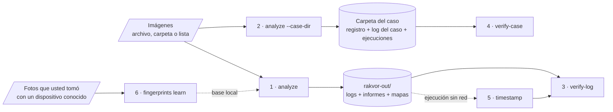
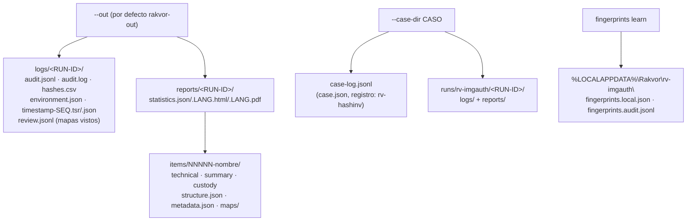

> La versión de referencia es la inglesa ([quick-guide.md](quick-guide.md)); esta traducción la sigue.

# Guía rápida

RV ImgAuth busca señales de que una foto o una imagen (JPEG, HEIC/HEIF, PNG, WebP) se modificó después de tomarse. Lee
cada evidencia que se le entrega (un archivo, una carpeta o una lista de archivos) sin cambiarla, calcula su hash y
examina cada imagen en un proceso de análisis separado: la estructura del archivo, los metadatos (EXIF, XMP, IPTC,
texto PNG), las tablas de cuantización JPEG y sus huellas, la doble compresión, la copia-desplazamiento, la miniatura
incrustada y, si se desea, imágenes de referencia conocidas. También escribe mapas visuales (ELA, ruido, fantasmas
JPEG) para el perito. Escribe informes para el perito y para el cliente, y registra cada acción en un log de auditoría
encadenado por hashes. Sus hallazgos son **señales, no veredictos**: cada uno dice lo que muestra y lo que no
demuestra. Una imagen sin hallazgos no queda probada como auténtica, y un hallazgo no prueba una manipulación ni
muestra quién cambió la imagen ni por qué. Los mapas son ayudas visuales, no resultados. Esta versión no decodifica los
píxeles HEIC. Esta página cubre las seis tareas habituales. La guía completa es [usage.es.md](usage.es.md), y todas
las opciones están en [usage-cli.md](usage-cli.md) (en inglés).



## Dos formas de usarlo

| Modo | Programa | Cuándo usarlo |
| --- | --- | --- |
| Aplicación de escritorio (GUI) | `rv-imgauth-gui.exe` (menú Inicio: *RV ImgAuth*) | Windows 10/11. Elige la evidencia y las opciones en una sola ventana, pulsa **Iniciar revisión** y luego mira los mapas en el visor de imágenes. |
| Línea de comandos (CLI) | `rv-imgauth.exe` | Scripts, lotes, los comandos de verificación (`verify-log`, `verify-case`, `timestamp`) y la base de huellas (`fingerprints`). |

Ambos usan el mismo motor. Con la misma evidencia y las mismas opciones dan los mismos hashes, hallazgos y mapas, y
ambos escriben los mismos archivos.

## Aplicación de escritorio: qué hace cada botón

No se escribe nada en el disco hasta que pulsa **Iniciar revisión**. Cada cambio que haga antes se guarda en memoria
y se escribe en el log de auditoría de la ejecución como una entrada `ui_*` cuando la ejecución empieza. Tras la
ejecución, los mapas que mire en el visor de imágenes quedan registrados en el `review.jsonl` de la ejecución
(`ui_map_viewed`).

| Botón o casilla | Qué hace | Qué escribe |
| --- | --- | --- |
| **Agregar archivos…** | Abre el selector de archivos de Windows y agrega los archivos elegidos a la lista de evidencia. | `ui_input_added` (una por archivo) |
| **Agregar carpeta…** | Agrega una carpeta completa. | `ui_input_added` |
| **Agregar ruta** | Agrega la ruta escrita en el cuadro de al lado (pulsar Enter hace lo mismo). | `ui_input_added` |
| Arrastrar y soltar | Los archivos o carpetas soltados en la ventana se agregan a la lista de evidencia, como con **Agregar archivos…**. | `ui_input_added` |
| **x** (junto a una entrada de evidencia) | Quita esa entrada de la lista de evidencia. | `ui_input_removed` |
| **Incluir subcarpetas** | Activada por defecto: las carpetas se leen con sus subcarpetas. | `ui_recursive_changed` |
| **Examinar…** junto a **Carpeta del caso** | Elige la carpeta compartida del caso. La carpeta de salida pasa a ser `<case>/runs/rv-imgauth/<RUN-ID>` y ya no se puede editar. | `ui_case_dir_changed` |
| **Registrar primero la evidencia con RV HashInv** | Aparece cuando hay una carpeta del caso. Ejecuta rv-hashinv sobre la misma evidencia antes del análisis, para que el caso tenga su registro de evidencias (Tarea 2). La línea de al lado muestra la versión de rv-hashinv encontrada o, en rojo, por qué no se puede usar ninguna. | `ui_intake_changed` |
| **Nivel de error (ELA)**, **Ruido**, **Fantasmas JPEG** (Mapas de análisis) | Los mapas que se escriben para cada imagen. ELA y Ruido están activados por defecto; Fantasmas JPEG no. | `ui_maps_changed` |
| **Detección de copia-desplazamiento** | Activada por defecto. Busca regiones copiadas dentro de la imagen. | `ui_copy_move_changed` |
| **Calidad JPEG para ELA** e **Imagen más grande** (selectores) | La calidad de recompresión del mapa ELA (95) y la imagen más grande que se decodifica (100 Mpx). | `ui_ela_quality_changed`, `ui_max_pixels_changed` |
| **Límites del proceso de análisis** (selectores de tiempo y memoria) | Tiempo (120 s) y memoria (2048 MB) permitidos al proceso de análisis para una imagen. Si se superan, la imagen recibe `PARSER_FAILED` y la revisión continúa. | `ui_worker_timeout_changed`, `ui_worker_memory_changed` |
| **Todos los archivos** / **Solo archivos señalados** (Informes por archivo) | Informes por archivo para todos los archivos, o solo para los que tienen un hallazgo por encima de informativo. | `ui_item_reports_changed` |
| **Añadir referencia** y **Examinar…** junto a **Imágenes de referencia** | Agregan originales conocidos del dispositivo que se afirma (rutas escritas, separadas por `;`, o archivos elegidos). Cada uno aparece con una **x** que lo quita. | `ui_references_changed` |
| **Examinar…** junto a **Base de huellas adicional** | Elige una base de huellas adicional (`.json`, como la escribe `fingerprints export`), que se usa además de la incluida y de la local. | `ui_fingerprints_db_changed` |
| **Examinar…** junto a **Carpeta de salida** | Elige dónde se escriben `logs/` y `reports/` (por defecto `rakvor-out`). | Nada hasta la ejecución: la carpeta usada se registra en `environment.json` |
| **Perito** e **ID del caso** (campos de texto) | El nombre del perito (por defecto, su usuario de Windows) y una referencia de caso opcional. | Nada hasta la ejecución: el perito se escribe en cada entrada de auditoría y en cada informe, el ID del caso en los informes |
| **Sello de tiempo confiable** (casilla y dirección) | Activado por defecto. Pide a la autoridad RFC 3161 de esa dirección un sello de tiempo para el log de auditoría. | `ui_timestamp_changed` |
| **Examinar…** junto a **Certificado de firma (.p12/.pfx)** | Elige su certificado. Cada informe PDF se firma entonces con él. Escriba la **Contraseña del certificado** en el campo de debajo. La contraseña solo se guarda en memoria y nunca se registra. | `ui_signing_certificate_changed` (solo la ruta) |
| **Iniciar revisión** | Inicia la ejecución con los ajustes mostrados. | `ui_start_clicked` y luego toda la ejecución (ver [Dónde van las salidas](#dónde-van-las-salidas)) |
| **Cancelar** | Se detiene después del archivo que se está leyendo y escribe informes parciales. | `item_cancelled`, `run_cancelled` |
| **Abrir informe** | Abre el informe de estadísticas (`statistics.<LANG>.html`) de la ejecución terminada. | Nada |
| **Abrir carpeta de logs** | Abre la carpeta de logs de la ejecución. | Nada |
| **Abrir informe de hashes** | Tras una ejecución con **Registrar primero la evidencia con RV HashInv**: abre el informe de estadísticas de rv-hashinv. | Nada |
| **Ver imagen** (uno por fila de la tabla Resultados) | Abre el visor de imágenes sobre ese elemento: la vista previa del original y un mapa lado a lado o superpuestos, los hallazgos, la estructura del archivo y los metadatos. | `ui_map_viewed` en el `review.jsonl` de la ejecución, una vez por elemento, mapa y modo de vista mostrados |
| **Volver a resultados** | Sale del visor de imágenes. | Nada |
| **-**, **+** y **Ajustar** (visor de imágenes) | Reducen, amplían y restablecen el zoom compartido del original y de la superposición. La rueda del ratón también amplía y arrastrar desplaza. | Nada |
| **ID de evidencia** (panel de resultado) | Tras una ejecución en una carpeta del caso, lista el ID de evidencia de cada elemento (E0001…) y su control contra el registro. Solo lectura. | Nada |
| **Advertencias** (panel de resultado) | Lista los errores encontrados durante la ejecución. Solo lectura. | Nada aquí: la ejecución registra cada error como `item_error` |

El sello de tiempo solo es cualificado en el sentido de eIDAS si la dirección de la TSA es la de un prestador
cualificado de servicios de confianza (QTSP) inscrito en una lista de confianza de la UE; la dirección por defecto
(DigiCert) no lo es.

Los selectores (algoritmos de hash, idioma de los informes, idioma de la interfaz, formato de custodia) también se
registran: `ui_hash_selection_changed`, `ui_language_changed`, `ui_interface_language_changed` y
`ui_jurisdiction_changed`. En el visor de imágenes, los selectores **Archivo** y **Superposición**, la vista **Lado a
lado** / **Superpuesto** y el control deslizante **Opacidad del mapa** eligen lo que se muestra; antes de mostrar una
imagen, el visor la compara con el hash del log de auditoría (verde: coincide; rojo: modificada tras la ejecución).

## Tarea 1: Analizar una imagen o una carpeta

1. Compruebe la compilación una vez en este PC: `rv-imgauth self-test` debe imprimir `PASS` para cada algoritmo
   (código de salida 0).
2. Ejecute el análisis sobre una copia verificada de la evidencia (los archivos nativos, no capturas de pantalla ni
   copias vueltas a guardar), nunca sobre el soporte original. Omita `--no-timestamp` cuando el PC pueda llegar a la
   TSA: la ejecución obtiene entonces también el sello de tiempo (`timestamp: ok …`).

   ```powershell
   rv-imgauth analyze -i evidence -r --hash sha256,md5 --lang es --case CASE-2026-014 --actor "Ana Ruiz" --no-timestamp
   ```

3. Lea el resumen. Sobre una copia de la evidencia de muestra (`examples\sample\evidence`, 15 imágenes sintéticas) en
   `evidence`, sin red (`--no-timestamp`), el comando anterior imprime (el tiempo transcurrido varía):

   ```text
   DONE (high-severity findings)  run 20261126T132030Z-ab84ac
     items: 15  bytes: 1330737  errors: 0  elapsed: 2 min 33 s
     findings: high 1, medium 10, low 11, info 45
     timestamp: off
     report: rakvor-out\reports\20261126T132030Z-ab84ac\statistics.es.html
     logs:   rakvor-out\logs\20261126T132030Z-ab84ac
   ```

4. Abra el archivo `report:`. Luego, para cada elemento, abra `technical.<LANG>.html` (para el perito) o
   `summary.<LANG>.html` (para el cliente), y mire los mapas con **Ver imagen** en la aplicación de escritorio (o en
   `maps/`, pero esa visualización no se registra).

**Qué escribe:** `rakvor-out/logs/<RUN-ID>/` (log de auditoría, `hashes.csv`, `environment.json`) y
`rakvor-out/reports/<RUN-ID>/` (informe de estadísticas y, por elemento, una revisión técnica, un resumen, un formato
de custodia, `structure.json`, `metadata.json` y `maps/`).

**Cómo leer el resultado:** `DONE` con código de salida 0 significa que no hay hallazgos de severidad alta.
`DONE (high-severity findings)` con código de salida 3 es un resultado normal para una evidencia, no un error: aquí la
muestra `pix-copy-move.jpg` da `COPY_MOVE_CANDIDATE` a propósito. Abra los elementos cuyo estado es `problem`. Cada
hallazgo indica lo que muestra y lo que no demuestra; [usage.es.md](usage.es.md#5-interpretar-cada-hallazgo) dice qué
comprobar antes de apoyarse en cada código. `timestamp: pending` significa que no se pudo contactar con la autoridad
(ver la Tarea 5).

Opciones del análisis:

| Opción | Qué fija |
| --- | --- |
| `--input` (`-i`) | Un archivo o una carpeta que revisar. Repítala para varios. |
| `--input-list` (`-L`) | Un archivo de texto con una ruta por línea. |
| `--recursive` (`-r`) | Leer también las subcarpetas. |
| `--hash` (`-H`) | Uno o dos de md5, sha1, sha256, sha512, sha3-256, blake3 (por defecto sha256). |
| `--out` (`-o`) | Carpeta de salida (por defecto `rakvor-out`). |
| `--lang` (`-l`) | Idioma de los informes: en, es, fr o all. |
| `--actor` (`-a`) | Nombre del perito en el log de auditoría y en los informes. |
| `--case` (`-c`) | Identificador del caso impreso en los informes. |
| `--progress` (`-p`) | bar, jsonl (un evento JSON por línea) o none. |
| `--jurisdiction` (`-j`) | Formato de custodia: co (Colombia) o fr (Francia). |
| `--tsa-url` | Autoridad RFC 3161 (por defecto `http://timestamp.digicert.com`). |
| `--no-timestamp` | Sin solicitud de sello de tiempo (laboratorios sin red). |
| `--sign-cert` | Su certificado `.p12`/`.pfx`: cada informe PDF se firma con él. |
| `--sign-pass-env` | La variable de entorno que contiene su contraseña (por defecto `RV_SIGN_PASSWORD`). |
| `--maps` | Los mapas por imagen: ela, noise, ghosts o none (por defecto `ela,noise`). |
| `--copy-move` | on (por defecto) u off: la búsqueda de copia-desplazamiento. |
| `--ela-quality` | Calidad de recompresión del mapa ELA, de 1 a 100 (por defecto 95). |
| `--max-pixels` | Las imágenes con más píxeles no se decodifican (por defecto 100 000 000). |
| `--reference` | Un original conocido del dispositivo que se afirma, con el que se compara cada elemento. Repítala para varios. |
| `--worker-timeout` | Segundos permitidos para una imagen (por defecto 120). |
| `--worker-memory` | Límite de memoria del proceso de análisis en MiB (por defecto 2048). |
| `--fingerprints-db` | Una base de huellas adicional (Tarea 6). |
| `--item-reports` | all (por defecto) o flagged: informes por archivo solo para los archivos con un hallazgo por encima de informativo. |
| `--case-dir` | La carpeta compartida del caso (Tarea 2). |
| `--evidence` (`-E`) | ID de evidencias registradas que analizar (Tarea 2). |
| `--intake` | hashinv: registrar primero la evidencia con rv-hashinv (Tarea 2). |
| `--hashinv-exe` | El programa rv-hashinv que se usa con `--intake hashinv` (Tarea 2). |

## Tarea 2: Analizar evidencia en una carpeta del caso

1. Elija una carpeta para el caso, en el volumen del caso, por ejemplo `cases\CASE-2026-014`. rv-imgauth es una
   herramienta de análisis: verifica cada archivo contra el registro de evidencias que escribe la herramienta de
   recepción, rv-hashinv. Nunca escribe el registro.
2. Registre y analice en un solo paso: `--intake hashinv` ejecuta primero rv-hashinv sobre la misma evidencia (crea el
   caso, así que indique `--case` y `--jurisdiction`). rv-hashinv se busca en `--hashinv-exe`, `RV_HASHINV`, junto a
   rv-imgauth, en la carpeta de instalación de RV HashInv y luego en `PATH`. Si el caso ya se registró antes, omita
   `--intake hashinv`.

   ```powershell
   rv-imgauth analyze --case-dir cases\CASE-2026-014 --case CASE-2026-014 --jurisdiction co -i evidence -r --intake hashinv --no-timestamp
   ```

3. Lea la última línea del resumen:

   ```text
     case:   CASE-2026-014 (analysis) verified 15, mismatched 0, not in registry 0
   ```

4. Más adelante, para analizar de nuevo algunos elementos registrados, indique sus ID:

   ```powershell
   rv-imgauth analyze --case-dir cases\CASE-2026-014 --evidence E0001,E0002 --no-timestamp
   ```

**Qué escribe:** la ejecución en `runs/rv-imgauth/<RUN-ID>/logs` y `/reports`, y sus entradas `run_started` y
`run_finished` en `case-log.jsonl` (con `--intake hashinv`, rv-hashinv escribe además `case.json`, el registro
`evidence/registry.json` y `.csv` y su propia ejecución en `runs/rv-hashinv/`).

**Cómo leer el resultado:** `verified` cuenta los archivos cuyos hashes coinciden con el registro. Un archivo que
difiere del registro recibe el hallazgo alto `EVIDENCE_HASH_MISMATCH_WITH_CASE` (se analiza igualmente); un archivo
que no está en el registro recibe `EVIDENCE_NOT_IN_CASE_REGISTRY` (medio). El código de salida 3 antes de leer nada
significa que la carpeta del caso no pasó la verificación: no se escribió nada en ella (ejecute la Tarea 4). El código
de salida 2 indica un error de uso, por ejemplo una carpeta que pertenece a otro caso o un ID de evidencia
desconocido.

## Tarea 3: Verificar el log de auditoría de una ejecución

1. Indique a `verify-log` la carpeta de logs de la ejecución (o el `audit.jsonl` que contiene):

   ```powershell
   rv-imgauth verify-log rakvor-out\logs\20261126T132030Z-ab84ac
   ```

2. Lea la salida:

   ```text
   OK  159 entries, chain intact: rakvor-out\logs\20261126T132030Z-ab84ac\audit.jsonl
       outputs: 248 verified of 248 recorded (md5, sha256)
   ```

3. Si la ejecución tiene sello de tiempo, agregue `--tsa-ca <raíces de la TSA.pem>` para comprobar también la cadena
   de certificados de la TSA contra los certificados raíz de la propia TSA. Si se vieron mapas en la GUI, la salida da
   además `review entries: N`.

**Qué escribe:** nada. Solo lee.

**Cómo leer el resultado:** `OK` (código de salida 0) significa que ninguna entrada se editó, borró ni reordenó, que
cada token de sello de tiempo coincide, que el registro de revisión (si lo hay) está intacto y anclado a esta
ejecución, y que cada informe, mapa, `structure.json`, `metadata.json`, `hashes.csv` y `environment.json` sigue
teniendo el hash que registró el log. `BROKEN` (código de salida 3) lista un problema por línea. El código de salida 1
significa que no se puede leer el log o el archivo `--tsa-ca`. La revocación del certificado de la TSA nunca se
comprueba.

## Tarea 4: Verificar un caso completo

1. Ejecute `verify-case` sobre la carpeta que contiene `case.json`:

   ```powershell
   rv-imgauth verify-case cases\CASE-2026-014
   ```

2. Lea la salida (después de la Tarea 2: la ejecución de recepción de rv-hashinv y las dos ejecuciones de rv-imgauth):

   ```text
   OK  case CASE-2026-014: 8 case-log entries, 15 registered items, 3 runs verified: cases\CASE-2026-014
       outputs: 454 verified of 454 recorded by the runs' audit logs
   ```

**Qué escribe:** nada. Solo lee.

**Cómo leer el resultado:** `OK` (código de salida 0) significa que el log del caso, el registro, el log de auditoría
(de cualquier herramienta Rakvor) y el registro de revisión de cada ejecución, y las salidas registradas por las
ejecuciones, están intactos. Las advertencias (por ejemplo, una ejecución todavía en curso) se imprimen pero no hacen
fallar la comprobación. `BROKEN` (código de salida 3) lista cada comprobación fallida. El código de salida 1 significa
que la carpeta no es una carpeta de caso (no tiene `case.json`).

## Tarea 5: Agregar el sello de tiempo después de trabajar sin red

1. Sin red, ejecute el análisis como siempre, o con `--no-timestamp` (o `RV_NO_TIMESTAMP=1`) para que no se envíe
   ninguna solicitud. Sin `--no-timestamp`, el resumen muestra `timestamp: pending`.

   ```powershell
   rv-imgauth analyze -i evidence\edited-gimp.jpg -o offline --no-timestamp
   ```

2. Cuando vuelva la red, agregue el sello de tiempo a la carpeta de logs de la ejecución:

   ```powershell
   rv-imgauth timestamp offline\logs\20261126T132521Z-c392d6
   ```

3. Lea el resultado: `OK  timestamp 2026-11-26T13:25:34Z by http://timestamp.digicert.com covers entry #18`. Use
   `--tsa-url` para elegir otra autoridad y `--actor` para nombrar al perito en la nueva entrada de auditoría.
4. Ejecute la Tarea 3 sobre la misma carpeta. Ahora muestra la línea del sello de tiempo y `TSA signature valid`:

   ```text
   OK  19 entries, chain intact: offline\logs\20261126T132521Z-c392d6\audit.jsonl
       timestamp 2026-11-26T13:25:34Z by http://timestamp.digicert.com covers entry #18: TSA signature valid (signer: CN=DigiCert SHA256 RSA4096 Timestamp Responder 2026 1,O=DigiCert\, Inc.,C=US); chain not checked (pass --tsa-ca <CA bundle> to validate it)
       outputs: 23 verified of 24 recorded (sha256), 1 skipped
       not re-hashed: logs/timestamp-00018.tsr (RFC 3161 token: checked by the timestamp verification)
   ```

**Qué escribe:** `timestamp-<SEQ>.tsr` (el token RFC 3161) y `timestamp-<SEQ>.json` en la carpeta de logs, y la
entrada `timestamp_obtained` en `audit.jsonl`.

**Cómo leer el resultado:** el código de salida 0 significa que el sello de tiempo se obtuvo y se registró. El código
de salida 1 significa que no se pudo contactar con la autoridad; no cambió nada, así que vuelva a intentarlo más
tarde. El código de salida 3 significa que el log falta o está roto; a un log roto no se le agrega ningún sello de
tiempo. El sello de tiempo prueba cuándo existía el log, no que la evidencia sea auténtica. El registro de revisión
(`review.jsonl`) se escribe después de la ejecución y no lo cubre el sello de tiempo de la ejecución.

## Tarea 6: Enseñar a la herramienta una cámara o un editor

1. Cree usted mismo originales conocidos: tome fotos con el dispositivo, o guarde archivos con la aplicación o el
   editor. Aprenda solo de archivos cuyo origen pueda probar. La base starter de esta versión está vacía: hasta que
   aprenda originales, cada JPEG da `QT_UNKNOWN`.
2. Aprenda el dispositivo. Aquí las dos imágenes de referencia de la muestra hacen las veces de esas fotos:

   ```powershell
   rv-imgauth fingerprints learn evidence\reference\ref-1.jpg evidence\reference\ref-2.jpg --label "Phone X camera" --category camera --case LAB-2026-03 --actor "Ana Ruiz"
   ```

3. Lea el resultado (primeras líneas; las siguientes dan las rutas de la base y de su log de auditoría y su SHA-256
   antes y después):

   ```text
   LEARNED local-phone-x-camera (Phone X camera, camera) from 2 file(s)
     producer contains: (none)
     creator contains:  Canon | Canon EOS R6
     traits:            qt_sha256=cfe3218ae132279888e3a2b4c6949ea5cfa8df2c92a42e1dac9597d5b622b545, subsampling=4:2:0
   ```

4. Vea lo que ha aprendido este puesto con `rv-imgauth fingerprints list --db local` (`--db starter` para las
   entradas incluidas, sin `--db` para ambas).
5. Exporte la base local para otro PC o para la revelación a la otra parte (un archivo existente nunca se
   sobrescribe); `--db starter` exporta la incluida:

   ```powershell
   rv-imgauth fingerprints export --out lab-fingerprints-2026-11.json
   ```

   En el otro PC, entréguela al análisis con `--fingerprints-db lab-fingerprints-2026-11.json`.

**Qué escribe:** `%LOCALAPPDATA%\Rakvor\rv-imgauth\fingerprints.local.json` (la base local, que usa cada análisis
posterior) y su log de cambios encadenado por hashes `fingerprints.audit.jsonl` en la misma carpeta; `export` escribe
el archivo indicado por `--out`. No se envía nada a ningún sitio.

**Cómo leer el resultado:** una coincidencia en un análisis posterior (`QT_MATCHES_DEVICE`, `QT_MATCHES_EDITOR`) es
una señal sobre el último codificador de la imagen, no sobre una persona ni un dispositivo concreto; las cadenas de
software se pueden falsificar. Categorías: camera, os, app, editor, messenger, library. El código de salida 1 indica
un archivo que no se puede leer o del que no se puede aprender, una base ilegible o un archivo de exportación que ya
existe; el código de salida 2, un error de uso (categoría desconocida, falta `--label`).

## Otros comandos

| Comando | Qué hace |
| --- | --- |
| `rv-imgauth self-test` | Comprueba cada algoritmo de hash contra valores de prueba publicados. |
| `rv-imgauth fingerprints` | Agrupa `learn`, `list` y `export` (Tarea 6). |
| `rv-imgauth update-check` | Le dice si hay publicada una versión más reciente. Solo avisa: no se descarga nada. `RV_NO_UPDATE_CHECK=1` lo desactiva. |
| `rv-imgauth describe --json` | Imprime la descripción de la herramienta para RV Hub. No lee ni escribe nada. |

## Códigos de salida

| Código | Significado | Lo devuelve |
| --- | --- | --- |
| 0 | Terminado; ningún hallazgo de severidad alta (comandos de verificación: todo lo comprobado está intacto). | todos los comandos |
| 1 | Error de ejecución: entrada no encontrada, salida no escribible, log del caso bloqueado, contraseña de certificado incorrecta, falta el archivo de `--fingerprints-db`, TSA inalcanzable (solo `timestamp`; `analyze` muestra `timestamp: pending` y continúa), carpeta que no es de caso, un self-test fallido, un archivo del que no se puede aprender o un archivo de exportación que ya existe, o una comprobación de actualizaciones que no se pudo hacer. | `analyze`, `verify-log`, `verify-case`, `timestamp`, `self-test`, `fingerprints`, `update-check` |
| 2 | Error de uso: opción desconocida, valor incorrecto, más de dos algoritmos, carpeta de caso de otro caso, ID de evidencia desconocido, categoría de huella desconocida. | todos los comandos (opción desconocida); `analyze`, `fingerprints learn` |
| 3 | Al menos un hallazgo de severidad alta, un log de auditoría o de revisión roto, una comprobación del caso fallida o (para `update-check`) una versión más reciente. | `analyze`, `verify-log`, `verify-case`, `timestamp`, `update-check` |
| 130 | Cancelado con Ctrl+C: se escriben informes parciales y la cancelación queda en el log de auditoría. | `analyze` |

## Dónde van las salidas



Sin `--case-dir`, cada ejecución crea `logs/<RUN-ID>/` y `reports/<RUN-ID>/` dentro de `--out` (por defecto
`.\rakvor-out`, relativo a la carpeta actual). Con `--case-dir`, van a `<CASE>/runs/rv-imgauth/<RUN-ID>/`. Guarde la
carpeta de logs junto con los informes: es la prueba de lo que se hizo.
