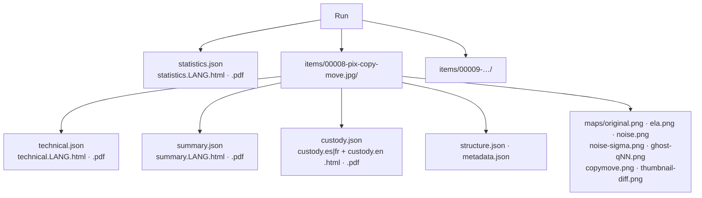

# Reports

Every run produces one **statistics report**. Every examined file produces a **technical review** for examiners,
lawyers and opposing experts, a plain-language **customer summary**, and a **chain-of-custody form**. Each exists as
JSON (language-neutral) plus HTML and PDF in each selected language (`--lang en|es|fr|all`). Image items also get
the derived files listed in [Per-item outputs](#per-item-outputs).

**Brand.** HTML and PDF reports carry the Rakvor header band (RV mark, *FORENSICS | INCIDENT RESPONSE | SECURITY*,
tagline in the report language). With `--sign-cert` each PDF is digitally signed and shows the signer; otherwise it
says "This PDF is not digitally signed". Every report file's digest is recorded in the audit log
(`item_reports_written`, `statistics_report_written`).

## Technical review vs customer summary

| | Technical review | Customer summary |
| --- | --- | --- |
| Reader | Examiner, lawyer, opposing expert | Client |
| Findings | Code, severity, parameters, **what it shows / what it does not prove** | Title and plain sentence |
| Image details | Every section below, with parameters and digests | "What the checks looked at": format, size, camera and software named in the metadata, capture date, number of maps, reference comparison counts ("8 properties consistent, 4 inconsistent. This neither proves nor excludes that device.") |
| Hashes | All digests | Primary digest ("Digital fingerprint") |
| Method, audit entries, limitations | Yes | "What we did"; "Recommended next step" |

## Statistics report sections

| Section | Content |
| --- | --- |
| Header | Run ID, case, examiner, interface, start/end, duration, hash algorithms, totals, throughput |
| Findings by severity / by type | Counts per severity and per code |
| Items by detected type | JPEG, PNG, WebP, HEIF, other |
| Duplicate groups | Identical files (same primary digest) |
| Image overview | Images examined, analyses not completed, items without report files (`--item-reports flagged`), and the item table (file, size, status, number of findings) |
| Case folder | With `--case-dir`: verified / mismatch / not registered counts |
| Limitations | The run's limitations |
| Trusted timestamp (RFC 3161) | Time and TSA, or a pending / disabled notice |
| Audit trail | Chain head and entry count at the time of writing |

## Technical review sections

In this order (HTML and PDF; the JSON holds the same data under `image`):

| Section | Content | Source in `technical.json` |
| --- | --- | --- |
| Identification, hashes | Path, size, modified time, extension, detected type, evidence id and registry check, every digest | `item`, `hashes` |
| Findings | Severity, code, title, what it shows, what it does not prove, parameters | `findings` |
| Image analysis | Format, size, analysis status, evidence re-hash (first and second pass), worker outcome (time, memory limit, network isolation), options used | `image.format`, `image.evidence_rehash`, `image.worker`, `image.options` |
| Original image (decoded preview) | The preview `maps/original.png` (PDF: a copy at most 480 px long; the hashed file is full size) and its parameters (decoder, stored orientation) | `image.original_preview` |
| Metadata summary | Key fields (Make, Model, Software, dates, offsets, PixelX/Y, Orientation, CreatorTool, IPTC, PNG text…), tag counts per group, GPS tag count, MakerNote, ICC hash, XMP presence, thumbnail presence, problems | `image.metadata_summary` |
| XMP edit history | `xmpMM:History` events: action, when, software agent, changed | `image.metadata_summary.xmp_history` |
| Structure summary | Segment / chunk / box sequence (repeats collapsed as `IDAT ×5`) and facts (frame type, subsampling, components, restart interval, table counts, bytes after EOI/IEND, VP8X flags, HEIF brands, items, grid, unreferenced bytes) | `image.structure_summary` |
| Quantization tables | Each table in natural order (8×8) with precision and the components using it; table SHA-256; IJG quality or nearest q and distance | `image.qt_fingerprint` |
| Fingerprint databases | Each database loaded (role starter / local / extra, name, version, SHA-256, entries, status) and the matches | `image.fingerprint_dbs`, `image.qt_fingerprint.matches` |
| Analysis maps | One block per map: title, file, digest, picture (PDF: print copy) and **every recorded parameter** | `image.maps`, `image.map_parameters` |
| Copy-move shift vectors | Shifts and block counts of the candidates, or none | findings `COPY_MOVE_CANDIDATE` |
| Comparison with reference images | References (path, SHA-256, status) and the per-property table: property, status (consistent / inconsistent / varies / not applicable), item value, reference value, value per reference | `image.references`, `image.reference_table` |
| Extracted files | Every derived file of the item: path, kind, size, digests | `extracted_files` |
| Method | What was done, in the report language | — |
| Audit trail | Audit entries covering the item (`#first – #last`), chain head | `audit` |
| Limitations | The six image limitations plus item-specific ones | `limitations` |

## Per-item outputs

All are written into the item folder by the worker, then hashed with the run's algorithms and recorded as
`output_written` (kind in brackets). A file is never overwritten.

| File | Kind | Content |
| --- | --- | --- |
| `structure.json` | `structure` | `format`, `width`, `height`, the full `structure` tree (every marker segment, chunk or box with `kind`, `offset`, `length`, `detail`, children), and the per-format info: `jpeg` (markers, SOF, components, subsampling, quantization and Huffman tables, restart interval, comments, bytes after EOI), `png` (chunks, bit depth, colour type, bytes after IEND), `webp` (kind, lossless, VP8X flags, chunks), `heif` (brands, primary item, items with type, extents and properties, grid, unreferenced bytes) |
| `metadata.json` | `metadata` | Every tag read (`group`, `name`, `value`): EXIF IFD0/Exif/GPS/IFD1, XMP, IPTC, PNG text and `tIME`, JPEG comments; MakerNote presence, ICC SHA-256, the XMP packet, `xmp_history`, reading problems |
| `maps/original.png` | `original_preview` | Lossless RGB8 PNG of exactly the pixels every analysis saw (stored orientation, alpha over white). Not written for HEIC, undecodable files or images above `--max-pixels` |
| `maps/ela.png` | `map` | Error level map (JPEG, `--maps ela`) |
| `maps/noise.png`, `maps/noise-sigma.png` | `map` | Median residual (full size) and σ per 40×40 HH1 block (half size) (`--maps noise`) |
| `maps/ghost-q50.png` … `ghost-q90.png` | `map` | JPEG ghost maps (JPEG ≤ 24 MP, `--maps ghosts`) |
| `maps/copymove.png` | `map` | Copy-move overlay, only when a candidate is found |
| `maps/thumbnail-diff.png` | `map` | Thumbnail vs resized main image difference, when the thumbnail decodes |

Parameters of each map (e.g. ELA `quality`, `gain`, `encoder`, `decoder`, `sampling`, `scaling`) are in
`technical.json` → `image.maps[].params` and printed under the map. Why each map looks the way it does:
[theory.md](theory.md#part-b--for-examiners-and-opposing-experts).

With `--item-reports flagged`, items whose status is `ok` get no technical, summary or custody files; their
derived outputs are still written and audited, they stay listed in the statistics report, and the audit log records
`item_reports_skipped`.

## Status and severity

| Item status | Rule | Customer wording |
| --- | --- | --- |
| `problem` | at least one **high** finding | "Problem found" — do not rely on this file until the examiner has explained it |
| `attention` | at least one **medium** or **low** finding | "Needs attention" |
| `ok` | only **info** findings or none | "No issues found" (with the limitation that this is not proof of authenticity) |

The run exits with code 3 when any item has a high finding. On the sample run (15 images, every map, two
references): high 1, medium 23, low 8, info 48.

Severity rule of the catalogue: visual maps and analyses not run are **info**; editor, software and structure
traces and inconsistencies are **medium**; common traces of ordinary sharing are **low**; copy-move candidates, a
thumbnail showing different content, failed analyses and evidence integrity problems are **high**.

## Finding codes

Every code with its severity as emitted by the code of this commit and its title (`i18n/en.json`). The *shows* and
*does not prove* texts are in the catalogue and in every report, in English, Spanish and French.

| Code | Severity | Title |
| --- | --- | --- |
| `EMPTY_FILE` | info | Empty file |
| `EXTENSION_MISMATCH` | medium | Extension does not match content |
| `EXECUTABLE_CONTENT` | high | Executable content under another name |
| `DUPLICATE` | info | Duplicate content |
| `UNREADABLE` | high | File could not be read |
| `PARSER_FAILED` | high | Image analysis did not complete |
| `EVIDENCE_CHANGED_DURING_ANALYSIS` | high | Evidence changed during the analysis |
| `EVIDENCE_HASH_MISMATCH_WITH_CASE` | high | Differs from the evidence registered in the case |
| `EVIDENCE_NOT_IN_CASE_REGISTRY` | medium | Not registered in the case |
| `REGISTRY_PATH_CONTENT_CHANGED` | medium | Registered path now holds different content |
| `JPEG_MARKER_ORDER_UNUSUAL` | medium | Unusual JPEG segment order |
| `DUPLICATE_TABLES` | medium | Tables defined twice |
| `DATA_AFTER_END_MARKER` | medium | Data after the end of the image |
| `PROGRESSIVE_ENCODING` | low | Progressive JPEG |
| `PNG_CHUNK_ORDER_INVALID` | medium | PNG chunks out of the required order |
| `PNG_PRIVATE_CHUNKS` | low | Private PNG chunks |
| `WEBP_FLAGS_MISMATCH` | medium | WebP header does not match its content |
| `HEIF_STRUCTURE_ANOMALY` | medium | Unusual HEIC/HEIF structure |
| `HEIF_UNREFERENCED_DATA` | medium | HEIC/HEIF bytes used by no item |
| `EXIF_SOFTWARE_EDITOR` | medium | Saved by editing or processing software |
| `XMP_EDIT_HISTORY` | medium | Edit history in XMP |
| `METADATA_DATES_INCONSISTENT` | medium | Metadata dates do not agree |
| `EXIF_DIMENSIONS_MISMATCH` | medium | Recorded size differs from the real size |
| `METADATA_STRIPPED` | low | Little or no camera metadata |
| `MESSENGER_TRACES` | low | Traces of a messenger or social network |
| `MAKERNOTE_MISSING_FOR_MAKE` | low | Manufacturer notes missing |
| `METADATA_PROBLEMS` | low | Damaged metadata |
| `FILE_STRUCTURE_DAMAGED` | medium | Damaged or truncated file structure |
| `THUMBNAIL_MISMATCH` | high | Embedded thumbnail differs from the image |
| `QT_STANDARD_IJG` | info | Standard (IJG) compression tables |
| `QT_NON_STANDARD` | info | Non-standard compression tables |
| `QT_MATCHES_EDITOR` | medium | Compression tables of an editor or app |
| `QT_MATCHES_DEVICE` | info | Compression tables of a known device |
| `QT_UNKNOWN` | info | Compression tables not in the database |
| `QT_INCONSISTENT_WITH_EXIF_MAKE` | medium | Compression tables do not fit the camera named |
| `DOUBLE_COMPRESSION_SIGNS` | low | Signs of repeated JPEG compression |
| `JPEG_GHOST_REGION` | medium | Region with a different compression history |
| `COEFFICIENTS_UNAVAILABLE` | info | Compression analysis not possible |
| `ELA_MAP_WRITTEN` | info | Error level map written |
| `ELA_NOT_APPLICABLE` | info | Error level map not applicable |
| `NOISE_INCONSISTENCY_MAP` | info | Noise maps written |
| `COPY_MOVE_CANDIDATE` | high | Possible copied-and-moved region |
| `REFERENCE_INCONSISTENT` | medium | Inconsistent with the reference set |
| `REFERENCE_CONSISTENT` | info | Consistent with the reference set |
| `HEIC_PIXELS_NOT_DECODED` | info | HEIC pixels not analysed |
| `ANALYSIS_SKIPPED_SIZE_CAP` | info | Analysis skipped for size |

Wording lives in `i18n/en.json`, `es.json`, `fr.json` (same keys in all three — enforced by a test).

## JSON schemas

| File | `schema` value | Schema |
| --- | --- | --- |
| `statistics.json` | `rakvor.statistics/1` | [schemas/statistics.schema.json](../schemas/statistics.schema.json) |
| `technical.json` | `rakvor.item-technical/1` | [schemas/item-technical.schema.json](../schemas/item-technical.schema.json) |
| `summary.json` | `rakvor.item-summary/1` | [schemas/item-summary.schema.json](../schemas/item-summary.schema.json) |
| `custody.json` | `rakvor.item-custody/1` | [schemas/item-custody.schema.json](../schemas/item-custody.schema.json) |

`python tests/validate_reports.py <reports/RUN-ID>` validates every JSON report (CI does it on the sample run).
Adding a field is a minor change; removing or renaming one bumps the `/N` version.

## PDF notes

PDFs are generated by a built-in writer (A4, Helvetica/Courier, WinAnsi), so nothing external is needed. Maps and
the preview are embedded as print copies at most 480 px on the long side; the full-resolution PNG next to the report
is the hashed original.
