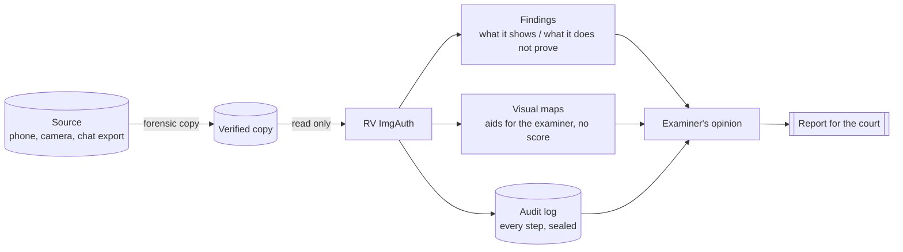
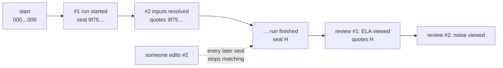
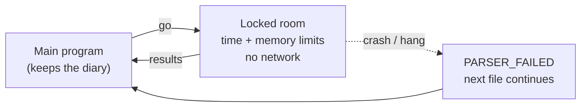
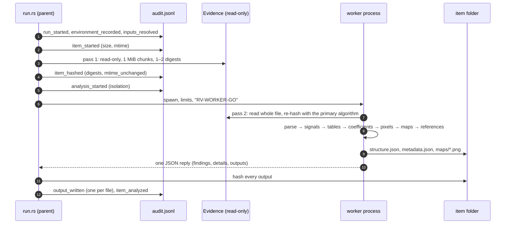
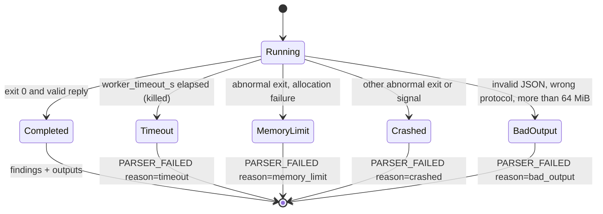

# Theory of operation

This page explains **why** each step of RV ImgAuth works, at two levels:

- **[Part A — For clients, lawyers and judges](#part-a--for-clients-lawyers-and-judges)**: plain language,
  everyday analogies, and what a result can and cannot mean. No knowledge of image formats or cryptography is
  needed.
- **[Part B — For examiners and opposing experts](#part-b--for-examiners-and-opposing-experts)**: algorithms,
  exact parameters and thresholds, the source file that implements each one, and the literature behind them.
  Every number in Part B is read from the code of this commit; where the code departs from the published method,
  Part B says so.

It describes what the tool **does**, not what it should do. Known weaknesses are listed where they apply and
collected in [admissibility.md](admissibility.md#consolidated-gap-list). How to run the tool:
[usage.md](usage.md). How to install and verify it: [installation.md](installation.md).

## Contents

- Part A: [A1 What the tool is](#a1-what-the-tool-is-and-is-not) ·
  [A2 Digital fingerprints](#a2-digital-fingerprints-hashes) ·
  [A3 How the file is built](#a3-how-the-file-is-built-structure) ·
  [A4 The labels inside the photo](#a4-the-labels-inside-the-photo-metadata) ·
  [A5 The compression recipe](#a5-the-compression-recipe-quantization-tables) ·
  [A6 Saved more than once](#a6-saved-more-than-once-double-compression) ·
  [A7 Re-save and compare (ELA)](#a7-re-save-and-compare-error-level-analysis) ·
  [A8 The grain of the picture (noise)](#a8-the-grain-of-the-picture-noise) ·
  [A9 Ghosts of an older save](#a9-ghosts-of-an-older-save-jpeg-ghosts) ·
  [A10 Copy and paste inside one picture](#a10-copy-and-paste-inside-one-picture-copy-move) ·
  [A11 The small preview](#a11-the-small-preview-embedded-thumbnail) ·
  [A12 Comparing with known originals](#a12-comparing-with-known-originals-reference-images) ·
  [A13 HEIC, PNG and WebP](#a13-heic-png-and-webp) ·
  [A14 The tool's own diary](#a14-the-tools-own-diary-audit-log-review-log-timestamp) ·
  [A15 Opening dangerous files safely](#a15-opening-dangerous-files-safely) ·
  [A16 Reading a result](#a16-reading-a-result)
- Part B: [B1 Source map](#b1-source-map-and-constants) ·
  [B2 Pipeline](#b2-pipeline-and-reads-of-the-evidence) ·
  [B3 Hashing](#b3-hashing) ·
  [B4 JPEG structure](#b4-jpeg-structure) ·
  [B5 Metadata](#b5-metadata-exif-xmp-iptc) ·
  [B6 Quantization tables](#b6-jpeg-dct-quantization-tables-and-the-ijg-scaling-formula) ·
  [B7 Fingerprint databases](#b7-fingerprint-databases) ·
  [B8 Double compression](#b8-double-jpeg-compression) ·
  [B9 Pixel decoding](#b9-pixel-decoding-and-the-preview) ·
  [B10 ELA](#b10-error-level-analysis-ela) ·
  [B11 Noise](#b11-noise-residual-and-mahdiansaic-σ-map) ·
  [B12 JPEG ghosts](#b12-jpeg-ghosts) ·
  [B13 Copy-move](#b13-copy-move-block-dct-matching) ·
  [B14 Thumbnail](#b14-embedded-thumbnail-comparison) ·
  [B15 Reference comparison](#b15-reference-comparison) ·
  [B16 PNG](#b16-png-structure) ·
  [B17 WebP](#b17-webp-structure) ·
  [B18 HEIF/HEIC](#b18-heifheic-structure) ·
  [B19 Worker isolation](#b19-worker-isolation) ·
  [B20 Audit chain, review log, timestamp](#b20-audit-chain-review-log-and-timestamp) ·
  [B21 Determinism](#b21-determinism-and-reproducibility) ·
  [B22 Validation status](#b22-validation-status-and-error-rates) ·
  [B23 References](#b23-references)

---

# Part A — For clients, lawyers and judges

## A1 What the tool is (and is not)

RV ImgAuth is a **magnifying glass for photos and screenshots** (JPEG, HEIC/HEIF, PNG and WebP). It looks for
traces that an image was re-saved, edited or assembled after it was first captured, and writes down every trace
it sees as a **finding**. Each finding says, in plain words, **what it shows** and **what it does not prove**.

It never says that an image is "real", "fake" or "authentic". That conclusion belongs to a human examiner, who
weighs the findings with everything else in the case: how the image was obtained, witnesses, other photos of the
same scene, the device itself. This follows the professional guidance for image authentication (SWGDE
18-I-001 v2.0, 2025): do not overstate results, a negative result can never be proven, and no probability is given
without a scientific basis.



| The tool can tell you | The tool cannot tell you |
| --- | --- |
| Which program last saved the file, when the file says so | That this information was not typed in by hand |
| That the JPEG was compressed at least twice | Whether the second save changed what the picture shows |
| That a region of the picture repeats elsewhere in it | Whether the repetition is a cover-up or just a tiled floor |
| That the small preview stored in the file shows something different | Which version is the original |
| The exact digital fingerprint of every file it read and wrote | That the copy you gave it equals what the camera produced |

## A2 Digital fingerprints (hashes)

A **hash** is a short code computed from every byte of a file — like a fingerprint. Change one character, or one
pixel, and the fingerprint changes completely; keep the file identical and the fingerprint is always the same,
on any computer.

| Text | SHA-256 fingerprint |
| --- | --- |
| `Amount due: EUR 1,250.00` | `ff105d2ef195aa26a96f6a7eaf3623488d60cc01c2fb7c2ccc94e74ada7577e5` |
| `Amount due: EUR 7,250.00` | `68890ed16423d5e22e2ba12a10eb995f39694fd9fb1a041413b69884a1c3438e` |

One digit differs; the two fingerprints share nothing recognisable. If today's fingerprint of a photo equals the
one recorded at intake, the photo is the same, bit for bit. RV ImgAuth computes one or two fingerprints of every
file it reads, reads each image a second time to check that it did not change in between, and fingerprints every
file it writes (maps, reports).

**A hash proves integrity, not authenticity**: it says the file did not change *since intake*. Whether the picture
was edited *before* intake is the question the rest of the tool helps an examiner with.

## A3 How the file is built (structure)

An image file is like a **parcel with labelled compartments**: a header, compartments for the date and camera, one
for the colour profile, then the picture itself, then an end mark. Cameras and phones pack the compartments in
a habitual order; editing programs often repack them differently, and some leave extra things after the end mark
(phones legitimately store depth maps or second pictures there).

The tool lists every compartment with its position in the file (`structure.json`) and reports unusual packing:
an unexpected order, tables defined twice, a "progressive" JPEG (typical of web tools, rare for cameras), bytes
after the end, PNG compartments out of the order the standard requires, a WebP header that announces contents
that are not there, or HEIC data that no part of the file uses.

**What a result can mean:** the file was written, or rewritten, by a certain kind of program. **What it cannot
mean:** that the picture content was changed. Re-packing is what every "save as" does.

## A4 The labels inside the photo (metadata)

Cameras write **labels** into the file: make and model, the date and time the picture was taken, the size, the
software. Editors add their own (Photoshop and GIMP write their name and sometimes a step-by-step history).
Messengers and social networks usually remove the labels.

The tool reads every label (`metadata.json`) and points out:

- a known editing program named in the labels (`EXIF_SOFTWARE_EDITOR`) or an edit history (`XMP_EDIT_HISTORY`);
- dates that do not agree with each other (`METADATA_DATES_INCONSISTENT`), for example a "last changed" date two
  days after the "taken" date;
- a recorded size that differs from the real size (`EXIF_DIMENSIONS_MISMATCH`), typical of cropping or resizing;
- a JPEG or HEIC with no camera labels at all (`METADATA_STRIPPED`);
- a Facebook marker (`MESSENGER_TRACES`), or a camera brand without the manufacturer's private notes
  (`MAKERNOTE_MISSING_FOR_MAKE`).

Analogy: labels are like the **handwritten note on the back of a print**. They are useful, but anybody with a pen
can write or rub them out. A label proves only that a program wrote it; its absence says nothing about the
picture.

## A5 The compression recipe (quantization tables)

A JPEG is made smaller by throwing away fine detail the eye barely sees. How much is thrown away, and where, is
set by two small grids of 64 numbers each: the **quantization tables**. They are the file's **recipe card**.
Many programs (libjpeg, GIMP, Pillow, ImageMagick and countless apps) use the same family of recipes — the "IJG
standard tables" — scaled by a quality number from 1 to 100. Camera makers and phone systems often use their own.

The tool reads the recipe, says whether it is a standard IJG recipe and at which quality, or "non-standard" (with
the nearest IJG quality, which is only an approximation), and looks it up in Rakvor's fingerprint database of
known devices and apps.

**What a result can mean:** the last program that saved the file is consistent with a family of encoders.
**What it cannot mean:** that a specific person or device made it. Recipes are shared by many programs, and the
database is small today (see [A16](#a16-reading-a-result)).

## A6 Saved more than once (double compression)

Every JPEG save throws detail away according to its recipe. If a JPEG is opened and saved **again** with a
different recipe, the second save leaves a regular **ripple** in the statistics of the image — like a
photocopy of a photocopy, where the second copy carries the grain of the first.

The tool measures that ripple and reports `DOUBLE_COMPRESSION_SIGNS` with a strength (low, moderate, strong).

**What a result can mean:** the file was encoded at least twice. **What it cannot mean:** that its content was
manipulated. Sending a photo through a messenger, exporting it from a photo app or rotating it in many viewers
all re-save it. No ripple does not mean "saved once": an identical recipe, a crop or a resize erases it.

## A7 Re-save and compare (error level analysis)

**ELA** re-saves the picture once more at a known quality and shows how much each spot changes. Areas that have
already been through many saves change little; areas that were pasted in recently, or have a different history,
can change more and look brighter on the map.

Analogy: rubbing a pencil over paper to reveal the indentations of older writing. You see *something*, and a
trained eye can read it, but the result also shows every crease of the paper.

The tool writes the map (`maps/ela.png`) and reports only that it did so (`ELA_MAP_WRITTEN`, informational). It
gives **no score**. Edges and textures are bright in perfectly ordinary photos; a picture saved many times looks
uniformly dark; resizing or recolouring changes the whole map. ELA is not made for PNG screenshots
(`ELA_NOT_APPLICABLE`).

## A8 The grain of the picture (noise)

Every camera sensor adds a faint, even **grain** (noise) to the whole photo. A region taken from another photo,
smoothed, or filled in by software often has a different grain.

The tool writes two noise pictures: the fine grain itself (`noise.png`) and a map of how strong the grain is in
each square of the picture (`noise-sigma.png`). Analogy: looking at a wall under raking light — a patch of new
plaster has a different texture. But an ordinary photo also has smooth sky, dark shadows and textured cloth, all
with different grain. The maps are aids for an examiner and carry no score (`NOISE_INCONSISTENCY_MAP`,
informational).

## A9 Ghosts of an older save (JPEG ghosts)

If a piece of a lower-quality JPEG was pasted into a picture that was then saved at a higher quality, re-saving
the whole picture at the **old, lower** quality leaves that piece almost unchanged while the rest changes: the
piece shows up as a dark **ghost** on the map for that quality.

The tool (only when asked, `--maps ghosts`) re-saves at qualities 50, 60, 70, 80 and 90, writes one map per
quality and reports `JPEG_GHOST_REGION` when a large dark region appears. **What it cannot mean on its own:**
that something was pasted. Smooth or saturated areas can look like ghosts, and the method only sees pieces that
came from a *lower* quality than the final picture.

## A10 Copy and paste inside one picture (copy-move)

A common edit hides something by **copying another part of the same picture** over it (grass over an object, a
crowd duplicated). The tool cuts a grey copy of the picture into small overlapping squares, gives each square a
compact description of its texture, sorts them so that identical squares end up next to each other, and looks
for many squares that are identical **with the same displacement** — like noticing that two pages of a book share
the same coffee stain at the same spot.

It reports `COPY_MOVE_CANDIDATE` (high) with the displacement and writes `maps/copymove.png` (source in orange,
copy in blue). **What it cannot mean on its own:** tiles, brick walls, fabric, text and clear sky repeat by
nature and must be checked by eye. **What it cannot find:** copies that were also enlarged, shrunk, rotated or
mirrored. No candidate does not mean no copy.

## A11 The small preview (embedded thumbnail)

Cameras store a **small preview** of the photo inside the file. Some editing programs change the big picture but
leave the old preview. The tool shrinks the main picture to the preview's size and compares them; if they differ
more than ordinary resampling explains, it reports `THUMBNAIL_MISMATCH` (high) and writes the difference
(`maps/thumbnail-diff.png`).

**What it cannot mean on its own:** which version is the original, or that the change was deceptive. Cropping
and rotating also make the preview and the picture differ.

## A12 Comparing with known originals (reference images)

When the image is said to come from a particular phone or camera, the examiner can give the tool a few
**known originals from that device** (`--reference`). The tool compares technical properties that the device
writes the same way every time — the compression recipe, the order of compartments, the set of labels, the
preview size, the resolution, the colour profile — and reports "consistent" or "inconsistent with the reference
set (n = number of references)".

Analogy: comparing the **watermark and paper** of a letter with other letters known to come from the same
office. A difference does not mean the letter is not from that office (settings, firmware updates and apps
change these properties on the same phone); a match does not prove it (many devices share them).

## A13 HEIC, PNG and WebP

- **HEIC/HEIF** (iPhone photos): the tool examines the file's structure and labels only. The pixels are **not
  decoded** in this version (the HEVC codec raises licensing questions), so there are no maps and no copy-move
  search for HEIC (`HEIC_PIXELS_NOT_DECODED`). Convert or obtain another version for a pixel examination, and
  record how you did it.
- **PNG** (most screenshots): lossless, so JPEG-specific tests (ELA, tables, double compression, ghosts) do not
  apply. Structure, text labels, dates, noise maps and copy-move still do.
- **WebP** (web images): structure, labels, and — when the pixels decode — noise maps and copy-move.

## A14 The tool's own diary (audit log, review log, timestamp)

Everything the tool does is written to a diary, `audit.jsonl`. Each line carries the fingerprint of the line before
it, like numbered pages where every page quotes the seal of the previous page. Tearing out, editing or reordering a
page breaks every later seal, and `rv-imgauth verify-log` (or an independent Python script) detects it.

Looking at the maps **after** the run is also recorded: each map the examiner opens in the desktop viewer is
written to a second diary, `review.jsonl`, which starts by quoting the last seal of the run's diary. A court can
therefore see not only what the tool computed, but which maps the examiner actually looked at.



To prove **when** the diary existed, the tool sends its latest seal (32 bytes, never the evidence) to a
time-stamping authority, an independent online notary, which signs "I saw this seal at this UTC time". A
timestamp proves that the diary existed at that time — not that its content is true. With the examiner's
certificate, every PDF report is also digitally signed.

## A15 Opening dangerous files safely

Image files can be damaged, or deliberately built to crash programs or exhaust memory ("decompression bombs").
RV ImgAuth examines each image in a **separate, locked room** (a worker process) with a time limit and a memory
limit, and refuses to decode pictures above a size cap. If an image crashes the room, the main program notes
"analysis did not complete" (`PARSER_FAILED`) and moves on; the diary is never touched by the room.



## A16 Reading a result

| Severity | Typical findings | How to read it |
| --- | --- | --- |
| **High** | `COPY_MOVE_CANDIDATE`, `THUMBNAIL_MISMATCH`, `PARSER_FAILED`, evidence changed or differing from the case registry | Look at this first; it needs an explanation |
| **Medium** | editor software, dates or sizes that disagree, tables of an editor, structure anomalies, ghost region, inconsistency with references | A trace of processing worth explaining |
| **Low** | stripped metadata, progressive JPEG, messenger traces, double compression | Common in ordinary sharing; context |
| **Info** | tables, maps written, analyses not applicable or skipped | Records what was done |

A file without findings is **not** proven authentic. Every report prints these limitations:

- careful edits can leave none of the traces these checks look for, and it is impossible to prove a negative
  (`NO_FINDING_IS_NOT_AUTHENTICITY`);
- maps are visual aids for a trained examiner, never results (`VISUAL_MAPS_REQUIRE_INTERPRETATION`);
- double compression shows the image was saved more than once; ordinary sharing does this
  (`DOUBLE_COMPRESSION_IS_NOT_MANIPULATION`);
- the compression-table database covers few devices and apps (`FINGERPRINT_DB_COVERAGE`);
- scaled, rotated or small copies are not found (`COPY_MOVE_SCALE_ROTATION_NOT_DETECTED`);
- **the error rates of these checks have not yet been measured** on a documented validation corpus
  (`NO_VALIDATED_ERROR_RATES_YET`); the findings are signals to be weighed by the examiner.

---

# Part B — For examiners and opposing experts

## B1 Source map and constants

| Process | Implementation | Key constants (value in this commit) |
| --- | --- | --- |
| Hashing | [src/core/src/hash.rs](../src/core/src/hash.rs) | 1 MiB chunks; ≤ 2 algorithms; known answers for `"abc"` |
| Image candidates | [src/core/src/imgscan.rs](../src/core/src/imgscan.rs) `is_image_candidate` | signature (JPEG `FF D8 FF`, PNG, `RIFF…WEBP`, `ftyp` heic/heix/hevc/heim/heis/mif1/msf1) or extension jpg/jpeg/jpe/jfif/png/webp/heic/heif/hif |
| JPEG parser, Huffman decoder | [src/img/src/parse/jpeg.rs](../src/img/src/parse/jpeg.rs) | baseline/extended sequential Huffman (SOF0/SOF1) only; ≤ 8 Mi blocks |
| PNG / WebP / HEIF walkers | [png.rs](../src/img/src/parse/png.rs), [webp.rs](../src/img/src/parse/webp.rs), [heif.rs](../src/img/src/parse/heif.rs) | PNG text ≤ 16 MiB; HEIF ≤ 20 000 boxes, depth ≤ 12 |
| Metadata | [src/img/src/parse/meta.rs](../src/img/src/parse/meta.rs) | values capped at 512 characters |
| Structure/metadata signals | [src/img/src/parse/signals.rs](../src/img/src/parse/signals.rs) | 37 editor patterns; 14 MakerNote makes |
| Quantization tables | [src/img/src/analysis/qt.rs](../src/img/src/analysis/qt.rs) | IJG q = 1..100, baseline forced for 8-bit tables |
| Double compression | [src/img/src/analysis/double.rs](../src/img/src/analysis/double.rs) | 9 AC positions; score > 12; ≥ 3 positions |
| Pixel decoding | [src/img/src/analysis/pixels.rs](../src/img/src/analysis/pixels.rs) | hard cap 120 MP; `--max-pixels` default 100 MP |
| ELA | [src/img/src/analysis/ela.rs](../src/img/src/analysis/ela.rs) | q = `--ela-quality` (95); gain 15; 4:4:4 |
| Noise | [src/img/src/analysis/noise.rs](../src/img/src/analysis/noise.rs) | residual gain 10; db8; 40×40 HH1 blocks; σ gain 25.5 |
| JPEG ghosts | [src/img/src/analysis/ghosts.rs](../src/img/src/analysis/ghosts.rs), cap in `imgscan.rs` | q = 50,60,70,80,90; 16×16; var < 2.5 skipped; ≤ 24 MP |
| Copy-move | [src/img/src/analysis/copymove.rs](../src/img/src/analysis/copymove.rs) | 1024 px, 16×16, DC/8, AC/3, 16 features, shift ≥ 32, ≥ 20 blocks |
| Thumbnail | [src/img/src/analysis/thumbnail.rs](../src/img/src/analysis/thumbnail.rs) | aspect 2 %; mean > 10; 8×8 block > 40 |
| Reference comparison | [src/img/src/analysis/reference.rs](../src/img/src/analysis/reference.rs) | 13 properties |
| Fingerprint DBs | [src/core/src/fingerprints.rs](../src/core/src/fingerprints.rs), [fingerprints/starter.json](../fingerprints/starter.json) | starter `rakvor-starter` version 0, **0 entries** |
| Worker isolation | [src/core/src/worker.rs](../src/core/src/worker.rs) | 120 s, 2048 MiB; stdout ≤ 64 MiB |
| Audit chain / review log | [src/core/src/audit.rs](../src/core/src/audit.rs), [src/core/src/review.rs](../src/core/src/review.rs) | genesis = 64 zeros |
| Timestamp, signing | [src/core/src/trust.rs](../src/core/src/trust.rs) | default TSA `http://timestamp.digicert.com` |

The image layer (`src/img`, crate `rv-imgauth-img`) is `#![forbid(unsafe_code)]`, has no I/O and no networking,
and is fuzzed (`fuzz/`, `.github/workflows/fuzz.yml`). Every analysis is deterministic for the same input and
parameters, and returns its parameters with its output so that the report states them.

## B2 Pipeline and reads of the evidence



Order inside `imgscan::analyze_image`:

1. Second read of the evidence and re-hash; a different digest raises `EVIDENCE_CHANGED_DURING_ANALYSIS` (high).
2. No image signature in the bytes (e.g. a PDF named `.jpg`): only the inventory findings (`EXTENSION_MISMATCH`).
3. `parse` → structure tree, metadata, per-format info, thumbnail. A parse error → `PARSER_FAILED` (high). The
   parsers read what they can: damage is reported as `FILE_STRUCTURE_DAMAGED` (medium) or `METADATA_PROBLEMS`
   (low) and the analysis continues.
4. Structure and metadata signals; `structure.json`, `metadata.json`.
5. JPEG: table fingerprint and database lookup; DCT coefficients (baseline only; otherwise
   `COEFFICIENTS_UNAVAILABLE`, info) → double compression.
6. Pixels: HEIF → `HEIC_PIXELS_NOT_DECODED`; above `--max-pixels` → `ANALYSIS_SKIPPED_SIZE_CAP`; otherwise
   decode, write `maps/original.png`, then ELA, noise, ghosts, copy-move and the thumbnail comparison.
7. Reference comparison when `--reference` is given (each reference read-only, SHA-256 recorded).

## B3 Hashing

| Algorithm | Standard | Output | Status for evidence |
| --- | --- | --- | --- |
| md5 | RFC 1321 | 128 bit | Practical collisions since 2004–2005; legacy matching only |
| sha1 | FIPS 180-4 | 160 bit | Practical collision 2017 ("SHAttered"); legacy matching only |
| sha256 | FIPS 180-4 | 256 bit | Default; recommended primary |
| sha512 | FIPS 180-4 | 512 bit | Recommended |
| sha3-256 | FIPS 202 | 256 bit | Sound; less familiar to courts |
| blake3 | BLAKE3 specification (2020) | 256 bit | Sound; not a NIST-approved hash |

One read loop feeds both selected digests, so both describe the same bytes; the first selected algorithm is the
primary (re-hash, duplicates, customer summary). `self-test` checks every algorithm against the published digest
of `"abc"`; it tests the hash implementations only. The tool does not enforce that SHA-256 or stronger is selected
(`md5,sha1` is accepted).

## B4 JPEG structure

Specifications: ITU-T T.81 | ISO/IEC 10918-1 (JPEG), ITU-T T.871 (JFIF), CIPA DC-008 (Exif), CIPA DC-007 (MPF).

`parse::jpeg::parse` walks SOI … EOI. Every marker segment becomes a node (`APPn` named by its identifier, e.g.
`APP1/Exif`, `APP1/XMP`, `APP2/ICC`, `APP2/MPF`, `APP13/Photoshop`, `APP14/Adobe`); the entropy-coded data after
each SOS becomes an `ECS` node (byte stuffing and RSTn skipped, RST count recorded); bytes between segments become
`garbage`; bytes after EOI become `MPF image` nodes (secondary images listed by a valid MPF index) or a `trailer`.
The top-level nodes therefore cover the file without gaps; offsets and lengths are in `structure.json`.

| Signal | Rule (code) | Severity |
| --- | --- | --- |
| `JPEG_MARKER_ORDER_UNUSUAL` | APP0/JFIF not right after SOI; APP1/Exif not right after SOI (or after the JFIF APP0); when EXIF names a Make or Model, an APPn segment after the first table or frame segment; reasons listed in `expected` | medium |
| `DUPLICATE_TABLES` | a quantization table id defined more than once anywhere, or a Huffman table id defined twice between two scans | medium |
| `DATA_AFTER_END_MARKER` | bytes after EOI; when an APP2/MPF index lists secondary images their bytes are counted apart (`mpf_bytes`, `other_bytes`), but the finding is raised (medium) even when every trailing byte is an MPF image | medium |
| `PROGRESSIVE_ENCODING` | SOF2 (or another progressive SOF) | low |

`decode_coefficients` decodes sequential Huffman scans (SOF0/SOF1), interleaved or not, with restart intervals,
into **quantized** DCT coefficients in natural order; the grid covers whole MCUs (padding blocks included).
Progressive and arithmetic-coded files return "unsupported" → `COEFFICIENTS_UNAVAILABLE` (info): the double
compression check is not run for them. The decoder is in-house (no crate exposes coefficients) and is checked by
the Pillow quantization-table oracle and fuzzing.

## B5 Metadata (EXIF, XMP, IPTC)

Readers ([meta.rs](../src/img/src/parse/meta.rs)): EXIF/TIFF with `kamadak-exif` (JPEG APP1, PNG `eXIf`, WebP
`EXIF`, the HEIF Exif item after its 4-byte TIFF-header offset), XMP with `quick-xml` including `xmpMM:History`
`stEvt` events (action, when, softwareAgent), IPTC-IIM from the Photoshop IRB (APP13, resource 0x0404), PNG
`tEXt`/`zTXt`/`iTXt`/`tIME`, JPEG `COM`. Every tag goes to `metadata.json` (group, name, value); values longer than
512 characters are capped. The tag names reported are checked against ExifTool in CI
([tests/oracle_exiftool.py](../tests/oracle_exiftool.py)).

| Signal | Rule | Severity |
| --- | --- | --- |
| `EXIF_SOFTWARE_EDITOR` | a value of EXIF Software, XMP CreatorTool, PNG text Software, IPTC OriginatingProgram, XMP `photoshop:History`, an XMP history agent or a JPEG comment matches one of 37 editor patterns (Photoshop, Lightroom, GIMP, Snapseed, Canva, Paint.NET, ImageMagick, libvips, Windows Photos…; case-insensitive substring; camera firmware and OS versions are deliberately absent); one finding per editor family with all sources | medium |
| `XMP_EDIT_HISTORY` | `xmpMM:History` has events; reports count, last agent, actions | medium |
| `METADATA_DATES_INCONSISTENT` | EXIF DateTime earlier than DateTimeOriginal; or DateTime more than 1 h after DateTimeOriginal **and** a Software tag present; OffsetTimeOriginal ≠ OffsetTimeDigitized; PNG `tIME` (UTC) more than 14 h from EXIF DateTime/DateTimeOriginal (local); XMP ModifyDate vs EXIF DateTime differing by more than 60 s (offsets applied when both are stated) | medium |
| `EXIF_DIMENSIONS_MISMATCH` | PixelX/YDimension ≠ frame size (swapped sizes accepted for Orientation 5–8) | medium |
| `METADATA_STRIPPED` | JPEG with a frame, or HEIF, without Make, Model and DateTimeOriginal | low |
| `MESSENGER_TRACES` | IPTC Special Instructions starting with `FBMD` (Facebook), or a table match with a `messenger` database entry | low |
| `MAKERNOTE_MISSING_FOR_MAKE` | Make contains one of 14 manufacturers (Canon, Nikon, Sony, Fujifilm, Olympus, OM Digital, Panasonic, Pentax, Ricoh, Apple, Samsung, Google, Huawei, Xiaomi) and there is no MakerNote | low |
| `METADATA_PROBLEMS` / `FILE_STRUCTURE_DAMAGED` | problems met while reading, split into metadata and file-structure problems | low / medium |

Messenger resizing limits (WhatsApp long side 1600, Telegram 2560, Facebook 960/2048; Giudice et al. 2016–17
data) are **not** used as a rule in this version: they are dated, and a size alone is a weak signal.

## B6 JPEG DCT, quantization tables and the IJG scaling formula

A baseline JPEG converts the image to YCbCr, splits each component into 8×8 blocks, applies the 2-D DCT-II and
divides each of the 64 coefficients by the corresponding entry of a quantization table, rounding to an integer.
Larger entries discard more detail. The DQT segment stores tables in zig-zag order; the tool de-zigzags them to
natural (row-major) order.

**IJG scaling** (libjpeg `jcparam.c`, `jpeg_quality_scaling` and `jpeg_add_quant_table`; base tables T.81 Annex K,
Tables K.1 and K.2):

```text
q  = clamp(q, 1, 100)
S  = 5000 / q        if q < 50          (integer division)
     200 − 2q        otherwise
Q[i] = (T[i] · S + 50) / 100            (integer division)
Q[i] = clamp(Q[i], 1, 32767), and ≤ 255 when baseline is forced (8-bit tables)
```

q = 50 gives the base tables; q = 100 gives all ones. First luminance row, natural order:

| q | S | Q[0..8] |
| --- | --- | --- |
| 50 | 100 | 16 11 10 16 24 40 51 61 |
| 75 | 50 | 8 6 5 8 12 20 26 31 |
| 90 | 20 | 3 2 2 3 5 8 10 12 |
| 95 | 10 | 2 1 1 2 2 4 5 6 |

**What the tool computes** (`qt::fingerprint`):

- luma = table of the first frame component, chroma = table of the second (if any); when an id is defined more
  than once, the **last** definition is used;
- `sha256` = SHA-256 over the luma then chroma values as u16 big-endian in natural order;
- exact IJG quality = the lowest q in 1..100 for which **both** tables equal the IJG tables (baseline forced for
  8-bit tables) → `QT_STANDARD_IJG {quality}` (info);
- otherwise the nearest q by the sum of absolute differences over both tables (ties to the lower q) →
  `QT_NON_STANDARD {nearest, distance}` (info). The nearest q is never presented as the file's quality.

What it shows: whether the last encoder used IJG tables (libjpeg, libjpeg-turbo, Pillow, GIMP, ImageMagick and
many apps) or tables of its own. What it does not prove: tables identify a family of encoders, never one program
or device (Farid 2006; Kornblum 2008). Mullan, Riess & Freiling (2019) show that on smartphones the tables depend
mostly on the OS version and app, that most images of an iOS version share a few table pairs, and that the
hardware model is identified from tables in only about 35 % of cases. Some cameras change tables with settings.

Oracle: [tests/oracle_qt.py](../tests/oracle_qt.py) compares the tables in every sample report with Pillow's
`.quantization` (CI, Linux).

## B7 Fingerprint databases

Three databases are loaded per run and recorded per item (name, role, version, SHA-256, entries, path): the
bundled **starter** DB ([fingerprints/starter.json](../fingerprints/starter.json)), the **local** DB learned on the
workstation (`fingerprints learn`), and an optional `--fingerprints-db` file. An entry matches when its
`traits.qt_sha256` equals the image's table hash.

| Result | Rule | Severity |
| --- | --- | --- |
| `QT_MATCHES_DEVICE` | entry category `camera` or `os` | info |
| `QT_MATCHES_EDITOR` | any other category (app, editor, messenger, library) | medium |
| `MESSENGER_TRACES` | the matched entry is a `messenger` | low |
| `QT_INCONSISTENT_WITH_EXIF_MAKE` | EXIF Make is present and the match is not a device, or the device entry's `creator_contains` does not fit the Make | medium |
| `QT_UNKNOWN` | no entry matches | info |

**State of the starter DB in this commit: version 0, no entries.** The plan to seed it with the IJG family and
Rakvor's own captures is not done yet (the JPEGsnoop and Exiv2 databases are GPL and ExifTool's JPEGDigest is
under Perl terms, so none can be bundled). In practice every JPEG gives `QT_UNKNOWN` until the examiner learns
known originals; IJG tables are recognised by `QT_STANDARD_IJG` regardless. See `FINGERPRINT_DB_COVERAGE` and
[usage.md](usage.md#9-fingerprint-database).

## B8 Double JPEG compression

Method: Popescu & Farid (2004); Lin, He, Tang & Tang (2009). Quantizing with step Q1, de-quantizing and
re-quantizing with Q2 ≠ Q1 leaves a periodic pattern (empty bins or alternating peaks) in the histogram of the
re-quantized values; single quantization leaves a smooth, Laplacian-like histogram.

For the luma component and each of the first nine AC positions in zig-zag order (natural indices
1, 8, 16, 9, 2, 3, 10, 17, 24):

1. folded histogram of the **quantized** values, `g[n] = #(|v| = n)` for n = 1..n_max (the zero bin is left out);
   n_max = the largest n with at least 5 values, at most 128; the position is unusable when n_max < 8;
2. detrend: `d[n] = (g[n] − m[n]) / sqrt(m[n] + 1)`, m = 5-bin moving average;
3. FFT power `|D[k]|²`, k = 1..n_max/2; score = max over k ≥ 2 divided by the median over k ≥ 1.

A position is periodic when its score exceeds **12**; `DOUBLE_COMPRESSION_SIGNS {components, strength}` (low) is
emitted when **at least 3** usable positions are periodic. Strength: low (3–4), moderate (5–6), strong (7–9).

Calibration (unit test `calibration`, 512×384 synthetic natural-like images, 3 seeds): single compression at q =
75, 90, 92, 95 had at most 1 of 9 positions above 12; aligned double compression 70→90, 60→90, 50→85 and 80→95
had 4 to 8 positions above 12.

Limits: needs an aligned 8×8 grid (crop by a non-multiple of 8, resize or rotation erase it); Q1 = Q2 leaves no
trace; Q1 finer than Q2 leaves a weak trace; smooth or tiny images leave too few coefficients. Lin et al. reported
about 60 % average detection in their setting. **No per-block map in v1** (Lin's posterior map is not
implemented). Double compression is expected after any re-save: it shows "encoded at least twice", never
manipulation.

## B9 Pixel decoding and the preview

| Format | Decoder | Choices (all recorded) |
| --- | --- | --- |
| JPEG | `zune-jpeg 0.4.21`, SIMD disabled | same pixels on every CPU; EXIF Orientation **not** applied (stored order, like the coefficients and the grid) |
| PNG | `png` | palette, grey and low bit depth expanded; 16-bit keeps the high byte; alpha / tRNS composited over **white** |
| WebP | `image-webp` | lossy and lossless; first frame of an animation; alpha over white |
| HEIF/HEIC | none | never decoded in v1 |

Images above `--max-pixels` (default 100 MP, range 1–2000 MP) are not decoded (`ANALYSIS_SKIPPED_SIZE_CAP`). The
image layer also refuses anything above a **hard cap of 120 MP** whatever `--max-pixels` says (see the
disagreement note in [admissibility.md](admissibility.md#consolidated-gap-list), G-IMG3). A decoding error is
recorded in `technical.json` → `image.pixel_decode_error` and no pixel analysis runs (no finding is raised for
it; see G-IMG4).

`maps/original.png` is the lossless RGB8 preview of exactly the pixels every analysis saw; viewers draw the maps
over it. Luma everywhere is integer BT.601: `Y = (19595 R + 38470 G + 7471 B + 32768) >> 16`.

## B10 Error Level Analysis (ELA)

Krawetz (2007): ELA = |I − JPEG_q(I)|. Implementation ([ela.rs](../src/img/src/analysis/ela.rs)):

- re-save with `jpeg-encoder 0.7.1` (IJG tables at q = `--ela-quality`, default 95, **4:4:4**, no chroma
  subsampling so colour edges do not dominate), decode with zune-jpeg (scalar);
- per RGB channel `min(255, 15 · |I − JPEG_q(I)|)` — a **fixed gain of 15**, not min-max scaling, so maps of
  different images are comparable;
- written as `maps/ela.png` (RGB, image size); parameters `quality`, `gain`, `encoder`, `decoder`, `sampling`,
  `scaling` in the report; finding `ELA_MAP_WRITTEN` (info). JPEG only: other formats get `ELA_NOT_APPLICABLE`.

Limits (Krawetz 2007; FotoForensics tutorial): ELA "only identifies 'a' change"; edges and texture light up in
unedited photos; repeated saves flatten the map; scaling, recolouring and added noise change the whole image;
not meaningful for lossless sources. No score is computed. Oracle: [tests/oracle_maps.py](../tests/oracle_maps.py)
recomputes the map with numpy on the same encoder output (CI).

## B11 Noise residual and Mahdian–Saic σ map

`noise.png`: residual `r = |Y − median3×3(Y)|` (borders replicated), drawn as `min(255, 10 · r)`, grey, full
resolution.

`noise-sigma.png` (Mahdian & Saic 2009): one-level 2-D DWT with Daubechies-8 (16 taps, the PyWavelets `db8`
coefficients), periodization (an odd side loses its last row/column), diagonal sub-band HH1; in non-overlapping
**40×40 blocks of HH1** (80×80 image pixels) the robust estimator **σ = median(|HH1|) / 0.6745** (Donoho &
Johnstone 1994). The map has half the image resolution; each block is grey `min(255, round(25.5 · σ))` (σ ≥ 10 is
white); trailing blocks smaller than 10 coefficients are not estimated (black). **The block-merging step of the
paper (|Δσ| < 1) is not applied in v1.** Signal `NOISE_INCONSISTENCY_MAP {blocks, sigma_min, sigma_max}` (info).

Limits: unedited photos have regions of different noise (sky, shadows, saturation, camera denoising); σ below
about 2 is hard to estimate; periodization mixes opposite borders in the outermost 4 HH1 coefficients. Oracle:
`tests/oracle_maps.py` with PyWavelets.

## B12 JPEG ghosts

Farid (2009). For each quality q in **50, 60, 70, 80, 90** (fixed by the core; at most 6 allowed by the module):

1. re-save at q (`jpeg-encoder`, IJG, 4:4:4) and decode;
2. per pixel the mean over R, G, B of the squared difference, averaged over **16×16 blocks** on the grid at offset
   (0, 0) only (**Farid searches all 64 offsets; v1 assumes the pasted region kept the grid alignment**);
3. blocks whose luma variance is below **2.5** (Farid's value), or whose difference varies by less than 1 across
   the qualities, are skipped (drawn white);
4. per block, differences normalised across the qualities to [0, 1].

`ghost-qNN.png` draws each block as `255 ·` normalised difference (dark = ghost candidate). A block is flagged at q
when its value is below both `median − 0.5` and `0.3`. `JPEG_GHOST_REGION {quality, area}` (medium) is emitted for
each q where the largest 4-connected region (which may pass through skipped blocks) covers at least **5 %** of the
image, has a bounding box of at least **100×100 px**, and at least **25 %** of its blocks are flagged.

Images above **24 MP** are skipped (`ANALYSIS_SKIPPED_SIZE_CAP`). Calibration: on `pix-spliced-ghost.jpg` (a
320×320 region from a q = 60 save in a 1024×768 q = 90 image) 119 blocks of the region are flagged at q = 60; the
clean samples have no flagged block at any quality. A q0 region can also ghost at a quality whose IJG steps divide
its own (q = 80 for q0 = 60).

Limits (Farid 2009): only regions saved earlier at a **lower** quality than the final image, with a gap of roughly
20 or more and at least about 100×100 px; smooth or saturated areas can look like ghosts. The plan listed
qualities 30–90; the code uses 50–90 in steps of 10.

## B13 Copy-move (block-DCT matching)

After Fridrich, Soukal & Lukáš (2003). Steps ([copymove.rs](../src/img/src/analysis/copymove.rs)), all
deterministic:

1. BT.601 luma; if the long side exceeds **1024 px**, area-average downscale to 1024.
2. Every **16×16** block at stride 1 (stride 2 above 1 048 576 positions; recorded).
3. Blocks with grey variance below **25** are skipped.
4. Feature: the first **16** zig-zag coefficients of the orthonormal 2-D DCT-II, divided by **8** (DC) or **3**
   (AC) and rounded; blocks with fewer than **3** non-zero quantized AC terms are skipped (gradients).
5. Lexicographic sort; each row compared with the next **10**; match when every coefficient is equal
   (tolerance 0).
6. Shift vector normalised (dx > 0, or dx = 0 and dy > 0), length ≥ **32** px (downscaled image). Shifts vote;
   shifts within ±1 of a stronger one are merged; a merged shift with ≥ **20** votes **and** more votes than all
   other shifts within radius **12** together is a candidate. At most 4 000 000 matches are kept.

Output: `COPY_MOVE_CANDIDATE {pairs, shift, blocks}` (high; shifts in original pixels, up to 5 listed) and
`copymove.png` (dimmed grey image, source blocks orange, target blocks blue). Copy-move options are fixed in v1
(no CLI parameters).

Calibration (unit tests): a 96×96 copy after q = 90 gave ≈ 3 150 votes for that shift only; a 200×200 copy in a
1600×1000 image searched at 1024×640, ≈ 9 450 votes; four clean 800×600 natural-like images, no shift with even 2
votes; a clean 4000×3000 image searched at 1024×768 produced a line of spurious shifts (≤ ≈ 100 votes) that the
isolation test removes. On the sample `pix-copy-move.jpg` the shift 200,0 receives 9 869 blocks.

Limits: plain translated copies only (no scale, rotation, flip); after downscaling, copies displaced by a
non-multiple of the scale factor match less well; repetitive content matches by nature; heavy compression or noise
after the copy hides it. Christlein et al. (2012) report image-level precision 78.7 % / recall 100 % for DCT block
features on plain copies in their benchmark — **not** a measured rate for this implementation. Keypoint methods
(SIFT/SURF; Amerini et al. 2011) are not implemented.

## B14 Embedded thumbnail comparison

For the EXIF IFD1 JPEG thumbnail ([thumbnail.rs](../src/img/src/analysis/thumbnail.rs)):

1. decode the thumbnail (no rotation); trim uniform near-black bars (every sample ≤ 16) and leave 4 px next to a
   trimmed bar out of the statistics;
2. aspect ratio difference > **2 %** is a mismatch (±2 px slack on a trimmed side);
3. area-average the main image to the thumbnail size; mean absolute difference over all samples, and the largest
   mean over 8×8 thumbnail-pixel blocks;
4. `THUMBNAIL_MISMATCH {difference}` (high) when the aspect mismatches, the mean exceeds **10**, or one block
   exceeds **40**.

`thumbnail-diff.png` (|difference| × 4, enlarged × 4) is written whenever the thumbnail decodes. Calibration: same
content gave mean 3.0 / 4.3 and largest block 9.9 / 19.1; a 200×150 replaced region gave mean 8.0 (missed by the
mean) but a block of 72.2. Limits: a camera's own resampling or sharpening adds a few levels; cropping and
rotation legitimately differ; the comparison does not say which version is the original.

## B15 Reference comparison

`--reference FILE` (repeatable) is applied to every item ([reference.rs](../src/img/src/analysis/reference.rs)).
Properties: format; quantization tables (hash); Huffman tables (SHA-256 of class, id, counts, symbols); marker
sequence (names only); EXIF tag set of IFD0 and Exif; EXIF tag count; MakerNote presence; thumbnail presence and
size; resolution and aspect (orientation-insensitive); ICC profile hash; chroma subsampling; PNG chunk sequence
(consecutive IDAT collapsed); HEIF item types.

A property is compared only when **all references share the same value** and it applies to the item. Result per
item: `REFERENCE_INCONSISTENT {n, differences, agreeing}` (medium) when any compared property differs, otherwise
`REFERENCE_CONSISTENT {n, compared}` (info); the per-property table (`consistent`, `inconsistent`, `varies`,
`not_applicable`) is in the technical report. Limits (Mullan et al. 2019): settings, firmware and apps change these
properties on one device and many devices share them. Huffman tables are weakly discriminative. PRNU (sensor
noise, Lukáš, Fridrich & Goljan 2006) is not implemented.

## B16 PNG structure

PNG 3rd Edition (W3C Recommendation 2025-06-24), §5.6 ordering rules ([signals.rs](../src/img/src/parse/signals.rs)
`png_order_problems`): IHDR first; IEND last; IDAT present and consecutive; PLTE before IDAT; cHRM, gAMA, iCCP,
sRGB, cICP, mDCV, cLLI, sBIT before PLTE and IDAT; pHYs, eXIf, sPLT, acTL, oFFs, pCAL, sCAL, sTER before IDAT;
tRNS, bKGD, hIST after PLTE and before IDAT; not both iCCP and sRGB; single-instance chunks at most once (incl.
tIME). Any violation → `PNG_CHUNK_ORDER_INVALID` (medium). Chunks not in the standard or registered extensions →
`PNG_PRIVATE_CHUNKS` (low). Bytes after IEND → `DATA_AFTER_END_MARKER`. CRC errors and truncation are reported as
structure damage. Text keys, `tIME` and `eXIf` feed the metadata signals. zlib level and IDAT split pattern as an
encoder fingerprint are not used (not an established method).

## B17 WebP structure

RFC 9649 (WebP, November 2024): RIFF/WEBP with VP8 (lossy), VP8L (lossless) or VP8X (extended). Checks
(`WEBP_FLAGS_MISMATCH`, medium): VP8X not first; a flag (ICC, Alpha, EXIF, XMP, Animation) set without its chunk
or a chunk without its flag; ALPH without the Alpha flag; canvas size ≠ bitstream size; ICCP not right after VP8X;
extended chunks in a simple-format file; more than one EXIF chunk. Bytes after the RIFF size →
`DATA_AFTER_END_MARKER`. VP8 quantizer indices are not used as a fingerprint.

## B18 HEIF/HEIC structure

ISO/IEC 23008-12 (HEIF) on ISOBMFF. The box walker ([heif.rs](../src/img/src/parse/heif.rs); ≤ 20 000 boxes, depth
≤ 12) reads ftyp, meta (hdlr, pitm, iinf/infe v2/v3, iloc v0–2, iref, iprp/ipco/ipma with ispe, irot, imir, colr,
hvcC, pixi, auxC, idat, dinf/dref) and mdat, resolves items to file extents, and reads the grid descriptor, the Exif
item, XMP mime items and a JPEG thumbnail item. Pixels are never decoded.

`HEIF_STRUCTURE_ANOMALY` (medium) lists: first box not ftyp; no primary item; primary item hidden; handler not
`pict`; meta without hdlr; references from or to undeclared items; iloc entries for undeclared items, missing
idat, unresolved construction methods, extents beyond the end of the file, overlapping extents between items;
grid output size ≠ primary `ispe`, cell count ≠ tile count, tiles of different sizes or not fitting the output;
a thumbnail with a different aspect ratio; data references pointing outside the file (`dref`).
`HEIF_UNREFERENCED_DATA` (medium) = bytes of mdat/idat payloads covered by no item extent plus bytes after the last
top-level box (free/skip are padding and not counted). Apple files normally contain hidden 512×512 tiles in a grid,
a thumbnail item, an Exif item and auxiliary (depth) images (McKeown & Russell 2020); iPhone edits produce a JPEG
plus an `.AAE` sidecar.

`hvcC` profile/level versus device is not checked. HEVC decoding: libheif/libde265 are LGPL-3.0 and HEVC patent
licensing for decoders is unsettled ([to verify] current Access Advance terms after its December 2025 acquisition
of the Via LA HEVC/VVC programme), hence structure only.

## B19 Worker isolation



The parent starts `<exe> worker --in … --item-dir … --opts … --expect-digest …` with piped stdio, applies the
limits (Unix `RLIMIT_AS` = `--worker-memory`, `RLIMIT_CORE` = 0; Windows Job Object with process memory limit,
kill-on-close, die-on-unhandled-exception), then writes `RV-WORKER-GO`; the child opens no evidence byte before
that line. The child writes only into the item folder and prints one JSON reply (protocol
`rv-imgauth-worker/1`); the parent enforces `--worker-timeout`, caps stdout at 64 MiB, keeps 4 KiB of stderr, and
hashes and audits every output (files left by a failed worker as `partial_output`). The worker code path has no
network code (test `worker_code_path_has_no_network_code`); on Linux it also runs in an empty network namespace
when permitted (`worker.network` recorded); Windows has no OS-level block (gap G23).

## B20 Audit chain, review log and timestamp

`audit.jsonl` entries: `seq`, `ts_utc`, `run_id`, `actor`, `action`, optional `item`, `details`,
`prev_entry_hash`, `entry_hash`.

```text
canonical(e) = JSON of e without "entry_hash"; keys sorted at every level; no whitespace; UTF-8, non-ASCII not
               escaped (Python: json.dumps(e, sort_keys=True, separators=(",", ":"), ensure_ascii=False))
entry_hash_n = SHA-256(canonical(e_n));  prev_entry_hash_1 = 64 × "0";  prev_entry_hash_n = entry_hash_(n-1)
```

The run's chain closes at `run_finished` (only `timestamp_obtained` may follow). Viewing after the run goes to
**`review.jsonl`** in the same folder ([review.rs](../src/core/src/review.rs)): same entry rule, and the first
entry holds `anchor_seq`/`anchor_hash` = the `run_finished` entry, with `prev_entry_hash` = that hash. `verify-log`
and `verify-case` check the review chain when it exists: intact, anchored to this run's `run_finished`, every
entry naming the run. The GUI writes one `ui_map_viewed` entry per (item, map, mode) shown, with the map's path,
kind, mode, opacity, whether the original was shown and the map's audited digest.

RFC 3161: the imprint is the chain head itself (32 bytes as a SHA-256 value), with a nonce and `certReq`.
`verify-log` checks the token digest, status, imprint, the TSA's CMS signature (ESS signing-certificate binding,
message digest, RSA, timeStamping EKU), and with `--tsa-ca` the chain; not revocation, policy OID or accuracy
(G18). Signed PDF reports use CMS `adbe.pkcs7.detached`, SHA-256, RSA, with the examiner's `.p12`; not PAdES, no
signature timestamp.

## B21 Determinism and reproducibility

| Same input + same build gives the same … | Varies between runs |
| --- | --- |
| evidence digests; findings and parameters | `run_id`, `ts_utc`, every `entry_hash` |
| `structure.json`, `metadata.json` | absolute paths, host, OS user (in `environment.json`) |
| every map PNG (fixed encoder, scalar decoder, integer luma) | report digests (they print run id and times) |
| `maps/original.png` | the RFC 3161 token |

[tests/run_samples.py](../tests/run_samples.py) runs the sample twice and requires byte-identical maps and
structure/metadata JSON. `environment.json` records tool, `rustc`, target, every dependency version (incl.
`jpeg-encoder` and `zune-jpeg`), OS, host, user and command line.

## B22 Validation status and error rates

| Assurance | Status in this commit |
| --- | --- |
| Synthetic ground truth | 15 sample images with exact expected findings ([examples/](../examples/README.md)); the copy-move sample is found at the planted shift and the clean controls give no candidate |
| Independent oracles (CI) | Pillow quantization tables; ExifTool tags; numpy/PyWavelets ELA, residual and σ maps; Python chain verifier and hashes |
| Unit calibration | Thresholds of double compression, ghosts, copy-move and thumbnail set from documented synthetic tests (above) |
| Fuzzing | cargo-fuzz on the parsers, nightly |
| **Error rates on real images** | **Not measured.** No documented Rakvor validation corpus yet; public datasets (Columbia, CoMoFoD, COVERAGE, CASIA, MICC) cannot be redistributed or used commercially and are for local testing only |

SWGDE 18-I-001 and ISO/IEC 27041 expect a validation record per method; until it exists, every report carries
`NO_VALIDATED_ERROR_RATES_YET` and the published rates quoted above belong to the papers, not to this tool.

## B23 References

Guidance and standards

- SWGDE 18-I-001, *Best Practices for Image Authentication*, v2.0 (2025-03-03).
- SWGDE 23-I-001, *Legal and Scientific Support Relating to the Admissibility of Image Examinations*, v1.0
  (2025-11-20).
- SWGDE 16-I-002, *Guidelines for Forensic Image Analysis*, v2.0 (2024).
- ITU-T T.81 | ISO/IEC 10918-1 (1992), JPEG, Annex K; ITU-T T.871 (JFIF); CIPA DC-008 (Exif) [to verify current
  edition]; CIPA DC-007 (MPF).
- Independent JPEG Group, libjpeg `jcparam.c` (`jpeg_quality_scaling`, `jpeg_add_quant_table`).
- W3C, *Portable Network Graphics (PNG) Specification (Third Edition)*, Recommendation 2025-06-24.
- RFC 9649, *WebP Image Format* (2024).
- ISO/IEC 23008-12 (HEIF); ISO/IEC 14496-12 (ISOBMFF).
- Adobe, XMP Specification and `stEvt` ResourceEvent type.
- RFC 3161, RFC 5816, RFC 5652; NIST FIPS 180-4, FIPS 202.

Literature

- A. C. Popescu, H. Farid, "Statistical Tools for Digital Forensics", Information Hiding 2004.
- Z. Lin, J. He, X. Tang, C.-K. Tang, "Fast, automatic and fine-grained tampered JPEG image detection via DCT
  coefficient analysis", Pattern Recognition 42 (2009) 2492–2501, doi:10.1016/j.patcog.2009.03.019.
- H. Farid, "Exposing Digital Forgeries From JPEG Ghosts", IEEE TIFS 4(1):154–160, 2009.
- H. Farid, "Digital Image Ballistics from JPEG Quantization", Dartmouth TR2006-583, 2006.
- J. Kornblum, "Using JPEG quantization tables to identify imagery processed by software", DFRWS 2008
  [to verify DOI 10.1016/j.diin.2008.05.004].
- P. Mullan, C. Riess, F. Freiling, "Forensic source identification using JPEG image headers: The case of
  smartphones", DFRWS EU 2019.
- N. Krawetz, "A Picture's Worth… Digital Image Analysis and Forensics", Black Hat USA 2007.
- B. Mahdian, S. Saic, "Using noise inconsistencies for blind image forensics", Image and Vision Computing 27
  (2009) 1497–1503, doi:10.1016/j.imavis.2009.02.001.
- D. L. Donoho, I. M. Johnstone, "Ideal spatial adaptation by wavelet shrinkage", Biometrika 81(3), 1994.
- I. Daubechies, *Ten Lectures on Wavelets*, SIAM 1992.
- J. Fridrich, D. Soukal, J. Lukáš, "Detection of Copy-Move Forgery in Digital Images", DFRWS 2003.
- V. Christlein, C. Riess, J. Jordan, C. Riess, E. Angelopoulou, "An Evaluation of Popular Copy-Move Forgery
  Detection Approaches", IEEE TIFS 7(6), 2012 (arXiv:1208.3665).
- I. Amerini, L. Ballan, R. Caldelli, A. Del Bimbo, G. Serra, "A SIFT-based forensic method for copy-move attack
  detection and transformation recovery", IEEE TIFS 6(3):1099–1110, 2011.
- S. McKeown, G. Russell, "Forensic considerations for the High Efficiency Image File Format (HEIF)", 2020
  (arXiv:2006.08060).
- O. Giudice, A. Paratore, M. Moltisanti, S. Battiato, "A Classification Engine for Image Ballistics of Social Data",
  2016 (arXiv:1610.06347).
- J. Lukáš, J. Fridrich, M. Goljan, "Digital camera identification from sensor pattern noise", IEEE TIFS 1(2),
  2006, doi:10.1109/TIFS.2006.873602.
- FotoForensics, ELA tutorial (limits of ELA).
