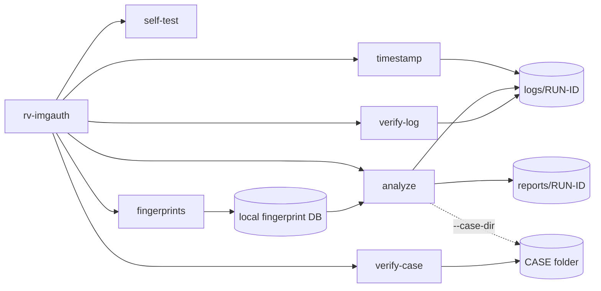

# Command-line reference

<!-- Generated by `rv-imgauth docs-cli`. Do not edit by hand: CI fails if this file differs. -->



## rv-imgauth

```text
DESCRIPTION:
  rv-imgauth looks for signals that a photo or image was modified after it was captured. It
  reviews a single file, a whole folder (bulk) or a list of files. For every file it:
    1. opens the file read-only and hashes it in one pass with one or two algorithms;
    2. identifies the real file type from its signature; JPEG, HEIC, PNG and WebP images (by
       signature or extension) are examined in an isolated worker process, which re-hashes the
       bytes it reads and compares them with the first pass;
    3. turns what it saw into findings (signals with a severity, what they show and what they do
       not prove) and writes a technical review and a customer summary (HTML, PDF and JSON).
  Planned in this build (not yet implemented; every image gets the info finding
  ANALYSIS_NOT_IMPLEMENTED): structure and metadata checks, JPEG quantization-table
  fingerprints, error level analysis (ELA) and noise maps, copy-move detection and comparison
  with reference images from the same device. The options for them are accepted and audited.
  Each run also writes a statistics report and an audit trail under <OUT>/logs/<RUN-ID>/. Every
  action is appended to a hash-chained log that `rv-imgauth verify-log` can check later.
  The result is a set of signals for an examiner, never a verdict that an image is authentic or
  manipulated.

  CASE FOLDER (--case-dir): Rakvor tools share one folder per case. rv-hashinv, the intake tool,
  registers each evidence file once (evidence ids E0001, E0002, ...). rv-imgauth is an analysis
  tool:
  before analysing an image it re-hashes it and verifies it against that registry, so the reports
  prove the examined file is bit-identical to the registered one. `rv-imgauth verify-case <CASE>`
  checks the whole case.

Usage: rv-imgauth <COMMAND>

Commands:
  analyze       Look for signals of modification in images (a file, a folder or a list) and write
                the reports
  fingerprints  Manage the local fingerprint database (learn, list, export). Offline only
  verify-log    Verify that an audit log (audit.jsonl) has not been edited, truncated or re-ordered,
                and check every RFC 3161 timestamp token of the run (imprint and the TSA's CMS
                signature)
  self-test     Check every hash algorithm against known-answer test vectors
  timestamp     Add an RFC 3161 timestamp to a finished run (e.g. after working offline)
  verify-case   Verify a whole case folder: case log, evidence registry and every run's audit log
  help          Print this message or the help of the given subcommand(s)

Options:
  -h, --help
          Print help (see a summary with '-h')

  -V, --version
          Print version

Run `rv-imgauth <COMMAND> --help` for the options, examples and exit codes of each command.
```

## rv-imgauth analyze

```text
DESCRIPTION:
  rv-imgauth looks for signals that a photo or image was modified after it was captured. It
  reviews a single file, a whole folder (bulk) or a list of files. For every file it:
    1. opens the file read-only and hashes it in one pass with one or two algorithms;
    2. identifies the real file type from its signature; JPEG, HEIC, PNG and WebP images (by
       signature or extension) are examined in an isolated worker process, which re-hashes the
       bytes it reads and compares them with the first pass;
    3. turns what it saw into findings (signals with a severity, what they show and what they do
       not prove) and writes a technical review and a customer summary (HTML, PDF and JSON).
  Planned in this build (not yet implemented; every image gets the info finding
  ANALYSIS_NOT_IMPLEMENTED): structure and metadata checks, JPEG quantization-table
  fingerprints, error level analysis (ELA) and noise maps, copy-move detection and comparison
  with reference images from the same device. The options for them are accepted and audited.
  Each run also writes a statistics report and an audit trail under <OUT>/logs/<RUN-ID>/. Every
  action is appended to a hash-chained log that `rv-imgauth verify-log` can check later.
  The result is a set of signals for an examiner, never a verdict that an image is authentic or
  manipulated.

  CASE FOLDER (--case-dir): Rakvor tools share one folder per case. rv-hashinv, the intake tool,
  registers each evidence file once (evidence ids E0001, E0002, ...). rv-imgauth is an analysis
  tool:
  before analysing an image it re-hashes it and verifies it against that registry, so the reports
  prove the examined file is bit-identical to the registered one. `rv-imgauth verify-case <CASE>`
  checks the whole case.

Usage: rv-imgauth analyze [OPTIONS]

Options:
  -i, --input <PATH>
          File or folder to review. Repeat for several.
          
          Folders are reviewed one level deep unless --recursive is given. Symbolic links are not
          followed.
          Default: none (required unless --input-list, --case-dir or --evidence is given).
          Example: --input D:\evidence --input E:\phone-export\chat.txt

  -L, --input-list <FILE>
          Text file with one path per line (bulk review). Lines starting with # are ignored.
          
          Relative paths are resolved from the list file's folder.
          Default: none. Example: --input-list case-014-files.txt

  -r, --recursive
          Also review files in subfolders.
          
          Default: off (only the first level of each folder). Example: -i D:\evidence --recursive

  -H, --hash <ALGO>
          Hash algorithm(s): one or two of md5, sha1, sha256, sha512, sha3-256, blake3.
          
          Both are computed in the same read of each file. More than two is refused (exit code 2).
          Default: sha256. Example: --hash sha256,md5   or   --hash sha256 --hash blake3

  -o, --out <DIR>
          Folder where logs/ and reports/ are created. Created if missing. Ignored with --case-dir.
          
          Default: ./rakvor-out. Example: --out E:\case-014\rv-imgauth

  -l, --lang <LANG>
          Report language: en, es, fr, or all (one HTML and PDF per language).
          
          JSON reports are language-neutral.
          Default: en. Example: --lang es   or   --lang all

  -a, --actor <NAME>
          Name of the examiner, written in every audit entry and report.
          
          Default: the operating-system user name. Example: --actor "Ana Ruiz"

  -c, --case <ID>
          Case or engagement identifier printed on the reports. With --case-dir it names the case
          when the folder is created, and must match case.json afterwards (it can be left out).
          Default: none. Example: --case CASE-2026-014

  -p, --progress <MODE>
          How progress is shown: bar, jsonl or none.
          
          Default: bar (hidden automatically when stderr is not a terminal).
          Example: --progress jsonl

          Possible values:
          - bar:   Progress bar with elapsed time, throughput and ETA on stderr
          - jsonl: One JSON event per line on stdout (for scripts and other tools)
          - none:  No progress output; only the final summary

  -j, --jurisdiction <CC>
          Chain-of-custody form per item: co (Colombia, Fiscalía style, Spanish) or fr (France,
          scellés, French). An English copy is always added. With --case-dir the case's
          jurisdiction applies.
          Default: co
          Example: --jurisdiction fr

      --tsa-url <URL>
          RFC 3161 time-stamping authority for the audit chain head.
          Default: http://timestamp.digicert.com
          Example: --tsa-url https://freetsa.org/tsr

      --no-timestamp
          Do not request a trusted timestamp (offline labs). Also set by RV_NO_TIMESTAMP=1.
          Default: off (a timestamp is requested)
          Example: --no-timestamp

      --sign-cert <P12>
          Examiner's certificate (.p12/.pfx, RSA) used to sign every PDF report. The password is
          read from the environment variable named by --sign-pass-env, or asked for interactively
          on the terminal without echo.
          Default: none (PDFs are not signed)
          Example: --sign-cert C:\certs\ana-ruiz.p12

      --sign-pass-env <VAR>
          Environment variable holding the certificate password.
          Default: RV_SIGN_PASSWORD
          Example: --sign-pass-env CERT_PASS

      --maps <LIST>
          Analysis maps written per image under <ITEM>/maps/: ela, noise (comma-separated or
          repeated), or none. Planned in this build: accepted and audited, no map is written yet.
          Default: ela,noise
          Example: --maps noise   or   --maps none

      --copy-move <ON|OFF>
          Look for regions copied and pasted within the same image (copy-move): on or off.
          Planned in this build.
          Default: on
          Example: --copy-move off

      --ela-quality <Q>
          JPEG quality used to re-compress each image for error level analysis, 1 to 100.
          Planned in this build.
          Default: 95
          Example: --ela-quality 90

      --max-pixels <N>
          Images with more pixels than this are not decoded (protection against decompression
          bombs), 1000000 to 2000000000.
          Default: 100000000 (100 megapixels)
          Example: --max-pixels 250000000

      --reference <FILE>
          Reference image (a known original from the same device) to compare with. Repeat for
          several. Read-only; its SHA-256 is recorded. Planned in this build.
          Default: none
          Example: --reference ref/IMG_0040.jpg --reference ref/IMG_0041.jpg

      --worker-timeout <SECS>
          Seconds a worker process may spend on one image before it is stopped (PARSER_FAILED).
          Default: 120
          Example: --worker-timeout 600

      --worker-memory <MB>
          Memory limit of one worker process in MiB (address space on Linux/macOS, job on Windows).
          Default: 2048
          Example: --worker-memory 4096

      --fingerprints-db <FILE>
          Extra fingerprint database (JSON, as written by `fingerprints export`),
          used with the bundled and local databases. Its name, version and SHA-256 are reported.
          Default: none (bundled starter DB + local learned DB)
          Example: --fingerprints-db case-014-fingerprints.json

      --item-reports <WHICH>
          Per-item report files for every item (all) or only for items with findings above info
          (flagged). Skipped items are still listed in the statistics report; each skip is audited.
          Default: all
          Example: --item-reports flagged

      --case-dir <DIR>
          Shared case folder that links the Rakvor tools of one case (see docs/case-folder.md).
          Every item is verified against <DIR>/evidence/registry.json (written by the intake tool,
          rv-hashinv) before it is analysed; outputs go to <DIR>/runs/rv-imgauth/<RUN-ID>/ and the
          run is recorded in <DIR>/case-log.jsonl. With no --input, every registered item is
          analysed.
          Default: none (standalone run in --out)
          Example: --case-dir E:\CASE-014

  -E, --evidence <IDS>
          Registered evidence ids to analyse (needs --case-dir), comma-separated or repeated.
          Default: none (the --input files, or every registered item)
          Example: --evidence E0001,E0007

      --intake <INTAKE>
          Register the evidence with the intake tool first: hashinv runs RV HashInv
          (`rv-hashinv scan --case-dir`) on the same --input/--input-list, so the case gets its hash
          inventory, hash reports and evidence registry from rv-hashinv itself; then every item is
          analysed and verified against that registry. Needs --case-dir; not with --evidence.
          rv-hashinv is searched in: --hashinv-exe, RV_HASHINV, next to rv-imgauth, the RV HashInv
          install folder, PATH. Its path, version and SHA-256 go into this run's audit log.
          Default: none. Example: --case-dir E:\CASE-014 --case CASE-014 -i D:\evidence -r --intake
          hashinv

      --hashinv-exe <EXE>
          rv-hashinv executable for --intake hashinv (needs version 0.3.0 or later).
          Default: searched (see --intake). Example: --hashinv-exe "C:\Tools\RV
          HashInv\rv-hashinv.exe"

  -h, --help
          Print help (see a summary with '-h')

EXAMPLES:
  Review one photo (SHA-256, English reports):
    rv-imgauth analyze --input evidence/IMG_0042.jpg
  Review a folder and its subfolders with SHA-256 + MD5, Spanish reports, for case CASE-2026-014:
    rv-imgauth analyze -i D:\evidence -r --hash sha256,md5 --lang es --case CASE-2026-014
  Review the files listed in a text file, reports in the three languages, machine-readable progress:
    rv-imgauth analyze --input-list files.txt --lang all --progress jsonl > events.jsonl
  Large batch: noise map only, no copy-move, reports only for flagged items:
    rv-imgauth analyze -i E:\phone-export -r --maps noise --copy-move off --item-reports flagged
  Compare with known originals from the same camera:
    rv-imgauth analyze -i IMG_0042.jpg --reference ref/IMG_0040.jpg --reference ref/IMG_0041.jpg
  Verify the audit log afterwards:
    rv-imgauth verify-log rakvor-out/logs/<RUN-ID>/audit.jsonl
  Analyse every item registered in a case folder (after rv-hashinv intake), then verify the case:
    rv-imgauth analyze --case-dir E:\CASE-014
    rv-imgauth verify-case E:\CASE-014
  Analyse two registered items of the case only:
    rv-imgauth analyze --case-dir E:\CASE-014 --evidence E0001,E0002

EXIT CODES:
  0    Completed; no high-severity finding.
  1    Runtime error (input not found, output not writable, case log locked, ...).
       See the audit log.
  2    Usage error (unknown option, more than two hash algorithms, unsupported language).
       With --case-dir: folder of another case or schema, --case missing when creating the
       case, unknown evidence id.
  3    Completed with at least one high-severity finding (e.g. an image that could not be
       analysed, evidence that changed during the run or differs from the case registry), or
       the case folder fails verification (nothing is written to it).
  130  Cancelled with Ctrl+C. Partial reports and the cancellation are written to the audit log.

FILES WRITTEN:
  <OUT>/logs/<RUN-ID>/audit.jsonl          Hash-chained log of every action (one JSON object/line).
  <OUT>/logs/<RUN-ID>/audit.log            The same actions, human-readable.
  <OUT>/logs/<RUN-ID>/hashes.csv           Hash register: index, path, size, digests, status.
  <OUT>/logs/<RUN-ID>/environment.json     Tool and dependency versions, OS, host, user, arguments.
  <OUT>/logs/<RUN-ID>/timestamp-<SEQ>.tsr  RFC 3161 token for the audit chain head (+ .json).
  <OUT>/reports/<RUN-ID>/statistics.json   Run statistics (+ statistics.<LANG>.html and .pdf).
  <ITEM> = <OUT>/reports/<RUN-ID>/items/<NNNNN>-<NAME>:
  <ITEM>/technical.json|.<LANG>.html|.pdf  Technical review (image analysis, fingerprint databases,
                                           maps, every file written for the item).
  <ITEM>/summary.json|.<LANG>.html|.pdf    Customer summary.
  <ITEM>/custody.json|.<es|fr|en>.html|.pdf  Chain-of-custody form.
  <ITEM>/maps/*.png                        Analysis maps (ELA, noise, copy-move; planned in this
                                           build).
  Every file under <ITEM> is hashed with the selected algorithms and recorded in the audit log.
  With --case-dir <CASE>, logs/ and reports/ go to <CASE>/runs/rv-imgauth/<RUN-ID>/, and:
  <CASE>/case-log.jsonl                    Hash-chained case log of every tool: run_started and
                                           run_finished of this run are appended to it.
  <CASE>/case.json                         Case id and jurisdiction (only if the folder is new).
  The evidence registry (<CASE>/evidence/registry.json) is read, never written, by rv-imgauth.

FORENSIC NOTES:
  - Evidence is opened read-only and never modified; modification times are compared before and
    after.
  - Work on a verified copy (write-blocked image or export), not on original media.
  - Findings are signals, not a verdict: an image without findings is not proven authentic, and a
    finding does not prove manipulation. Read "What it does not prove" and the Limitations
    section.
  - Images are analysed in a separate worker process with a time and memory limit, and images
    larger than --max-pixels are not decoded (decompression bombs).
  - Metadata (EXIF, XMP) and software strings are written by the device or program that saved the
    file and can be forged; re-saving, resizing or sending through a messenger destroys most
    traces.
  - Each audit entry stores the SHA-256 of the previous one; editing, deleting or re-ordering any
    line is detected by `verify-log`. Keep the log folder with the reports.
  - MD5 and SHA-1 are accepted for compatibility with older case files; pair them with SHA-256 or
    BLAKE3.
  - The chain head is timestamped by an RFC 3161 authority (proves when the log existed). Offline?
    The run finishes with `timestamp_pending`; run `rv-imgauth timestamp <LOG>` later.
  - With --sign-cert every PDF report is signed with the examiner's certificate; the password is
    never logged.
  - Case folder: every item is compared with the registry (by --evidence id, else by path, else
    by content) before it is analysed; a different hash is the high finding
    EVIDENCE_HASH_MISMATCH_WITH_CASE (the analysis still runs), a file not in the registry is
    EVIDENCE_NOT_IN_CASE_REGISTRY (medium). If no selected algorithm is in the registry, SHA-256
    (or another registry algorithm) is added and logged as case_algorithm_added.
  - The case log and registry digest are re-verified before every write; a broken case is
    refused (exit 3). Appends happen under case-log.lock; a lock older than 10 minutes is
    reported as stale and never deleted automatically.
  - Each run's audit.jsonl records case_linked (the case-log entry it started from); the case
    log records the run's final audit head, so the two chains vouch for each other.
```

## rv-imgauth fingerprints

```text
Manage the local fingerprint database (learn, list, export). Offline only

Usage: rv-imgauth fingerprints <COMMAND>

Commands:
  learn   Learn a device, app or editor from known-original images and add it to the local database
  list    List the entries of the fingerprint databases with their version and SHA-256
  export  Write a database to a JSON file (for --fingerprints-db elsewhere, or for disclosure)
  help    Print this message or the help of the given subcommand(s)

Options:
  -h, --help
          Print help (see a summary with '-h')

DESCRIPTION:
  Fingerprints recognise the camera, phone, app or editor that wrote an image (planned in this
  build: JPEG quantization tables and software strings). Three databases are used by `analyze`:
  the bundled starter DB, the local DB learned on this workstation and, optionally,
  --fingerprints-db FILE. The local DB lives in
  %LOCALAPPDATA%\Rakvor\rv-imgauth\fingerprints.local.json (Windows) or
  $XDG_DATA_HOME/rakvor/rv-imgauth/ (default ~/.local/share/rakvor/rv-imgauth/) on Linux/macOS.
  Nothing is ever sent anywhere: learning only reads the files you name.

EXAMPLES:
  rv-imgauth fingerprints learn originals/*.jpg --label "Phone X camera" --category camera
  rv-imgauth fingerprints list --db local
  rv-imgauth fingerprints export --out lab-fingerprints-2026-10.json
```

### rv-imgauth fingerprints learn

```text
Learn a device, app or editor from known-original images and add it to the local database

Usage: rv-imgauth fingerprints learn [OPTIONS] --label <TEXT> --category <CAT> <IMAGE>...

Arguments:
  <IMAGE>...
          Known-original images made with the device or tool to learn (read-only; never modified).
          Default: none (at least one is required)
          Example: originals/IMG_0001.jpg originals/IMG_0002.jpg

Options:
      --label <TEXT>
          Name of the tool as it should appear in reports.
          Default: none (required)
          Example: --label "Phone X camera"

      --category <CAT>
          Category: camera, os, app, editor, messenger or library.
          Default: none (required)
          Example: --category camera

  -c, --case <ID>
          Case the originals come from, written in the entry's source and the audit log.
          Default: none
          Example: --case CASE-2026-014

  -a, --actor <NAME>
          Examiner written in the audit log.
          Default: the operating-system user name
          Example: --actor "Ana Ruiz"

  -h, --help
          Print help (see a summary with '-h')

DESCRIPTION:
  Reads each image read-only, takes what identifies the software or device that wrote it and adds
  one entry `local-<label>` to the local database. Several files: only what all files share is
  kept. Learning the same label again merges into the existing entry. Nothing is written if any
  file fails. Planned in this build: image parsing is not implemented yet, so learning reports an
  error and leaves the database unchanged.

FILES WRITTEN:
  <LOCAL-DB-FOLDER>/fingerprints.local.json    The local database (version incremented).
  <LOCAL-DB-FOLDER>/fingerprints.audit.jsonl   Hash-chained log of every change: files and their
                                               SHA-256, DB SHA-256 before and after, examiner, case.

FORENSIC NOTES:
  - Learn only from files whose origin you can prove (taken by you with the device, or vendor
    samples).
  - Software strings can be forged; a match is a signal about the software, not about a person.
  - The DB SHA-256 printed here appears in every report that used the database.

EXAMPLES:
  rv-imgauth fingerprints learn IMG_0001.jpg --label "Phone X camera" --category camera
  rv-imgauth fingerprints learn a.jpg b.jpg --label "Messenger Y" --category messenger --case LAB-01

EXIT CODES:
  0  Learned (or merged); DB SHA-256 before/after printed.
  1  A file is unreadable or cannot be learned from; or the DB cannot be written.
  2  Usage error (unknown category, missing --label).
```

### rv-imgauth fingerprints list

```text
List the entries of the fingerprint databases with their version and SHA-256

Usage: rv-imgauth fingerprints list [OPTIONS]

Options:
      --db <DB>
          Which database: local (learned on this workstation), starter (bundled) or all.
          Default: all
          Example: --db local

  -h, --help
          Print help (see a summary with '-h')

EXAMPLES:
  rv-imgauth fingerprints list
  rv-imgauth fingerprints list --db local

EXIT CODES:
  0  Listed.
  1  The local database cannot be read.
```

### rv-imgauth fingerprints export

```text
Write a database to a JSON file (for --fingerprints-db elsewhere, or for disclosure)

Usage: rv-imgauth fingerprints export [OPTIONS] --out <FILE>

Options:
      --out <FILE>
          File to create. An existing file is never overwritten.
          Default: none (required)
          Example: --out lab-fingerprints-2026-10.json

      --db <DB>
          Which database: local or starter.
          Default: local
          Example: --db starter

  -h, --help
          Print help (see a summary with '-h')

EXAMPLES:
  rv-imgauth fingerprints export --out lab-fingerprints-2026-10.json
  rv-imgauth fingerprints export --db starter --out starter.json

EXIT CODES:
  0  Written; its SHA-256 is printed.
  1  The output already exists (never overwritten) or the local database does not exist.
```

## rv-imgauth verify-log

```text
Verify that an audit log (audit.jsonl) has not been edited, truncated or re-ordered, and check every
RFC 3161 timestamp token of the run (imprint and the TSA's CMS signature)

Usage: rv-imgauth verify-log [OPTIONS] <LOG>

Arguments:
  <LOG>
          Path to audit.jsonl, or to the run's log folder that contains it.
          
          Example: rakvor-out/logs/20261019T101500Z-a1b2c3

Options:
      --tsa-ca <FILE>
          CA bundle (PEM, one or more certificates, or one DER certificate) that the TSA certificate
          must chain to. Obtain it from the TSA's own repository, not from the token.
          Default: none (the TSA signature is checked, the chain is not validated)
          Example: --tsa-ca C:\certs\tsa-roots.pem

  -h, --help
          Print help (see a summary with '-h')

EXAMPLES:
  rv-imgauth verify-log rakvor-out/logs/20261019T101500Z-a1b2c3/audit.jsonl
  rv-imgauth verify-log rakvor-out/logs/20261019T101500Z-a1b2c3
  rv-imgauth verify-log rakvor-out/logs/20261019T101500Z-a1b2c3 --tsa-ca digicert-tsa-roots.pem

TIMESTAMP CHECKS:
  For each timestamp-<N>.tsr: the token covers the chain head of entry N; the TSA's CMS signature is
  valid (signer certificate in the token, ESS signing-certificate binding, message digest over the
  TSTInfo, RSA signature, timeStamping key usage). Without --tsa-ca the output says "chain not
  validated"; with it the TSA certificate must chain to a certificate of the bundle (signatures,
  validity at the token's time, CA flag). Revocation is not checked.

EXIT CODES:
  0  The chain is intact and every timestamp token verifies.
  1  The log or the --tsa-ca file cannot be read.
  3  The chain is broken (an entry was edited, deleted or re-ordered), or a timestamp token does not
     verify (altered token, invalid TSA signature, chain not trusted by --tsa-ca).
```

## rv-imgauth self-test

```text
Check every hash algorithm against known-answer test vectors

Usage: rv-imgauth self-test

Options:
  -h, --help
          Print help (see a summary with '-h')

EXAMPLES:
  rv-imgauth self-test

EXIT CODES:
  0  All algorithms give the published answer for the input "abc".
  1  At least one algorithm failed: do not use this build for evidence.
```

## rv-imgauth timestamp

```text
Add an RFC 3161 timestamp to a finished run (e.g. after working offline)

Usage: rv-imgauth timestamp [OPTIONS] <LOG>

Arguments:
  <LOG>
          The run's log folder (or its audit.jsonl).
          
          Example: rakvor-out/logs/20261019T101500Z-a1b2c3

Options:
      --tsa-url <URL>
          RFC 3161 time-stamping authority.
          Default: http://timestamp.digicert.com
          Example: --tsa-url https://freetsa.org/tsr

  -a, --actor <NAME>
          Name written in the new audit entry.
          Default: the operating-system user name
          Example: --actor "Ana Ruiz"

  -h, --help
          Print help (see a summary with '-h')

EXAMPLES:
  rv-imgauth timestamp rakvor-out/logs/20261019T101500Z-a1b2c3
  rv-imgauth timestamp rakvor-out/logs/20261019T101500Z-a1b2c3 --tsa-url https://freetsa.org/tsr

EXIT CODES:
  0  Timestamp obtained and logged.
  1  The TSA could not be reached (nothing changed; try again).
  3  The log is broken: no timestamp is added to a broken chain.
```

## rv-imgauth verify-case

```text
Verify a whole case folder: case log, evidence registry and every run's audit log

Usage: rv-imgauth verify-case <CASE>

Arguments:
  <CASE>
          The case folder (the one that holds case.json).
          
          Example: E:\CASE-014

Options:
  -h, --help
          Print help (see a summary with '-h')

CHECKS:
  - case-log.jsonl is an intact hash chain starting with case_created; case.json is unchanged;
  - evidence/registry.json has the SHA-256 recorded at the last registry change;
  - every run announced in the case log (by any Rakvor tool) has an intact audit.jsonl (and
    valid timestamp tokens), its case_linked entry points to its run_started entry, and the
    audit head recorded at run_finished is its final entry (only timestamp_obtained may follow).

EXAMPLES:
  rv-imgauth verify-case E:\CASE-014

EXIT CODES:
  0  The case folder is intact (warnings, e.g. a run still in progress, are printed).
  1  The folder is not a case folder (no case.json).
  3  At least one check failed: the case was edited, truncated or re-ordered.
```

