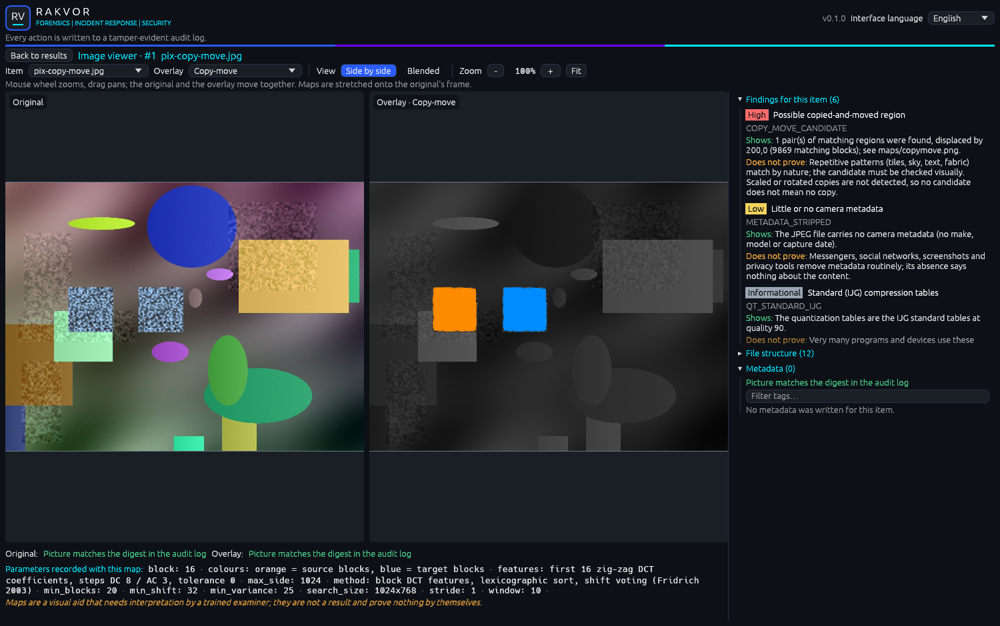
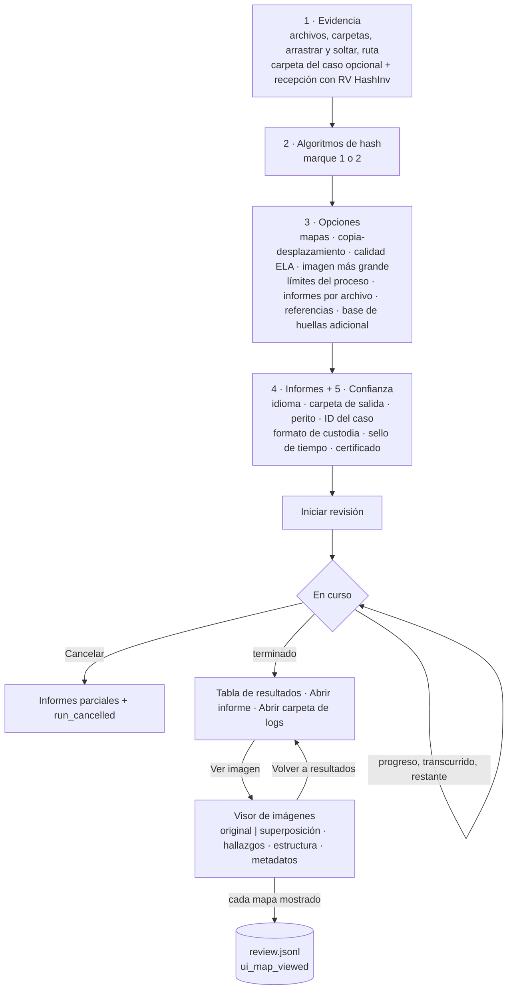

> La versión de referencia es la inglesa ([usage-gui.md](usage-gui.md)); esta traducción la sigue.

# Uso de la aplicación de escritorio (Windows 10/11)

Inicie **RV ImgAuth** desde el menú Inicio (instalador) o haga doble clic en `rv-imgauth-gui.exe` (zip portable). La
ventana y los ejecutables llevan el icono de Rakvor. No hace falta ningún otro programa; la aplicación también funciona
en máquinas virtuales sin controlador gráfico (renderizado por software).



## Flujo de trabajo



## La ventana

| Zona | Qué hace |
| --- | --- |
| **1. Evidencia** | *Agregar archivos…* y *Agregar carpeta…*, arrastrar y soltar en la ventana (o en el icono del ejecutable), o pegar una ruta y pulsar Enter. *Incluir subcarpetas* está activada por defecto. *Carpeta del caso* vincula la ejecución a un caso compartido ([case-folder.md](case-folder.md), en inglés); una vez definida, *Registrar primero la evidencia con RV HashInv* ejecuta rv-hashinv antes del análisis (se muestra la versión encontrada; al pasar el ratón, su ruta y su SHA-256; en rojo cuando no se puede usar ninguna). |
| **2. Algoritmos de hash** | Marque uno o dos; no se puede desmarcar el último. |
| **3. Opciones** | Análisis de imagen, límites, referencias (tabla siguiente). |
| **4. Informes** | Idioma de los informes (English, Español, Français o los tres), carpeta de salida (bloqueada en la carpeta del caso cuando hay una), perito, ID del caso. |
| **5. Confianza** | *Formato de custodia* (Colombia / Francia), *Sello de tiempo confiable* (activado por defecto), certificado de firma y su contraseña (solo en memoria, nunca se registra). |
| **Idioma de la interfaz** | Selector arriba a la derecha; independiente del idioma de los informes. |
| **Iniciar revisión / Cancelar** | Durante una ejecución los ajustes quedan bloqueados y el botón pasa a ser *Cancelar*. |
| **Progreso** | Barra por bytes, archivos hechos / total, tiempo transcurrido y tiempo restante estimado; el archivo actual. Durante una recepción: *Ingreso (RV HashInv): n/N archivos*. |
| **Resultado** | Conteos por severidad, **Abrir informe**, **Abrir carpeta de logs**, **Abrir informe de hashes** (tras una recepción) y la tabla **Resultados**: archivo, estado (ok / atención / problema), número de hallazgos con la severidad más alta, número de mapas, ID de evidencia en un caso, y **Ver imagen**. |

### 3. Opciones

Cada opción corresponde 1:1 a la opción de la línea de comandos del mismo nombre ([usage.es.md](usage.es.md#3-opciones-del-análisis)).

| Opción | Por defecto | Equivalente en la CLI |
| --- | --- | --- |
| Mapas de análisis: *Nivel de error (ELA)*, *Ruido*, *Fantasmas JPEG* | ELA y Ruido | `--maps` |
| *Detección de copia-desplazamiento* | activada | `--copy-move` |
| *Calidad JPEG para ELA* (valores 75, 85, 90, 95, 100) | 95 | `--ela-quality` |
| *Imagen más grande* (valores 25, 50, 100, 200, 500, 1000 Mpx) | 100 Mpx | `--max-pixels` (la capa de imagen nunca decodifica más de 120 Mpx: los valores por encima no tienen efecto) |
| *Límites del proceso de análisis*: tiempo (s) y memoria (MB) | 120 s / 2048 MB | `--worker-timeout`, `--worker-memory` |
| *Informes por archivo*: Todos los archivos / Solo archivos señalados | Todos los archivos | `--item-reports` |
| *Imágenes de referencia*: escriba una ruta y pulse Intro (varias separadas por `;`), *Añadir referencia*, *Examinar…*, quite con **x** | ninguna | `--reference` (repetida) |
| *Base de huellas adicional* | ninguna | `--fingerprints-db` |

Las opciones numéricas se eligen de valores predefinidos (el valor actual siempre aparece en la lista), de modo que
cada elección es un único cambio registrado.

## Visor de imágenes

**Ver imagen** en una fila de resultados abre el visor para ese elemento. Se construye a partir de las salidas de la
propia ejecución (la vista previa `maps/original.png`, los mapas, `structure.json`, `metadata.json` y los hallazgos),
nunca a partir de la evidencia.

| Control | Qué hace |
| --- | --- |
| *Volver a resultados* | Vuelve a la tabla de resultados |
| *Archivo* | Cambia a otro elemento de la ejecución |
| *Superposición* (selector de mapa) | Nivel de error (ELA) · Residuo de ruido · Nivel de ruido (σ) · Copia-movimiento · Fantasma JPEG qNN · Diferencia con la miniatura; solo los mapas escritos para este elemento |
| *Vista*: **Lado a lado** | El original a la izquierda, la superposición a la derecha, con **un único zoom y desplazamiento compartidos**: la misma región queda bajo el cursor en ambos lados |
| *Vista*: **Superpuesto** | La superposición dibujada sobre el original, con un control deslizante *Opacidad del mapa* |
| *Zoom* (−, +, *Ajustar*) | Del 50 % al 1600 %; la rueda del ratón amplía en el cursor, arrastrar desplaza, el doble clic restablece |
| Lectura del píxel | Bajo las imágenes: *Píxel x, y* del original bajo el cursor y el píxel correspondiente de la superposición (los mapas de otro tamaño, como el mapa σ a media resolución, se ajustan al marco del original) |
| Control de hash | Para la vista previa del original y para la superposición: *La imagen coincide con el hash del registro de auditoría* (verde), *NO coincide* (rojo: el archivo cambió tras la ejecución) o *Sin hash auditado* (gris) |
| *Parámetros registrados con este mapa* | Los parámetros del mapa tal como figuran en el informe (calidad, ganancia, codificador y versión, tamaños de bloque, umbrales) |
| Frase fija | "Los mapas son una ayuda visual que debe interpretar un examinador capacitado; no son un resultado ni prueban nada por sí solos." |

El panel de la derecha tiene tres secciones plegables:

- **Hallazgos de este archivo**, los más graves primero, cada uno con *Muestra* y *No demuestra* en el idioma de la
  interfaz;
- **Estructura del archivo**: el árbol de marcadores / chunks / boxes con *Elemento*, *Desplazamiento* y *Longitud*
  a partir de `structure.json`;
- **Metadatos**: una tabla filtrable *Grupo / Etiqueta / Valor* a partir de `metadata.json`, el **Historial de edición
  XMP** y los problemas encontrados al leer (*No se pudo leer*).

Cuando no hay vista previa, el visor dice por qué: esta versión no decodifica los píxeles HEIC; los píxeles no se
pudieron decodificar; la imagen supera *Imagen más grande*; o el archivo no es una imagen.

### El registro de revisión

La visualización forma parte del registro. Cada vez que se muestra un mapa para un (elemento, mapa, modo de vista)
que no se había mostrado antes, la GUI agrega una entrada **`ui_map_viewed`** al **`review.jsonl`** de la ejecución
revisada, junto a su `audit.jsonl`:

```json
{"seq": 1, "at_utc": "…", "actor": "…", "action": "ui_map_viewed", "run_id": "20261028T…",
 "anchor_seq": 209, "anchor_hash": "<entry_hash of run_finished>", "prev_entry_hash": "<same>",
 "details": {"item": "pix-copy-move.jpg", "index": 8, "evidence_id": null, "map": "maps/copymove.png",
             "map_kind": "copy_move", "mode": "side_by_side", "opacity": null, "original_shown": true,
             "map_digest": {"algorithm": "sha256", "value": "…"}, "run_id": "20261028T…"},
 "entry_hash": "…"}
```

`review.jsonl` es una cadena de hashes propia, anclada a la entrada `run_finished` de la ejecución (la cadena de
auditoría de la ejecución ya está cerrada en ese momento). `rv-imgauth verify-log` y `verify-case` la comprueban
("review entries: N"); una entrada editada, reordenada o ajena las hace fallar con el código 3. Si el registro de
revisión no se puede escribir (el log de auditoría de la ejecución ya no se verifica, o la carpeta es de solo
lectura), la línea de estado lo indica y la visualización se registra en su lugar en el log de auditoría de la
siguiente ejecución.

## Apertura desde RV Hub

RV Hub abre la aplicación con la carpeta del caso ya completada: `rv-imgauth-gui.exe --case-dir <CASE> [FILES...]`
(o `--case-dir=<CASE>`). El log de auditoría empieza entonces con `ui_case_dir_from_launcher` (la ruta y `at_utc`); un
`--case-dir` sin carpeta se ignora, se indica en la ventana y se registra como `ui_launch_argument_ignored`.

## Qué registra la GUI

Antes de que empiece la ejecución, la GUI escribe cada elección en el log de auditoría de la ejecución, cada una con
su hora:

| Acción | Se registra como |
| --- | --- |
| Agregar / quitar evidencia, subcarpetas | `ui_input_added`, `ui_input_removed`, `ui_recursive_changed` |
| Carpeta del caso, recepción | `ui_case_dir_changed`, `ui_intake_changed` |
| Selección de hash, idioma de los informes, idioma de la interfaz | `ui_hash_selection_changed`, `ui_language_changed`, `ui_interface_language_changed` |
| Formato de custodia, sello de tiempo, certificado | `ui_jurisdiction_changed`, `ui_timestamp_changed`, `ui_signing_certificate_changed` |
| Opciones | `ui_maps_changed`, `ui_copy_move_changed`, `ui_ela_quality_changed`, `ui_max_pixels_changed`, `ui_references_changed`, `ui_worker_timeout_changed`, `ui_worker_memory_changed`, `ui_fingerprints_db_changed`, `ui_item_reports_changed` |
| Abierta por RV Hub con `--case-dir` | `ui_case_dir_from_launcher`, `ui_case_dir_changed` (o `ui_launch_argument_ignored`) |
| Iniciar | `ui_start_clicked` (ajustes finales, todas las opciones) |
| Cancelar | `item_cancelled`, `run_cancelled` |
| Tras la ejecución: mapas vistos | `ui_map_viewed` en el `review.jsonl` de la ejecución |

Los mensajes de validación anteriores a una ejecución no se registran (todavía no hay ejecución ni log).

## Mismos resultados que la línea de comandos

La GUI llama al mismo motor que `rv-imgauth analyze`. Una ejecución en la GUI con la misma evidencia y las mismas
opciones da hashes, hallazgos y mapas idénticos; `environment.json` registra `"frontend": "gui"`.
