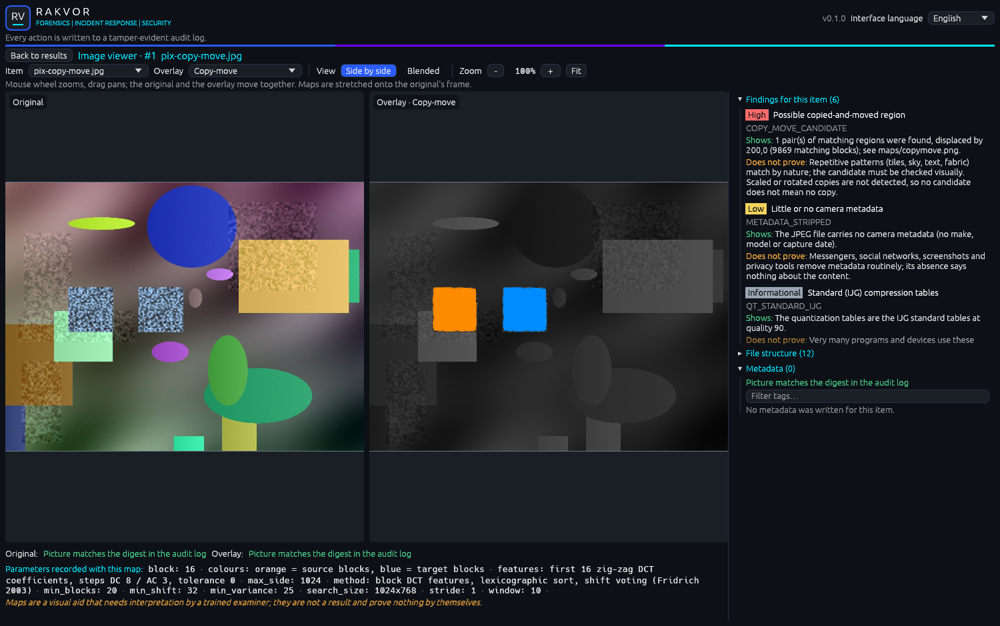
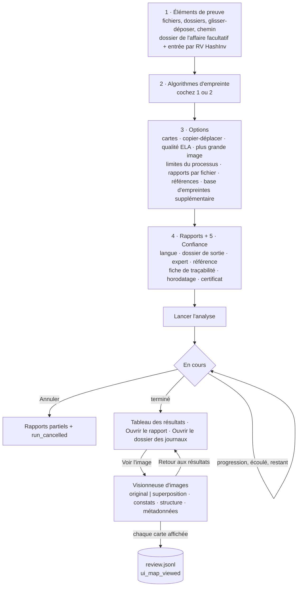

> La version de référence est la version anglaise ([usage-gui.md](usage-gui.md)) ; cette traduction la suit.

# Utiliser l'application de bureau (Windows 10/11)

Lancez **RV ImgAuth** depuis le menu Démarrer (programme d'installation) ou double-cliquez sur `rv-imgauth-gui.exe`
(zip portable). La fenêtre et les exécutables portent l'icône Rakvor. Aucun autre logiciel n'est nécessaire ;
l'application fonctionne aussi sur des machines virtuelles sans pilote graphique (rendu logiciel).



## Déroulement



## La fenêtre

| Zone | Ce qu'elle fait |
| --- | --- |
| **1. Éléments de preuve** | *Ajouter des fichiers…* et *Ajouter un dossier…*, glisser-déposer sur la fenêtre (ou sur l'icône de l'exécutable), ou coller un chemin et appuyer sur Entrée. *Inclure les sous-dossiers* est coché par défaut. *Dossier de l'affaire* rattache l'exécution à une affaire partagée ([case-folder.md](case-folder.md), en anglais) ; une fois défini, *Enregistrer d'abord les éléments de preuve avec RV HashInv* exécute rv-hashinv avant l'analyse (la version trouvée est affichée ; au survol, son chemin et son SHA-256 ; en rouge quand aucune n'est utilisable). |
| **2. Algorithmes d'empreinte** | Cochez-en un ou deux ; on ne peut pas décocher le dernier. |
| **3. Options** | Analyses d'image, limites, références (tableau ci-dessous). |
| **4. Rapports** | Langue des rapports (English, Español, Français ou les trois), dossier de sortie (verrouillé sur le dossier de l'affaire s'il y en a un), expert, référence du dossier. |
| **5. Confiance** | *Fiche de possession* (Colombie / France), *Horodatage qualifié* (activé par défaut), certificat de signature et son mot de passe (en mémoire seulement, jamais journalisé). |
| **Langue de l'interface** | Sélecteur en haut à droite ; indépendant de la langue des rapports. |
| **Lancer l'analyse / Annuler** | Pendant une exécution, les réglages sont verrouillés et le bouton devient *Annuler*. |
| **Progression** | Barre selon les octets, fichiers traités / total, temps écoulé et temps restant estimé ; le fichier en cours. Pendant une entrée : *Entrée (RV HashInv) : n/N fichiers*. |
| **Résultat** | Nombre par gravité, **Ouvrir le rapport**, **Ouvrir le dossier des journaux**, **Ouvrir le rapport d'empreintes** (après une entrée) et le tableau **Résultats** : fichier, état (ok / attention / problème), nombre de constatations avec la gravité la plus élevée, nombre de cartes, identifiant de l'élément dans une affaire, et **Voir l'image**. |

### 3. Options

Chaque option correspond 1:1 à l'option de la ligne de commande du même nom ([usage.fr.md](usage.fr.md#3-options-danalyse)).

| Option | Par défaut | Équivalent CLI |
| --- | --- | --- |
| Cartes d'analyse : *Niveau d'erreur (ELA)*, *Bruit*, *Fantômes JPEG* | ELA et Bruit | `--maps` |
| *Détection de copier-déplacer* | activée | `--copy-move` |
| *Qualité JPEG pour l'ELA* (valeurs 75, 85, 90, 95, 100) | 95 | `--ela-quality` |
| *Plus grande image* (valeurs 25, 50, 100, 200, 500, 1000 Mpx) | 100 Mpx | `--max-pixels` (la couche image ne décode jamais plus de 120 Mpx : les valeurs au-delà sont sans effet) |
| *Limites du processus d'analyse* : délai (s) et mémoire (Mo) | 120 s / 2048 Mo | `--worker-timeout`, `--worker-memory` |
| *Rapports par fichier* : Tous les fichiers / Fichiers signalés uniquement | Tous les fichiers | `--item-reports` |
| *Images de référence* : saisissez un chemin puis Entrée (plusieurs séparés par `;`), *Ajouter une référence*, *Parcourir…*, retirez avec **x** | aucune | `--reference` (répétée) |
| *Base d'empreintes supplémentaire* | aucune | `--fingerprints-db` |

Les options numériques se choisissent parmi des valeurs prédéfinies (la valeur actuelle est toujours listée) : chaque
choix est ainsi une seule modification consignée.

## Visionneuse d'images

**Voir l'image** sur une ligne des résultats ouvre la visionneuse pour cet élément. Elle est construite à partir des
sorties de l'exécution elle-même (l'aperçu `maps/original.png`, les cartes, `structure.json`, `metadata.json` et les
constatations), jamais à partir de l'élément de preuve.

| Contrôle | Ce qu'il fait |
| --- | --- |
| *Retour aux résultats* | Revient au tableau des résultats |
| *Fichier* | Passe à un autre élément de l'exécution |
| *Superposition* (sélecteur de carte) | Niveau d'erreur (ELA) · Résidu de bruit · Niveau de bruit (σ) · Copier-déplacer · Fantôme JPEG qNN · Différence avec la vignette ; seulement les cartes écrites pour cet élément |
| *Affichage* : **Côte à côte** | L'original à gauche, la superposition à droite, avec **un seul zoom et un seul déplacement partagés** : la même zone reste sous le curseur des deux côtés |
| *Affichage* : **Superposé** | La superposition dessinée sur l'original, avec un curseur *Opacité de la carte* |
| *Zoom* (−, +, *Ajuster*) | De 50 % à 1600 % ; la molette zoome sous le curseur, le glisser déplace, le double-clic réinitialise |
| Lecture du pixel | Sous les images : *Pixel x, y* de l'original sous le curseur, et le pixel correspondant de la superposition (les cartes d'une autre taille, comme la carte σ à demi-résolution, sont ajustées au cadre de l'original) |
| Contrôle d'empreinte | Pour l'aperçu de l'original et pour la superposition : *L'image correspond à l'empreinte du journal d'audit* (vert), *NE correspond PAS* (rouge : le fichier a changé après l'exécution) ou *Aucune empreinte auditée* (gris) |
| *Paramètres enregistrés avec cette carte* | Les paramètres de la carte tels qu'écrits dans le rapport (qualité, gain, encodeur et version, tailles de bloc, seuils) |
| Phrase fixe | « Les cartes sont une aide visuelle à interpréter par un examinateur formé ; elles ne sont pas un résultat et ne prouvent rien à elles seules. » |

Le panneau de droite a trois sections repliables :

- **Constats pour ce fichier**, les plus graves d'abord, chacun avec *Montre* et *Ne prouve pas* dans la langue de
  l'interface ;
- **Structure du fichier** : l'arbre des marqueurs / chunks / boxes avec *Élément*, *Position* et *Longueur* d'après
  `structure.json` ;
- **Métadonnées** : un tableau filtrable *Groupe / Balise / Valeur* d'après `metadata.json`, l'**Historique d'édition
  XMP** et les problèmes rencontrés à la lecture (*Illisible*).

Quand il n'y a pas d'aperçu, la visionneuse dit pourquoi : cette version ne décode pas les pixels HEIC ; les pixels
n'ont pas pu être décodés ; l'image dépasse *Plus grande image* ; ou le fichier n'est pas une image.

### Le journal de revue

La consultation fait partie du registre. Chaque fois qu'une carte est affichée pour un (élément, carte, mode
d'affichage) qui n'avait pas encore été affiché, la GUI ajoute une entrée **`ui_map_viewed`** au **`review.jsonl`** de
l'exécution examinée, à côté de son `audit.jsonl` :

```json
{"seq": 1, "at_utc": "…", "actor": "…", "action": "ui_map_viewed", "run_id": "20261028T…",
 "anchor_seq": 209, "anchor_hash": "<entry_hash of run_finished>", "prev_entry_hash": "<same>",
 "details": {"item": "pix-copy-move.jpg", "index": 8, "evidence_id": null, "map": "maps/copymove.png",
             "map_kind": "copy_move", "mode": "side_by_side", "opacity": null, "original_shown": true,
             "map_digest": {"algorithm": "sha256", "value": "…"}, "run_id": "20261028T…"},
 "entry_hash": "…"}
```

`review.jsonl` est une chaîne d'empreintes à part entière, ancrée à l'entrée `run_finished` de l'exécution (la chaîne
d'audit de l'exécution est alors close). `rv-imgauth verify-log` et `verify-case` la vérifient (« review entries:
N ») ; une entrée modifiée, réordonnée ou étrangère les fait échouer avec le code 3. Si le journal de revue ne peut pas
être écrit (le journal d'audit de l'exécution ne se vérifie plus, ou le dossier est en lecture seule), la ligne d'état
l'indique et la consultation est consignée à la place dans le journal d'audit de l'exécution suivante.

## Ouverture depuis RV Hub

RV Hub ouvre l'application avec le dossier de l'affaire déjà renseigné : `rv-imgauth-gui.exe --case-dir <CASE>
[FILES...]` (ou `--case-dir=<CASE>`). Le journal d'audit commence alors par `ui_case_dir_from_launcher` (le chemin et
`at_utc`) ; un `--case-dir` sans dossier est ignoré, signalé dans la fenêtre et journalisé comme
`ui_launch_argument_ignored`.

## Ce que la GUI consigne

Avant le début de l'exécution, la GUI écrit chaque choix dans le journal d'audit de l'exécution, chacun avec son
heure :

| Action | Journalisée comme |
| --- | --- |
| Ajouter / retirer des éléments, sous-dossiers | `ui_input_added`, `ui_input_removed`, `ui_recursive_changed` |
| Dossier de l'affaire, entrée | `ui_case_dir_changed`, `ui_intake_changed` |
| Sélection d'empreintes, langue des rapports, langue de l'interface | `ui_hash_selection_changed`, `ui_language_changed`, `ui_interface_language_changed` |
| Fiche de traçabilité, horodatage, certificat | `ui_jurisdiction_changed`, `ui_timestamp_changed`, `ui_signing_certificate_changed` |
| Options | `ui_maps_changed`, `ui_copy_move_changed`, `ui_ela_quality_changed`, `ui_max_pixels_changed`, `ui_references_changed`, `ui_worker_timeout_changed`, `ui_worker_memory_changed`, `ui_fingerprints_db_changed`, `ui_item_reports_changed` |
| Ouverte par RV Hub avec `--case-dir` | `ui_case_dir_from_launcher`, `ui_case_dir_changed` (ou `ui_launch_argument_ignored`) |
| Lancer | `ui_start_clicked` (réglages finaux, toutes les options) |
| Annuler | `item_cancelled`, `run_cancelled` |
| Après l'exécution : cartes consultées | `ui_map_viewed` dans le `review.jsonl` de l'exécution |

Les messages de validation avant une exécution ne sont pas journalisés (pas encore d'exécution, ni de journal).

## Mêmes résultats que la ligne de commande

La GUI appelle le même moteur que `rv-imgauth analyze`. Une exécution dans la GUI avec les mêmes éléments et les mêmes
options donne des empreintes, des constatations et des cartes identiques ; `environment.json` consigne
`"frontend": "gui"`.
