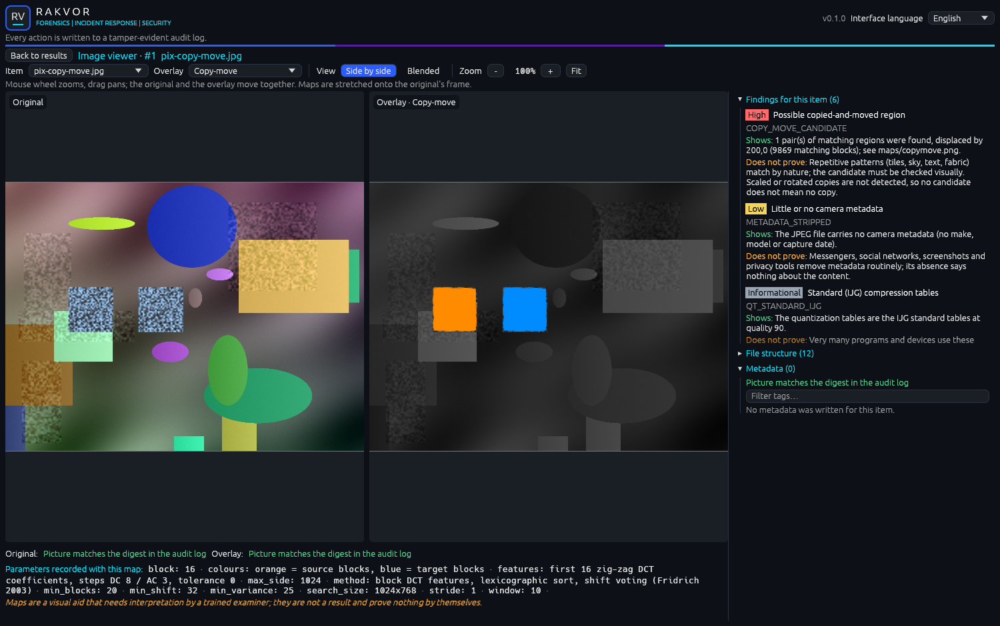
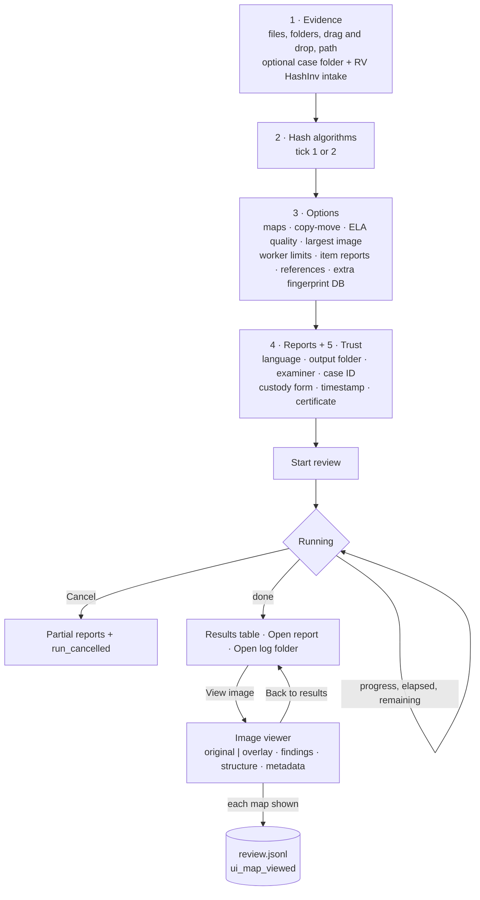

# Using the desktop app (Windows 10/11)

Start **RV ImgAuth** from the Start menu (installer) or double-click `rv-imgauth-gui.exe` (portable zip). The
window and the executables carry the Rakvor icon. No other software is required; the app also runs on virtual
machines without a graphics driver (software rendering).



## Workflow



## The window

| Area | What it does |
| --- | --- |
| **1. Evidence** | *Add files…* and *Add folder…*, drag and drop onto the window (or onto the executable's icon), or paste a path and press Enter. *Include subfolders* is on by default. *Case folder* links the run to a shared case ([case-folder.md](case-folder.md)); once set, *Register the evidence with RV HashInv first* runs rv-hashinv before the analysis (the version found is shown; hover for its path and SHA-256; in red when none can be used). |
| **2. Hash algorithms** | Tick one or two; you cannot untick the last one. |
| **3. Options** | Image analyses, limits, references (table below). |
| **4. Reports** | Report language (English, Español, Français or all three), output folder (locked to the case folder when one is set), examiner, case ID. |
| **5. Trust** | *Custody form* (Colombia / France), *Trusted timestamp* (on by default), signing certificate and its password (memory only, never logged). |
| **Interface language** | Top-right selector; independent of the report language. |
| **Start review / Cancel** | During a run the settings are locked and the button becomes *Cancel*. |
| **Progress** | Bar by bytes, files done / total, elapsed time and estimated time remaining; the current file. During an intake: *Intake (RV HashInv): n/N files*. |
| **Result** | Counts by severity, **Open report**, **Open log folder**, **Open hash report** (after an intake), and the **Results** table: file, status (ok / attention / problem), number of findings with the highest severity, number of maps, evidence id in a case, and **View image**. |

### 3. Options

Every option maps 1:1 onto the command-line option of the same name ([usage.md](usage.md#3-analysis-options)).

| Option | Default | CLI equivalent |
| --- | --- | --- |
| Analysis maps: *Error level (ELA)*, *Noise*, *JPEG ghosts* | ELA and Noise | `--maps` |
| *Copy-move detection* | on | `--copy-move` |
| *ELA JPEG quality* (presets 75, 85, 90, 95, 100) | 95 | `--ela-quality` |
| *Largest image* (presets 25, 50, 100, 200, 500, 1000 Mpx) | 100 Mpx | `--max-pixels` (the image layer never decodes more than 120 Mpx: presets above it have no effect) |
| *Worker limits*: timeout (s) and memory (MB) | 120 s / 2048 MB | `--worker-timeout`, `--worker-memory` |
| *Item reports*: All items / Flagged items only | All items | `--item-reports` |
| *Reference images*: type a path and press Enter (several separated by `;`), *Add reference*, *Browse…*, remove with **x** | none | `--reference` (repeated) |
| *Extra fingerprint DB* | none | `--fingerprints-db` |

Numeric options are picked from presets (the current value is always listed), so each choice is one recorded
change.

## Image viewer

**View image** on a results row opens the viewer for that item. It is built from the run's own outputs (the
preview `maps/original.png`, the maps, `structure.json`, `metadata.json` and the findings), never from the evidence.

| Control | What it does |
| --- | --- |
| *Back to results* | Returns to the results table |
| *Item* | Switches to another item of the run |
| *Overlay* (map selector) | Error level (ELA) · Noise residual · Noise level (σ) · Copy-move · JPEG ghost qNN · Thumbnail difference — only the maps written for this item |
| *View*: **Side by side** | Original on the left, overlay on the right, with **one shared zoom and pan**: the same region stays under the cursor on both sides |
| *View*: **Blended** | The overlay drawn over the original, with an *Overlay opacity* slider |
| *Zoom* (−, +, *Fit*) | 50 % to 1600 %; mouse wheel zooms at the cursor, drag pans, double-click resets |
| Pixel readout | Under the pictures: *Pixel x, y* of the original under the cursor, and the matching pixel of the overlay (maps of another size, such as the half-resolution σ map, are stretched onto the original's frame) |
| Digest check | For the original preview and the overlay: *Picture matches the digest in the audit log* (green), *does NOT match* (red: the file changed after the run), or *No audited digest* (grey) |
| *Parameters recorded with this map* | The map's parameters as written in the report (quality, gain, encoder and version, block sizes, thresholds) |
| Fixed sentence | "Maps are a visual aid that needs interpretation by a trained examiner; they are not a result and prove nothing by themselves." |

The right-hand panel has three collapsible sections:

- **Findings for this item**, most severe first, each with *Shows* and *Does not prove* in the interface language;
- **File structure**: the marker / chunk / box tree with *Element*, *Offset* and *Length* from `structure.json`;
- **Metadata**: a filterable *Group / Tag / Value* table from `metadata.json`, the **XMP edit history**, and the
  problems met while reading (*Could not be read*).

When there is no preview the viewer says why: HEIC pixels are not decoded in this version; the pixels could not be
decoded; the image is larger than *Largest image*; or the file is not an image at all.

### The review log

Viewing is part of the record. Each time a map is shown for an (item, map, view mode) that has not been shown
before, the GUI appends a **`ui_map_viewed`** entry to the reviewed run's **`review.jsonl`**, next to its
`audit.jsonl`:

```json
{"seq": 1, "at_utc": "…", "actor": "…", "action": "ui_map_viewed", "run_id": "20261028T…",
 "anchor_seq": 209, "anchor_hash": "<entry_hash of run_finished>", "prev_entry_hash": "<same>",
 "details": {"item": "pix-copy-move.jpg", "index": 8, "evidence_id": null, "map": "maps/copymove.png",
             "map_kind": "copy_move", "mode": "side_by_side", "opacity": null, "original_shown": true,
             "map_digest": {"algorithm": "sha256", "value": "…"}, "run_id": "20261028T…"},
 "entry_hash": "…"}
```

`review.jsonl` is a hash chain of its own, anchored to the run's `run_finished` entry (the run's audit chain is
closed by then). `rv-imgauth verify-log` and `verify-case` check it ("review entries: N"); an edited, re-ordered or
foreign entry fails them with exit 3. If the review log cannot be written (the run's audit log no longer verifies,
or the folder is read-only), the status line says so and the view is recorded in the next run's audit log instead.

## Opening from RV Hub

RV Hub opens the app with the case folder already filled: `rv-imgauth-gui.exe --case-dir <CASE> [FILES...]` (or
`--case-dir=<CASE>`). The audit log then starts with `ui_case_dir_from_launcher` (the path and `at_utc`); a
`--case-dir` without a folder is ignored, shown in the window and logged as `ui_launch_argument_ignored`.

## What the GUI records

Before the run starts, the GUI writes every choice to the run's audit log, each with its time:

| Action | Logged as |
| --- | --- |
| Add / remove evidence, subfolders | `ui_input_added`, `ui_input_removed`, `ui_recursive_changed` |
| Case folder, intake | `ui_case_dir_changed`, `ui_intake_changed` |
| Hash selection, report language, interface language | `ui_hash_selection_changed`, `ui_language_changed`, `ui_interface_language_changed` |
| Custody form, timestamp, certificate | `ui_jurisdiction_changed`, `ui_timestamp_changed`, `ui_signing_certificate_changed` |
| Options | `ui_maps_changed`, `ui_copy_move_changed`, `ui_ela_quality_changed`, `ui_max_pixels_changed`, `ui_references_changed`, `ui_worker_timeout_changed`, `ui_worker_memory_changed`, `ui_fingerprints_db_changed`, `ui_item_reports_changed` |
| Opened by RV Hub with `--case-dir` | `ui_case_dir_from_launcher`, `ui_case_dir_changed` (or `ui_launch_argument_ignored`) |
| Start | `ui_start_clicked` (final settings, all options) |
| Cancel | `item_cancelled`, `run_cancelled` |
| After the run: maps viewed | `ui_map_viewed` in the run's `review.jsonl` |

Validation messages before a run are not logged (no run, no log yet).

## Same results as the command line

The GUI calls the same engine as `rv-imgauth analyze`. A GUI run with the same evidence and options gives identical
hashes, findings and maps; `environment.json` records `"frontend": "gui"`.
