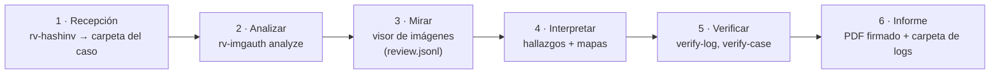

> La versión de referencia es la inglesa ([usage.md](usage.md)); esta traducción la sigue.

# Guía de uso: de la recepción de la evidencia a un informe verificado

Esta guía sigue un caso de principio a fin: recepción de la evidencia, análisis de las imágenes, revisión de los
mapas, lectura de los hallazgos y verificación de la ejecución. Las tareas habituales en breve están en
[quick-guide.es.md](quick-guide.es.md); cada opción de cada comando está en [usage-cli.md](usage-cli.md) (generado a
partir de `--help`, en inglés); la aplicación de escritorio está en [usage-gui.es.md](usage-gui.es.md); por qué
funciona cada análisis está en [theory.md](theory.md) (en inglés).



## Contenido

- [1. Antes de empezar](#1-antes-de-empezar)
- [2. Recorrido de un caso](#2-recorrido-de-un-caso)
- [3. Opciones del análisis](#3-opciones-del-análisis)
- [4. Leer las salidas](#4-leer-las-salidas)
- [5. Interpretar cada hallazgo](#5-interpretar-cada-hallazgo)
- [6. Sellos de tiempo](#6-sellos-de-tiempo)
- [7. Firmar los informes](#7-firmar-los-informes)
- [8. Verificar una ejecución](#8-verificar-una-ejecución)
- [9. Base de huellas](#9-base-de-huellas)
- [10. Imágenes de referencia](#10-imágenes-de-referencia)
- [11. Solución de problemas y códigos de salida](#11-solución-de-problemas-y-códigos-de-salida)

## 1. Antes de empezar

- Trabaje sobre una **copia verificada** (imagen forense, exportación con bloqueador de escritura o exportación de
  chat), nunca sobre el soporte original.
- Analice el **archivo nativo** que le entregaron (el `.jpg`/`.heic` del teléfono o de la exportación), no una captura
  de pantalla ni una copia vuelta a guardar por un visor: cada nuevo guardado destruye rastros y agrega doble
  compresión.
- Elija **sha256** (o sha512) como uno de los algoritmos de hash.
- Compruebe la herramienta instalada una vez por versión ([installation.es.md](installation.es.md#7-self-test-de-la-primera-ejecución-y-muestra)).
- Sincronice el reloj del puesto y anote la fuente.

## 2. Recorrido de un caso

### 2.1 Recepción con rv-hashinv en una carpeta del caso

```powershell
# 1. Recepción y análisis en un paso: rv-hashinv registra E0001…, luego rv-imgauth analiza cada imagen
rv-imgauth analyze -i D:\export\photos -r --case-dir E:\CASE-014 --case CASE-014 --jurisdiction co --intake hashinv

# …o en dos pasos
rv-hashinv scan -i D:\export\photos -r --case-dir E:\CASE-014 --case CASE-014 --jurisdiction co
rv-imgauth analyze --case-dir E:\CASE-014                       # cada elemento registrado
rv-imgauth analyze --case-dir E:\CASE-014 --evidence E0003,E0007 # solo algunos

# 2. Comprobación del caso completo antes de entregarlo
rv-imgauth verify-case E:\CASE-014
```

Cada imagen se vuelve a hashear y se compara con el registro **antes** de analizarla: un hash diferente es el hallazgo
alto `EVIDENCE_HASH_MISMATCH_WITH_CASE` (el análisis se hace igualmente), un archivo no registrado es
`EVIDENCE_NOT_IN_CASE_REGISTRY` (medio). Detalles: [case-folder.md](case-folder.md) (en inglés).

### 2.2 Ejecuciones independientes

```powershell
# Una foto, análisis por defecto (ELA, ruido, copia-desplazamiento, miniatura), informes en inglés
rv-imgauth analyze -i evidence\IMG_0042.jpg

# Una carpeta con todos los mapas incluidos los fantasmas JPEG, SHA-256 + MD5, informes en español
rv-imgauth analyze -i D:\evidence -r --maps ela,noise,ghosts --hash sha256,md5 --lang es --case CASE-2026-014

# Comparar con originales conocidos del teléfono que se afirma
rv-imgauth analyze -i IMG_0042.jpg --reference ref\IMG_0040.jpg --reference ref\IMG_0041.jpg

# Lote grande: solo ruido, sin copia-desplazamiento, informes solo para los elementos señalados
rv-imgauth analyze -i E:\phone-export -r --maps noise --copy-move off --item-reports flagged
```

Qué archivos se examinan como imágenes: cualquier archivo cuyo contenido empiece con una firma JPEG, PNG, WebP o HEIF
(`ftyp` heic, heix, hevc, heim, heis, mif1, msf1), o cuya extensión sea jpg, jpeg, jpe, jfif, png, webp, heic, heif o
hif. Los demás archivos solo reciben las comprobaciones de inventario (tipo por firma, extensión que no coincide,
ejecutable, vacío).

### 2.3 Desde la aplicación de escritorio

Mismo motor y mismos resultados: [usage-gui.es.md](usage-gui.es.md).

### Inicio desde RV Hub: `--case-dir` y `describe --json`

RV Hub (el lanzador de Rakvor) encuentra las herramientas instaladas, las abre sobre una carpeta del caso y sugiere
cuál conviene para un archivo. Se apoya en dos puntos de entrada de RV ImgAuth:

- **`rv-imgauth-gui.exe --case-dir <CASE> [FILES...]`** inicia la aplicación de escritorio con **Carpeta del caso** ya
  completada (`--case-dir=<CASE>` también funciona). Los demás argumentos se cargan como evidencia, como cuando se
  sueltan archivos sobre el icono. El ajuste previo se escribe en el log de auditoría de la ejecución como
  `ui_case_dir_from_launcher` (ruta y `at_utc`) seguido de `ui_case_dir_changed`. Un `--case-dir` sin carpeta se
  ignora: la ventana lo indica y el log de auditoría registra `ui_launch_argument_ignored`.
- **`rv-imgauth describe --json`** imprime un objeto JSON (claves ordenadas) que lee RV Hub; está oculto en
  `rv-imgauth --help` pero figura en [usage-cli.md](usage-cli.md). No lee ni escribe nada. Esquema:
  [`schemas/describe.schema.json`](../schemas/describe.schema.json) (`rakvor.describe/1`, idéntico en todas las
  herramientas Rakvor).

| Campo | Significado |
| --- | --- |
| `schema` | `rakvor.describe/1` |
| `tool`, `title`, `version` | `rv-imgauth`, `RV ImgAuth`, la versión del producto (`version.txt`) |
| `role` | `analysis` (examina evidencia registrada en la carpeta del caso) |
| `main_verb` | `analyze`: el comando que hace el trabajo principal |
| `accepts` | `extensions` (en minúsculas, sin punto) y `signatures` de contenido (`format` + `match`: bytes hexadecimales en un desplazamiento); `"*"` = cualquier archivo |
| `case_formats`, `log_formats` | `rakvor.case/1`; `rakvor.audit/1` = `logs/audit.jsonl`, `rakvor.review/1` = `logs/review.jsonl` |
| `cli_exe`, `gui_exe` | `rv-imgauth.exe`, `rv-imgauth-gui.exe` |
| `exit_codes` | El significado de 0, 1, 2, 3 y 130 (la tabla de códigos de salida en Solución de problemas) |

```powershell
rv-imgauth describe --json
```

## 3. Opciones del análisis

| Opción | Por defecto | Efecto |
| --- | --- | --- |
| `--maps LIST` | `ela,noise` | Mapas por imagen: `ela` (solo JPEG, `ela.png`), `noise` (`noise.png`, `noise-sigma.png`), `ghosts` (solo JPEG, `ghost-q50…q90.png`, imágenes ≤ 24 MP), o `none`. `maps/original.png` y `thumbnail-diff.png` se escriben sea cual sea la selección |
| `--copy-move on\|off` | `on` | Búsqueda de copia-desplazamiento; `copymove.png` cuando se encuentra un candidato |
| `--ela-quality Q` | `95` | Calidad de recompresión para ELA (1–100); se registra con el mapa |
| `--max-pixels N` | `100000000` | Las imágenes con más píxeles no se decodifican (`ANALYSIS_SKIPPED_SIZE_CAP`); rango 1 000 000–120 000 000 (el límite fijo de la capa de imagen) |
| `--reference FILE` | ninguna | Original conocido con el que se compara cada elemento; repetible ([§10](#10-imágenes-de-referencia)) |
| `--fingerprints-db FILE` | ninguna | Base de huellas adicional además de la incluida y de la local |
| `--item-reports all\|flagged` | `all` | `flagged`: archivos de informe solo para los elementos con un hallazgo por encima de info |
| `--worker-timeout S` / `--worker-memory MB` | 120 / 2048 | Límites del proceso de análisis por imagen (`PARSER_FAILED` cuando se superan) |
| `--hash`, `--lang`, `--actor`, `--case`, `--jurisdiction`, `--progress`, `--out` | | Opciones comunes de Rakvor ([usage-cli.md](usage-cli.md)) |
| `--tsa-url`, `--no-timestamp`, `--sign-cert`, `--sign-pass-env` | | Opciones de confianza ([§6](#6-sellos-de-tiempo), [§7](#7-firmar-los-informes)) |
| `--case-dir`, `--evidence`, `--intake hashinv`, `--hashinv-exe` | | Carpeta del caso ([case-folder.md](case-folder.md)) |

Análisis que siempre se ejecutan sobre cada imagen: estructura, metadatos, (JPEG) tablas de cuantización y búsqueda
de huellas, (JPEG baseline) doble compresión, y la comparación con la miniatura incrustada cuando el archivo tiene una.
Los píxeles HEIC nunca se decodifican (`HEIC_PIXELS_NOT_DECODED`).

## 4. Leer las salidas

```text
<OUT>/logs/<RUN-ID>/            audit.jsonl, audit.log, hashes.csv, environment.json, timestamp-*.tsr|.json,
                                review.jsonl (solo después de ver mapas en la GUI)
<OUT>/reports/<RUN-ID>/         statistics.json | .<LANG>.html | .<LANG>.pdf
  items/<NNNNN>-<NAME>/         technical.*, summary.*, custody.*
                                structure.json   árbol de marcadores / chunks / boxes con desplazamientos
                                metadata.json    cada etiqueta (EXIF, XMP, IPTC, texto PNG, comentarios)
                                maps/original.png  vista previa sin pérdida de los píxeles decodificados (no HEIC)
                                maps/ela.png, noise.png, noise-sigma.png, ghost-qNN.png, copymove.png,
                                thumbnail-diff.png
```

Empiece por el **informe de estadísticas** (hallazgos por severidad y por código, vista general de las imágenes),
luego la **revisión técnica** de cada elemento señalado (hallazgos, resumen de metadatos, historial XMP, resumen de la
estructura, tablas de cuantización, bases de huellas, cada mapa con sus parámetros, tabla de comparación con las
referencias). El **resumen para el cliente** es la versión en lenguaje sencillo. Cada sección se describe en
[reports.md](reports.md) (en inglés).

Los mapas se examinan mejor en el **visor de imágenes** de la aplicación de escritorio (lado a lado con el original,
zoom sincronizado), que además registra lo que usted miró ([usage-gui.es.md](usage-gui.es.md#visor-de-imágenes)). Los
archivos PNG se pueden abrir en cualquier visor, pero esa visualización no se registra.

## 5. Interpretar cada hallazgo

Cada hallazgo de los informes indica lo que muestra y lo que no demuestra. Las comprobaciones siguientes son lo que un
perito debe hacer antes de apoyarse en uno. Severidades y catálogo completo:
[reports.md](reports.md#finding-codes) (en inglés).

| Hallazgo | Comprobar antes de apoyarse en él |
| --- | --- |
| `EXIF_SOFTWARE_EDITOR`, `XMP_EDIT_HISTORY` | Qué fuente nombró al editor; si un paso inocente (rotación, redimensionado, exportación) lo explica; compare las fechas del historial con la fecha de captura |
| `METADATA_DATES_INCONSISTENT` | Zonas horarias (OffsetTime*), reloj de la cámara, software que reescribe DateTime al guardar |
| `EXIF_DIMENSIONS_MISMATCH` | Orientación, recorte, redimensionado; compare con `THUMBNAIL_MISMATCH` y el conjunto de referencias |
| `METADATA_STRIPPED`, `MESSENGER_TRACES` | Obtenga el archivo por otro canal (teléfono, modo documento, correo) si importan los metadatos originales |
| `MAKERNOTE_MISSING_FOR_MAKE` | Revise imágenes de referencia del mismo modelo y firmware: algunos teléfonos lo omiten |
| `QT_STANDARD_IJG`, `QT_NON_STANDARD`, `QT_MATCHES_*`, `QT_UNKNOWN`, `QT_INCONSISTENT_WITH_EXIF_MAKE` | Las tablas describen el **último codificador**. Aprenda originales del dispositivo que se afirma (§9) y compare (§10) |
| `DOUBLE_COMPRESSION_SIGNS` | Es esperable tras cualquier nuevo guardado; un original de cámara normalmente no debería mostrarlo: compare con originales conocidos |
| `JPEG_GHOST_REGION` | Abra el mapa de fantasma a esa calidad; ¿la región oscura es un borde de objeto o una zona lisa o saturada? Compare las demás calidades |
| `COPY_MOVE_CANDIDATE` | Abra `copymove.png`: ¿las regiones naranja y azul son textura repetitiva (baldosas, cielo, texto) o un duplicado significativo? Revíselo a resolución completa |
| `THUMBNAIL_MISMATCH` | Abra `thumbnail-diff.png`: ¿diferencia global (recorte, rotación, color) o local (un objeto)? |
| `REFERENCE_INCONSISTENT` | Qué propiedades difieren; si las referencias tienen el mismo formato, modelo, firmware y ajustes |
| `JPEG_MARKER_ORDER_UNUSUAL`, `DUPLICATE_TABLES`, `PROGRESSIVE_ENCODING` | Qué programa escribe esa disposición; compare con imágenes de referencia |
| `DATA_AFTER_END_MARKER`, `HEIF_UNREFERENCED_DATA`, `PNG_PRIVATE_CHUNKS` | Extraiga y examine por separado los bytes adicionales (desplazamientos en `structure.json`); las imágenes secundarias MPF son normales en los teléfonos |
| `PNG_CHUNK_ORDER_INVALID`, `WEBP_FLAGS_MISMATCH`, `HEIF_STRUCTURE_ANOMALY`, `FILE_STRUCTURE_DAMAGED` | ¿Copia interrumpida o edición a nivel de bytes? Compare con la fuente si está disponible |
| `ELA_MAP_WRITTEN`, `NOISE_INCONSISTENCY_MAP` | Solo informativos: diga en el informe qué mapas examinó y qué vio, nunca "el mapa demuestra" |
| `HEIC_PIXELS_NOT_DECODED`, `PIXELS_NOT_DECODED`, `ANALYSIS_SKIPPED_SIZE_CAP`, `COEFFICIENTS_UNAVAILABLE`, `ELA_NOT_APPLICABLE` | Un análisis no se ejecutó: no se concluye nada de él; dígalo |
| `PARSER_FAILED` | Ver [§11](#11-solución-de-problemas-y-códigos-de-salida) |

Cuando los píxeles de un JPEG, PNG o WebP no se pueden decodificar, `PIXELS_NOT_DECODED` da el motivo del
decodificador (también en `technical.json` → `image.pixel_decode_error`) y no se ejecuta ningún análisis de píxeles.

## 6. Sellos de tiempo

Por defecto cada ejecución pide a la TSA (`http://timestamp.digicert.com`, se cambia con `--tsa-url`) que firme la
cabeza de la cadena de auditoría justo antes de escribir el informe de estadísticas.

| Situación | Qué ocurre | Qué hacer |
| --- | --- | --- |
| TSA accesible | `timestamp_obtained`; `timestamp-NNNNN.tsr` y `.json` en la carpeta de logs | Verifique con OpenSSL (abajo) |
| Sin red | `timestamp_pending`; la ejecución termina; advertencia en el informe de estadísticas | Más tarde: `rv-imgauth timestamp <log folder>` |
| `--no-timestamp` / `RV_NO_TIMESTAMP=1` / GUI desmarcada | Sin solicitud | `rv-imgauth timestamp` más tarde si hace falta |
| Cadena rota | `rv-imgauth timestamp` se niega (código 3) | Investigue; no repare |

```powershell
rv-imgauth verify-log <OUT>\logs\<RUN-ID> --tsa-ca C:\certs\tsa-roots.pem
```

Sin `--tsa-ca` la salida indica *chain not checked*. Un token que registra el log y cuyo `.tsr` o `.json` falta hace
fallar el log (código 3). La revocación, el OID de política y la precisión nunca los comprueba la herramienta.
Contraste la **firma y la cadena** con OpenSSL; tampoco comprueba la revocación (no se le da ninguna CRL y OpenSSL no
consulta OCSP, así que "Verification: OK" no dice nada sobre la revocación):

```bash
cd <OUT>/logs/<RUN-ID>
N=00060                                                   # del nombre de archivo timestamp-00060.tsr
H=$(python -c "import json;print(json.load(open('timestamp-$N.json'))['head'])")
openssl ts -reply -in timestamp-$N.tsr -text
openssl ts -reply -in timestamp-$N.tsr -token_out -out token.der
openssl pkcs7 -inform DER -in token.der -print_certs > tsa-certs.pem
openssl ts -verify -digest "$H" -in timestamp-$N.tsr -CAfile <TSA root.pem> -untrusted tsa-certs.pem
```

Establezca por separado el estado de revocación del certificado de la TSA, a partir de evidencia CRL/OCSP que cubra
genTime (una CRL emitida después de genTime por la CA de la TSA, o una respuesta OCSP archivada en el momento del
sellado), p. ej.
`openssl verify -crl_check -CRLfile tsa-ca.crl -CAfile <TSA root.pem> -untrusted tsa-certs.pem -attime <genTime-epoch> tsa.pem`,
o `rv-certcheck analyze --crl … --ocsp …`.

> **Fechas de la CRL y `-attime`.** OpenSSL aplica `-attime` también a la CRL, así que `openssl verify -crl_check -attime <genTime-epoch>` solo funciona con una CRL cuyo intervalo `thisUpdate`–`nextUpdate` contenga genTime; una CRL emitida después de genTime falla con "CRL is not yet valid". Para usar una CRL posterior como evidencia, compruebe su firma (`openssl crl -in tsa-ca.crl -CAfile <TSA root.pem> -noout -verify`) y luego busque en ella el número de serie del certificado de la TSA (`openssl crl -in tsa-ca.crl -noout -text`): si no figura, o figura con una fecha de revocación posterior a genTime, no estaba revocado en genTime. Una CA puede quitar de sus CRL los certificados caducados, así que para un certificado de TSA que ya caducó un número de serie ausente no es concluyente: use una CRL anterior a su caducidad, o una respuesta OCSP archivada en el momento del sellado.

El registro de revisión (`review.jsonl`) se escribe después de la ejecución y **no** lo cubre el sello de tiempo de la
ejecución; su primera entrada está anclada a `run_finished`.

## 7. Firmar los informes

`--sign-cert <file.p12|.pfx>` firma cada informe PDF (estadísticas, técnico, resumen, custodia) con su propio
certificado (solo claves RSA). La contraseña viene de la variable indicada por `--sign-pass-env` (por defecto
`RV_SIGN_PASSWORD`) o de una solicitud sin eco; nunca se registra.

```powershell
$s = Read-Host "Certificate password" -AsSecureString
$env:RV_SIGN_PASSWORD = [Runtime.InteropServices.Marshal]::PtrToStringBSTR(
    [Runtime.InteropServices.Marshal]::SecureStringToBSTR($s))
rv-imgauth analyze -i E:\export -r --sign-cert C:\certs\examiner.p12 --case CASE-2026-014
Remove-Item Env:RV_SIGN_PASSWORD
```

## 8. Verificar una ejecución

| Paso | Comando | Demuestra |
| --- | --- | --- |
| 1 | `rv-imgauth verify-log <log> [--tsa-ca <bundle>]` (código 0 intacto, 3 roto o una salida cambiada) | Ninguna entrada de auditoría editada, borrada ni reordenada; tokens de sello de tiempo válidos; `review.jsonl` intacto y anclado a esta ejecución ("review entries: N"); cada salida registrada conserva su hash (línea `outputs:`) |
| 2 | `rv-imgauth verify-case <CASE>` (carpeta del caso) | Log del caso, registro y cada ejecución (y su registro de revisión) intactos, con cada salida registrada sin cambios |
| 3 | `python tests/verify_chain.py <log>` (árbol de código fuente) | La misma regla de cadena, con una implementación independiente; vuelve a calcular el hash de la evidencia de `hashes.csv` y de cada salida que registra el log de auditoría |
| 4 | OpenSSL ([§6](#6-sellos-de-tiempo)) | La TSA firmó esa cabeza a esa hora |
| 5 | Paso 1 (línea `outputs:`); script de abajo para una comprobación independiente | Cada informe, mapa y salida JSON conserva su hash auditado |

```text
OK  210 entries, chain intact: …/logs/20261113T230819Z-01615d/audit.jsonl
    timestamp 2026-11-13T23:12:44Z by http://timestamp.digicert.com covers entry #207: TSA signature valid (…)
    outputs: 422 verified of 423 recorded (md5, sha256), 1 skipped
    not re-hashed: logs/timestamp-00207.tsr (RFC 3161 token: checked by the timestamp verification)
```

La línea `outputs:` es el recálculo del hash de cada archivo que, según el log, escribió la ejecución (informes por elemento, estadísticas, mapas, `original.png`, `structure.json`, `metadata.json`, `hashes.csv`,
`environment.json`), con cada algoritmo que registró el log; la entrada más reciente de un archivo prevalece. Un
archivo editado, borrado o sustituido después de la ejecución deja la ejecución en `BROKEN` (código 3) y se nombra:

```text
BROKEN  …/logs/20261113T230819Z-01615d/audit.jsonl
  - output reports/items/00004-edited-gimp.jpg/maps/ela.png: md5 differs from audit entry #38 (recorded fa1c…, now ca78…): edited or replaced after the run
  - output reports/statistics.en.pdf: missing (recorded by audit entry #209): deleted or moved after the run
    outputs: 420 verified of 423 recorded (md5, sha256), 1 missing, 1 changed, 1 skipped
```

Una ruta registrada que es absoluta, contiene `..` o se resuelve fuera de la carpeta de la ejecución a través de un
enlace simbólico o una unión se rechaza y nunca se lee. El token de sello de tiempo aparece como `not re-hashed`
porque la comprobación del sello de tiempo ya lo verifica. Los archivos que la ejecución no registró (cualquier cosa
agregada después a la carpeta) no se comprueban.

El paso 5 está integrado en `verify-log` y `verify-case`. Para comprobarlo con un código que se lee en una pantalla
(una implementación independiente, p. ej. para un perito de la contraparte), vuelva a calcular el hash de cada archivo que registró la ejecución (necesita `sha256` entre los algoritmos de la ejecución):

```bash
python - "<OUT>/logs/<RUN-ID>" "<OUT>/reports/<RUN-ID>" <<'EOF'
import hashlib, json, pathlib, sys
log, rep = pathlib.Path(sys.argv[1]), pathlib.Path(sys.argv[2])
checked = bad = 0
for line in (log / "audit.jsonl").open(encoding="utf-8"):
    e = json.loads(line); d = e["details"]
    if e["action"] == "output_written":
        files = {d["file"]: d["hashes"]["sha256"]}
    elif e["action"] == "item_reports_written":
        files = {f'{d["folder"]}/{k}': v["sha256"] for k, v in d["files"].items()}
    elif e["action"] == "statistics_report_written":
        files = {k: v["sha256"] for k, v in d["files"].items()}
    else:
        continue
    for rel, want in files.items():
        checked += 1
        p = rep / rel
        got = hashlib.sha256(p.read_bytes()).hexdigest() if p.is_file() else "missing"
        if got != want:
            bad += 1; print("MISMATCH", rel, got)
print(f"{checked} files checked, {bad} mismatches"); sys.exit(3 if bad else 0)
EOF
```

En la ejecución de muestra (15 imágenes, todos los mapas, dos referencias) esto comprueba 296 archivos.

## 9. Base de huellas

El hash de las tablas de cuantización de cada JPEG se busca en tres bases: la base **starter** incluida, la base
**local** aprendida en este puesto y un archivo `--fingerprints-db` opcional. **La base starter de esta versión está
vacía** (`rakvor-starter` versión 0): hasta que aprenda originales, cada JPEG da `QT_UNKNOWN` (las tablas IJG se
siguen reconociendo como `QT_STANDARD_IJG`).

```powershell
# 1. Haga usted mismo originales conocidos con el dispositivo o la aplicación (o muestras del fabricante) y apréndalos
rv-imgauth fingerprints learn originals\IMG_0001.jpg originals\IMG_0002.jpg --label "Phone X camera" --category camera --case CASE-014
# 2. Vea lo que tiene (versión y SHA-256 de cada base)
rv-imgauth fingerprints list
# 3. Revele o comparta (nunca sobrescribe un archivo existente)
rv-imgauth fingerprints export --out CASE-014-fingerprints.json
```

Categorías: `camera`, `os` (coincidencias de dispositivo → `QT_MATCHES_DEVICE`, info), `app`, `editor`, `messenger`,
`library` (→ `QT_MATCHES_EDITOR`, medio; `messenger` agrega además `MESSENGER_TRACES`). Aprender de varios archivos
conserva solo lo que todos comparten (hash de las tablas, submuestreo de crominancia, Software/CreatorTool, Make/Model)
y registra cada cambio en `fingerprints.audit.jsonl` (encadenado por hashes). Aprenda solo de archivos cuyo origen
pueda probar. Base local: `%LOCALAPPDATA%\Rakvor\rv-imgauth\fingerprints.local.json` (Linux/macOS
`$XDG_DATA_HOME/rakvor/rv-imgauth/`).

## 10. Imágenes de referencia

`--reference` toma originales conocidos del dispositivo que se afirma (hechos por usted con el dispositivo,
idealmente del mismo modelo, firmware, aplicación y ajustes, y en el **mismo formato** que la imagen cuestionada). Se
leen en solo lectura y su SHA-256 se registra en el informe.

- Una propiedad solo se compara cuando todas las referencias tienen el mismo valor para ella ("varies" en otro caso).
- El resultado es "consistent" o "inconsistent with the reference set (n = …)", con una tabla por propiedad en el
  informe técnico.
- Use al menos dos referencias: con una, cada propiedad cuenta como compartida.
- Un elemento PNG, WebP o HEIC comparado con referencias JPEG se informa como inconsistente solo por el formato
  (G-IMG6).

## 11. Solución de problemas y códigos de salida

| Código de salida | Significado |
| :-: | --- |
| 0 | Terminado; ningún hallazgo de severidad alta |
| 1 | Error de ejecución (entrada no encontrada, salida no escribible, log del caso bloqueado…) |
| 2 | Error de uso (opción desconocida, más de dos algoritmos de hash, idioma no admitido; errores de uso de la carpeta del caso) |
| 3 | Terminado con al menos un hallazgo de severidad alta, o un log de auditoría / de revisión o una carpeta del caso rotos |
| 130 | Cancelado con Ctrl+C (se escriben informes parciales) |

`fingerprints`, `verify-log`, `verify-case`, `timestamp`, `self-test` y `describe` tienen sus propios códigos, listados
en [usage-cli.md](usage-cli.md).

| Síntoma | Causa y solución |
| --- | --- |
| `PARSER_FAILED` con motivo `timeout` | Imagen muy grande o patológica: `--worker-timeout 600` |
| `PARSER_FAILED` con motivo `memory_limit` | `--worker-memory 4096` en una máquina con RAM suficiente |
| `PARSER_FAILED` con motivo `crashed` / `bad_output` | Conserve el archivo y el log; infórmelo (no debería ocurrir); examínelo a mano |
| `PARSER_FAILED` "image structure not readable" | El archivo no se puede analizar como el formato que declara su firma |
| `ANALYSIS_SKIPPED_SIZE_CAP` | Por encima de `--max-pixels` (análisis de píxeles) o de 24 MP (fantasmas). Suba `--max-pixels` hasta 120 000 000 |
| `COEFFICIENTS_UNAVAILABLE` | JPEG progresivo o con codificación aritmética, o datos de entropía dañados: sin comprobación de doble compresión |
| Sin mapas para un PNG o WebP | Los píxeles no se decodificaron: ver el hallazgo `PIXELS_NOT_DECODED` |
| `HEIC_PIXELS_NOT_DECODED` | Por diseño en esta versión |
| `EVIDENCE_CHANGED_DURING_ANALYSIS` | Otro programa cambió el archivo entre las dos lecturas: vuelva a ejecutar sobre una copia protegida contra escritura |
| GUI: "No se pudo escribir el registro de revisión de esta ejecución" | El log de auditoría de la ejecución ya no se verifica o la carpeta es de solo lectura; la visualización se registra en su lugar en el log de auditoría de la siguiente ejecución |
