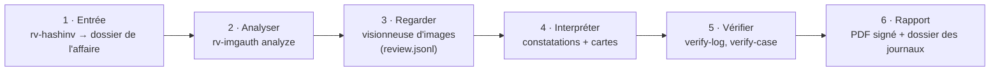

> La version de référence est la version anglaise ([usage.md](usage.md)) ; cette traduction la suit.

# Guide d'utilisation : de l'entrée des éléments de preuve à un rapport vérifié

Ce guide suit une affaire de bout en bout : entrée des éléments de preuve, analyse des images, examen des cartes,
lecture des constatations et vérification de l'exécution. Les tâches courantes en bref sont dans
[quick-guide.fr.md](quick-guide.fr.md) ; chaque option de chaque commande est dans [usage-cli.md](usage-cli.md)
(généré à partir de `--help`, en anglais) ; l'application de bureau est dans [usage-gui.fr.md](usage-gui.fr.md) ;
pourquoi chaque analyse fonctionne est dans [theory.md](theory.md) (en anglais).



## Sommaire

- [1. Avant de commencer](#1-avant-de-commencer)
- [2. Parcours d'une affaire](#2-parcours-dune-affaire)
- [3. Options d'analyse](#3-options-danalyse)
- [4. Lire les sorties](#4-lire-les-sorties)
- [5. Interpréter chaque constatation](#5-interpréter-chaque-constatation)
- [6. Horodatages](#6-horodatages)
- [7. Signer les rapports](#7-signer-les-rapports)
- [8. Vérifier une exécution](#8-vérifier-une-exécution)
- [9. Base d'empreintes](#9-base-dempreintes)
- [10. Images de référence](#10-images-de-référence)
- [11. Dépannage et codes de sortie](#11-dépannage-et-codes-de-sortie)

## 1. Avant de commencer

- Travaillez sur une **copie vérifiée** (image forensique, export avec bloqueur d'écriture ou export de messagerie),
  jamais sur le support d'origine.
- Analysez le **fichier natif** qui vous a été remis (le `.jpg`/`.heic` du téléphone ou de l'export), pas une capture
  d'écran ni une copie réenregistrée par une visionneuse : chaque réenregistrement détruit des traces et ajoute une
  double compression.
- Choisissez **sha256** (ou sha512) parmi les algorithmes d'empreinte.
- Vérifiez l'outil installé une fois par version ([installation.fr.md](installation.fr.md#7-autotest-de-la-première-exécution-et-exemple)).
- Synchronisez l'horloge du poste et notez la source.

## 2. Parcours d'une affaire

### 2.1 Entrée avec rv-hashinv dans un dossier de l'affaire

```powershell
# 1. Entrée et analyse en une étape : rv-hashinv enregistre E0001…, puis rv-imgauth analyse chaque image
rv-imgauth analyze -i D:\export\photos -r --case-dir E:\CASE-014 --case CASE-014 --jurisdiction co --intake hashinv

# …ou en deux étapes
rv-hashinv scan -i D:\export\photos -r --case-dir E:\CASE-014 --case CASE-014 --jurisdiction co
rv-imgauth analyze --case-dir E:\CASE-014                       # chaque élément enregistré
rv-imgauth analyze --case-dir E:\CASE-014 --evidence E0003,E0007 # seulement certains

# 2. Contrôle de toute l'affaire avant la remise
rv-imgauth verify-case E:\CASE-014
```

Chaque image est de nouveau hachée et comparée au registre **avant** son analyse : une empreinte différente est la
constatation élevée `EVIDENCE_HASH_MISMATCH_WITH_CASE` (l'analyse a quand même lieu), un fichier non enregistré est
`EVIDENCE_NOT_IN_CASE_REGISTRY` (moyenne). Détails : [case-folder.md](case-folder.md) (en anglais).

### 2.2 Exécutions autonomes

```powershell
# Une photo, analyses par défaut (ELA, bruit, copier-déplacer, vignette), rapports en anglais
rv-imgauth analyze -i evidence\IMG_0042.jpg

# Un dossier avec toutes les cartes y compris les fantômes JPEG, SHA-256 + MD5, rapports en espagnol
rv-imgauth analyze -i D:\evidence -r --maps ela,noise,ghosts --hash sha256,md5 --lang es --case CASE-2026-014

# Comparer avec des originaux connus du téléphone allégué
rv-imgauth analyze -i IMG_0042.jpg --reference ref\IMG_0040.jpg --reference ref\IMG_0041.jpg

# Gros lot : bruit seulement, pas de copier-déplacer, rapports seulement pour les éléments signalés
rv-imgauth analyze -i E:\phone-export -r --maps noise --copy-move off --item-reports flagged
```

Quels fichiers sont examinés comme des images : tout fichier dont le contenu commence par une signature JPEG, PNG, WebP
ou HEIF (`ftyp` heic, heix, hevc, heim, heis, mif1, msf1), ou dont l'extension est jpg, jpeg, jpe, jfif, png, webp,
heic, heif ou hif. Les autres fichiers ne reçoivent que les contrôles d'inventaire (type par signature, extension
incohérente, exécutable, vide).

### 2.3 Depuis l'application de bureau

Même moteur et mêmes résultats : [usage-gui.fr.md](usage-gui.fr.md).

### Démarrage depuis RV Hub : `--case-dir` et `describe --json`

RV Hub (le lanceur de Rakvor) trouve les outils installés, les ouvre sur un dossier de l'affaire et suggère celui qui
convient à un fichier. Il s'appuie sur deux points d'entrée de RV ImgAuth :

- **`rv-imgauth-gui.exe --case-dir <CASE> [FILES...]`** démarre l'application de bureau avec **Dossier de l'affaire**
  déjà renseigné (`--case-dir=<CASE>` fonctionne aussi). Les autres arguments sont chargés comme éléments, comme
  lorsque des fichiers sont déposés sur l'icône. Ce préréglage est écrit dans le journal d'audit de l'exécution comme
  `ui_case_dir_from_launcher` (chemin et `at_utc`) suivi de `ui_case_dir_changed`. Un `--case-dir` sans dossier est
  ignoré : la fenêtre l'indique et le journal d'audit consigne `ui_launch_argument_ignored`.
- **`rv-imgauth describe --json`** affiche un objet JSON (clés triées) que lit RV Hub ; il est masqué dans
  `rv-imgauth --help` mais figure dans [usage-cli.md](usage-cli.md). Il ne lit et n'écrit rien. Schéma :
  [`schemas/describe.schema.json`](../schemas/describe.schema.json) (`rakvor.describe/1`, identique dans tous les
  outils Rakvor).

| Champ | Signification |
| --- | --- |
| `schema` | `rakvor.describe/1` |
| `tool`, `title`, `version` | `rv-imgauth`, `RV ImgAuth`, la version du produit (`version.txt`) |
| `role` | `analysis` (examine des éléments enregistrés dans le dossier de l'affaire) |
| `main_verb` | `analyze` : la commande qui fait le travail principal |
| `accepts` | `extensions` (en minuscules, sans point) et `signatures` de contenu (`format` + `match` : octets hexadécimaux à un décalage) ; `"*"` = tout fichier |
| `case_formats`, `log_formats` | `rakvor.case/1` ; `rakvor.audit/1` = `logs/audit.jsonl`, `rakvor.review/1` = `logs/review.jsonl` |
| `cli_exe`, `gui_exe` | `rv-imgauth.exe`, `rv-imgauth-gui.exe` |
| `exit_codes` | La signification de 0, 1, 2, 3 et 130 (le tableau des codes de sortie dans Dépannage) |

```powershell
rv-imgauth describe --json
```

## 3. Options d'analyse

| Option | Par défaut | Effet |
| --- | --- | --- |
| `--maps LIST` | `ela,noise` | Cartes par image : `ela` (JPEG seulement, `ela.png`), `noise` (`noise.png`, `noise-sigma.png`), `ghosts` (JPEG seulement, `ghost-q50…q90.png`, images ≤ 24 MP), ou `none`. `maps/original.png` et `thumbnail-diff.png` sont écrits quelle que soit la sélection |
| `--copy-move on\|off` | `on` | Recherche de copier-déplacer ; `copymove.png` quand un candidat est trouvé |
| `--ela-quality Q` | `95` | Qualité de recompression pour l'ELA (1–100) ; consignée avec la carte |
| `--max-pixels N` | `100000000` | Les images de plus de pixels ne sont pas décodées (`ANALYSIS_SKIPPED_SIZE_CAP`) ; plage 1 000 000–120 000 000 (la limite fixe de la couche image) |
| `--reference FILE` | aucune | Original connu auquel chaque élément est comparé ; répétable ([§10](#10-images-de-référence)) |
| `--fingerprints-db FILE` | aucune | Base d'empreintes supplémentaire en plus de la base fournie et de la base locale |
| `--item-reports all\|flagged` | `all` | `flagged` : fichiers de rapport seulement pour les éléments ayant une constatation au-dessus d'info |
| `--worker-timeout S` / `--worker-memory MB` | 120 / 2048 | Limites du processus d'analyse par image (`PARSER_FAILED` quand elles sont dépassées) |
| `--hash`, `--lang`, `--actor`, `--case`, `--jurisdiction`, `--progress`, `--out` | | Options communes de Rakvor ([usage-cli.md](usage-cli.md)) |
| `--tsa-url`, `--no-timestamp`, `--sign-cert`, `--sign-pass-env` | | Options de confiance ([§6](#6-horodatages), [§7](#7-signer-les-rapports)) |
| `--case-dir`, `--evidence`, `--intake hashinv`, `--hashinv-exe` | | Dossier de l'affaire ([case-folder.md](case-folder.md)) |

Analyses toujours faites sur chaque image : structure, métadonnées, (JPEG) tables de quantification et recherche
d'empreintes, (JPEG baseline) double compression, et la comparaison avec la vignette incorporée quand le fichier en a
une. Les pixels HEIC ne sont jamais décodés (`HEIC_PIXELS_NOT_DECODED`).

## 4. Lire les sorties

```text
<OUT>/logs/<RUN-ID>/            audit.jsonl, audit.log, hashes.csv, environment.json, timestamp-*.tsr|.json,
                                review.jsonl (seulement après consultation de cartes dans la GUI)
<OUT>/reports/<RUN-ID>/         statistics.json | .<LANG>.html | .<LANG>.pdf
  items/<NNNNN>-<NAME>/         technical.*, summary.*, custody.*
                                structure.json   arbre des marqueurs / chunks / boxes avec décalages
                                metadata.json    chaque balise (EXIF, XMP, IPTC, texte PNG, commentaires)
                                maps/original.png  aperçu sans perte des pixels décodés (pas pour HEIC)
                                maps/ela.png, noise.png, noise-sigma.png, ghost-qNN.png, copymove.png,
                                thumbnail-diff.png
```

Commencez par le **rapport de statistiques** (constatations par gravité et par code, vue d'ensemble des images), puis
l'**examen technique** de chaque élément signalé (constatations, résumé des métadonnées, historique XMP, résumé de la
structure, tables de quantification, bases d'empreintes, chaque carte avec ses paramètres, tableau de comparaison avec
les références). La **synthèse pour le client** en est la version en langage courant. Chaque section est décrite dans
[reports.md](reports.md) (en anglais).

Les cartes s'examinent au mieux dans la **visionneuse d'images** de l'application de bureau (côte à côte avec
l'original, zoom synchronisé), qui consigne en plus ce que vous avez regardé
([usage-gui.fr.md](usage-gui.fr.md#visionneuse-dimages)). Les fichiers PNG s'ouvrent dans n'importe quelle visionneuse,
mais cette consultation n'est pas consignée.

## 5. Interpréter chaque constatation

Chaque constatation des rapports indique ce qu'elle montre et ce qu'elle ne prouve pas. Les contrôles ci-dessous sont
ce qu'un expert doit faire avant de s'appuyer sur l'une d'elles. Gravités et catalogue complet :
[reports.md](reports.md#finding-codes) (en anglais).

| Constatation | À vérifier avant de s'y appuyer |
| --- | --- |
| `EXIF_SOFTWARE_EDITOR`, `XMP_EDIT_HISTORY` | Quelle source a nommé l'éditeur ; si une étape anodine (rotation, redimensionnement, export) l'explique ; comparez les dates de l'historique avec la date de prise de vue |
| `METADATA_DATES_INCONSISTENT` | Fuseaux horaires (OffsetTime*), horloge de l'appareil, logiciel qui réécrit DateTime à l'enregistrement |
| `EXIF_DIMENSIONS_MISMATCH` | Orientation, recadrage, redimensionnement ; comparez avec `THUMBNAIL_MISMATCH` et le jeu de références |
| `METADATA_STRIPPED`, `MESSENGER_TRACES` | Obtenez le fichier par un autre canal (téléphone, mode document, courriel) si les métadonnées d'origine comptent |
| `MAKERNOTE_MISSING_FOR_MAKE` | Vérifiez des images de référence du même modèle et du même micrologiciel : certains téléphones l'omettent |
| `QT_STANDARD_IJG`, `QT_NON_STANDARD`, `QT_MATCHES_*`, `QT_UNKNOWN`, `QT_INCONSISTENT_WITH_EXIF_MAKE` | Les tables décrivent le **dernier encodeur**. Apprenez des originaux de l'appareil allégué (§9) et comparez (§10) |
| `DOUBLE_COMPRESSION_SIGNS` | Attendu après tout réenregistrement ; un original d'appareil photo ne devrait normalement pas le montrer : comparez avec des originaux connus |
| `JPEG_GHOST_REGION` | Ouvrez la carte de fantôme à cette qualité ; la zone sombre est-elle un bord d'objet ou une zone lisse ou saturée ? Comparez les autres qualités |
| `COPY_MOVE_CANDIDATE` | Ouvrez `copymove.png` : les zones orange et bleue sont-elles une texture répétitive (carreaux, ciel, texte) ou un doublon significatif ? Vérifiez en pleine résolution |
| `THUMBNAIL_MISMATCH` | Ouvrez `thumbnail-diff.png` : différence globale (recadrage, rotation, couleur) ou locale (un objet) ? |
| `REFERENCE_INCONSISTENT` | Quelles propriétés diffèrent ; si les références ont le même format, modèle, micrologiciel et réglages |
| `JPEG_MARKER_ORDER_UNUSUAL`, `DUPLICATE_TABLES`, `PROGRESSIVE_ENCODING` | Quel programme écrit cette disposition ; comparez avec des images de référence |
| `DATA_AFTER_END_MARKER`, `HEIF_UNREFERENCED_DATA`, `PNG_PRIVATE_CHUNKS` | Extrayez et examinez à part les octets supplémentaires (décalages dans `structure.json`) ; les images secondaires MPF sont normales sur les téléphones |
| `PNG_CHUNK_ORDER_INVALID`, `WEBP_FLAGS_MISMATCH`, `HEIF_STRUCTURE_ANOMALY`, `FILE_STRUCTURE_DAMAGED` | Copie interrompue ou modification au niveau des octets ? Comparez avec la source si elle est disponible |
| `ELA_MAP_WRITTEN`, `NOISE_INCONSISTENCY_MAP` | Informatif seulement : dites dans le rapport quelles cartes vous avez examinées et ce que vous avez vu, jamais « la carte prouve » |
| `HEIC_PIXELS_NOT_DECODED`, `PIXELS_NOT_DECODED`, `ANALYSIS_SKIPPED_SIZE_CAP`, `COEFFICIENTS_UNAVAILABLE`, `ELA_NOT_APPLICABLE` | Une analyse n'a pas eu lieu : on n'en conclut rien ; dites-le |
| `PARSER_FAILED` | Voir [§11](#11-dépannage-et-codes-de-sortie) |

Quand les pixels d'un JPEG, PNG ou WebP ne peuvent pas être décodés, `PIXELS_NOT_DECODED` donne la raison du décodeur
(aussi dans `technical.json` → `image.pixel_decode_error`) et aucune analyse de pixels n'a lieu.

## 6. Horodatages

Par défaut, chaque exécution demande à la TSA (`http://timestamp.digicert.com`, modifiable avec `--tsa-url`) de signer
la tête de la chaîne d'audit juste avant l'écriture du rapport de statistiques.

| Situation | Ce qui se passe | Que faire |
| --- | --- | --- |
| TSA joignable | `timestamp_obtained` ; `timestamp-NNNNN.tsr` et `.json` dans le dossier des journaux | Vérifiez avec OpenSSL (ci-dessous) |
| Hors ligne | `timestamp_pending` ; l'exécution se termine ; avertissement sur le rapport de statistiques | Plus tard : `rv-imgauth timestamp <log folder>` |
| `--no-timestamp` / `RV_NO_TIMESTAMP=1` / GUI décochée | Aucune demande | `rv-imgauth timestamp` plus tard si nécessaire |
| Chaîne rompue | `rv-imgauth timestamp` refuse (code 3) | Enquêtez ; ne réparez pas |

```powershell
rv-imgauth verify-log <OUT>\logs\<RUN-ID> --tsa-ca C:\certs\tsa-roots.pem
```

Sans `--tsa-ca`, la sortie indique *chain not checked*. Un jeton consigné par le journal dont le `.tsr` ou le `.json`
manque fait échouer le journal (code 3). La révocation, l'OID de politique et la précision ne sont jamais vérifiés par
l'outil. Recoupez la **signature et la chaîne** avec OpenSSL ; il ne vérifie pas non plus la révocation (aucune CRL
n'est fournie et OpenSSL n'interroge pas OCSP, donc « Verification: OK » ne dit rien de la révocation) :

```bash
cd <OUT>/logs/<RUN-ID>
N=00060                                                   # d'après le nom de fichier timestamp-00060.tsr
H=$(python -c "import json;print(json.load(open('timestamp-$N.json'))['head'])")
openssl ts -reply -in timestamp-$N.tsr -text
openssl ts -reply -in timestamp-$N.tsr -token_out -out token.der
openssl pkcs7 -inform DER -in token.der -print_certs > tsa-certs.pem
openssl ts -verify -digest "$H" -in timestamp-$N.tsr -CAfile <TSA root.pem> -untrusted tsa-certs.pem
```

Établissez à part l'état de révocation du certificat de la TSA, à partir d'éléments CRL/OCSP couvrant genTime (une CRL
émise après genTime par la CA de la TSA, ou une réponse OCSP archivée au moment de l'horodatage), par ex.
`openssl verify -crl_check -CRLfile tsa-ca.crl -CAfile <TSA root.pem> -untrusted tsa-certs.pem -attime <genTime-epoch> tsa.pem`,
ou `rv-certcheck analyze --crl … --ocsp …`.

> **Dates de la CRL et `-attime`.** OpenSSL applique aussi `-attime` à la CRL, donc `openssl verify -crl_check -attime <genTime-epoch>` ne fonctionne qu'avec une CRL dont l'intervalle `thisUpdate`–`nextUpdate` contient genTime ; une CRL émise après genTime échoue avec « CRL is not yet valid ». Pour utiliser une CRL ultérieure comme élément de preuve, vérifiez sa signature (`openssl crl -in tsa-ca.crl -CAfile <TSA root.pem> -noout -verify`), puis cherchez-y le numéro de série du certificat de la TSA (`openssl crl -in tsa-ca.crl -noout -text`) : absent, ou listé avec une date de révocation postérieure à genTime, il n'était pas révoqué à genTime. Une CA peut retirer de ses CRL les certificats expirés ; pour un certificat de TSA expiré depuis, un numéro absent n'est donc pas concluant : utilisez une CRL antérieure à son expiration, ou une réponse OCSP archivée au moment de l'horodatage.

Le journal de revue (`review.jsonl`) est écrit après l'exécution et n'est **pas** couvert par l'horodatage de
l'exécution ; sa première entrée est ancrée à `run_finished`.

## 7. Signer les rapports

`--sign-cert <file.p12|.pfx>` signe chaque rapport PDF (statistiques, technique, synthèse, traçabilité) avec votre
propre certificat (clés RSA uniquement). Le mot de passe vient de la variable désignée par `--sign-pass-env` (par
défaut `RV_SIGN_PASSWORD`) ou d'une invite sans écho ; il n'est jamais journalisé.

```powershell
$s = Read-Host "Certificate password" -AsSecureString
$env:RV_SIGN_PASSWORD = [Runtime.InteropServices.Marshal]::PtrToStringBSTR(
    [Runtime.InteropServices.Marshal]::SecureStringToBSTR($s))
rv-imgauth analyze -i E:\export -r --sign-cert C:\certs\examiner.p12 --case CASE-2026-014
Remove-Item Env:RV_SIGN_PASSWORD
```

## 8. Vérifier une exécution

| Étape | Commande | Prouve |
| --- | --- | --- |
| 1 | `rv-imgauth verify-log <log> [--tsa-ca <bundle>]` (code 0 intact, 3 rompu ou sortie modifiée) | Aucune entrée d'audit modifiée, supprimée ni réordonnée ; jetons d'horodatage valides ; `review.jsonl` intact et ancré à cette exécution (« review entries: N ») ; chaque sortie consignée a toujours son empreinte (ligne `outputs:`) |
| 2 | `rv-imgauth verify-case <CASE>` (dossier de l'affaire) | Journal de l'affaire, registre et chaque exécution (et son journal de revue) intacts, avec chaque sortie consignée inchangée |
| 3 | `python tests/verify_chain.py <log>` (arbre des sources) | Même règle de chaîne, implémentation indépendante ; recalcule l'empreinte des éléments de `hashes.csv` et de chaque sortie consignée par le journal d'audit |
| 4 | OpenSSL ([§6](#6-horodatages)) | La TSA a signé cette tête à cette heure |
| 5 | Étape 1 (ligne `outputs:`) ; script ci-dessous pour un contrôle indépendant | Chaque rapport, carte et sortie JSON a toujours son empreinte auditée |

```text
OK  210 entries, chain intact: …/logs/20261113T230819Z-01615d/audit.jsonl
    timestamp 2026-11-13T23:12:44Z by http://timestamp.digicert.com covers entry #207: TSA signature valid (…)
    outputs: 422 verified of 423 recorded (md5, sha256), 1 skipped
    not re-hashed: logs/timestamp-00207.tsr (RFC 3161 token: checked by the timestamp verification)
```

La ligne `outputs:` est le recalcul de l'empreinte de chaque fichier que, selon le journal, l'exécution a écrit (rapports par élément, statistiques, cartes, `original.png`, `structure.json`, `metadata.json`, `hashes.csv`,
`environment.json`), avec chaque algorithme consigné par le journal ; l'entrée la plus récente pour un fichier
l'emporte. Un fichier modifié, supprimé ou remplacé après l'exécution rend l'exécution `BROKEN` (code 3) et est nommé :

```text
BROKEN  …/logs/20261113T230819Z-01615d/audit.jsonl
  - output reports/items/00004-edited-gimp.jpg/maps/ela.png: md5 differs from audit entry #38 (recorded fa1c…, now ca78…): edited or replaced after the run
  - output reports/statistics.en.pdf: missing (recorded by audit entry #209): deleted or moved after the run
    outputs: 420 verified of 423 recorded (md5, sha256), 1 missing, 1 changed, 1 skipped
```

Un chemin consigné qui est absolu, contient `..` ou mène hors du dossier de l'exécution par un lien symbolique ou une
jonction est rejeté et jamais lu. Le jeton d'horodatage est listé comme `not re-hashed` parce que le contrôle de
l'horodatage le vérifie déjà. Les fichiers que l'exécution n'a pas consignés (tout ce qui a été ajouté au dossier
ensuite) ne sont pas vérifiés.

L'étape 5 est intégrée à `verify-log` et `verify-case`. Pour la vérifier avec un code qui tient sur un écran (une
implémentation indépendante, par ex. pour un expert adverse), recalculez l'empreinte de chaque fichier consigné par l'exécution (il faut `sha256` parmi les algorithmes de l'exécution) :

```bash
python - "<OUT>/logs/<RUN-ID>" "<OUT>/reports/<RUN-ID>" <<'EOF'
import hashlib, json, pathlib, sys
log, rep = pathlib.Path(sys.argv[1]), pathlib.Path(sys.argv[2])
checked = bad = 0
for line in (log / "audit.jsonl").open(encoding="utf-8"):
    e = json.loads(line); d = e["details"]
    if e["action"] == "output_written":
        files = {d["file"]: d["hashes"]["sha256"]}
    elif e["action"] == "item_reports_written":
        files = {f'{d["folder"]}/{k}': v["sha256"] for k, v in d["files"].items()}
    elif e["action"] == "statistics_report_written":
        files = {k: v["sha256"] for k, v in d["files"].items()}
    else:
        continue
    for rel, want in files.items():
        checked += 1
        p = rep / rel
        got = hashlib.sha256(p.read_bytes()).hexdigest() if p.is_file() else "missing"
        if got != want:
            bad += 1; print("MISMATCH", rel, got)
print(f"{checked} files checked, {bad} mismatches"); sys.exit(3 if bad else 0)
EOF
```

Sur l'exécution d'exemple (15 images, toutes les cartes, deux références), cela vérifie 296 fichiers.

## 9. Base d'empreintes

L'empreinte des tables de quantification de chaque JPEG est cherchée dans trois bases : la base **starter** fournie,
la base **locale** apprise sur ce poste et un fichier `--fingerprints-db` facultatif. **La base starter de cette
version est vide** (`rakvor-starter` version 0) : tant que vous n'avez pas appris d'originaux, chaque JPEG donne
`QT_UNKNOWN` (les tables IJG restent reconnues comme `QT_STANDARD_IJG`).

```powershell
# 1. Fabriquez vous-même des originaux connus avec l'appareil ou l'application (ou des échantillons du fabricant), puis apprenez-les
rv-imgauth fingerprints learn originals\IMG_0001.jpg originals\IMG_0002.jpg --label "Phone X camera" --category camera --case CASE-014
# 2. Voyez ce que vous avez (version et SHA-256 de chaque base)
rv-imgauth fingerprints list
# 3. Communiquez ou partagez (n'écrase jamais un fichier existant)
rv-imgauth fingerprints export --out CASE-014-fingerprints.json
```

Catégories : `camera`, `os` (correspondances d'appareil → `QT_MATCHES_DEVICE`, info), `app`, `editor`, `messenger`,
`library` (→ `QT_MATCHES_EDITOR`, moyenne ; `messenger` ajoute aussi `MESSENGER_TRACES`). Apprendre à partir de
plusieurs fichiers ne garde que ce qu'ils partagent tous (empreinte des tables, sous-échantillonnage de chrominance,
Software/CreatorTool, Make/Model) et consigne chaque modification dans `fingerprints.audit.jsonl` (chaîné). N'apprenez
qu'à partir de fichiers dont vous pouvez prouver l'origine. Base locale :
`%LOCALAPPDATA%\Rakvor\rv-imgauth\fingerprints.local.json` (Linux/macOS `$XDG_DATA_HOME/rakvor/rv-imgauth/`).

## 10. Images de référence

`--reference` prend des originaux connus de l'appareil allégué (pris par vous avec l'appareil, idéalement du même
modèle, micrologiciel, application et réglages, et au **même format** que l'image en cause). Ils sont lus en lecture
seule et leur SHA-256 est consigné dans le rapport.

- Une propriété n'est comparée que lorsque toutes les références ont la même valeur pour elle (« varies » sinon).
- Le résultat est « consistent » ou « inconsistent with the reference set (n = …) », avec un tableau par propriété
  dans le rapport technique.
- Utilisez au moins deux références : avec une seule, chaque propriété compte comme partagée.
- Un élément PNG, WebP ou HEIC comparé à des références JPEG est déclaré incohérent sur le seul format (G-IMG6).

## 11. Dépannage et codes de sortie

| Code de sortie | Signification |
| :-: | --- |
| 0 | Terminé ; aucune constatation de gravité élevée |
| 1 | Erreur d'exécution (entrée introuvable, sortie non inscriptible, journal de l'affaire verrouillé…) |
| 2 | Erreur d'utilisation (option inconnue, plus de deux algorithmes d'empreinte, langue non prise en charge ; erreurs d'utilisation du dossier de l'affaire) |
| 3 | Terminé avec au moins une constatation de gravité élevée, ou un journal d'audit / de revue ou un dossier de l'affaire rompu |
| 130 | Annulé avec Ctrl+C (rapports partiels écrits) |

`fingerprints`, `verify-log`, `verify-case`, `timestamp`, `self-test` et `describe` ont leurs propres codes, listés dans
[usage-cli.md](usage-cli.md).

| Symptôme | Cause et solution |
| --- | --- |
| `PARSER_FAILED` avec la raison `timeout` | Image très grande ou pathologique : `--worker-timeout 600` |
| `PARSER_FAILED` avec la raison `memory_limit` | `--worker-memory 4096` sur une machine avec assez de RAM |
| `PARSER_FAILED` avec la raison `crashed` / `bad_output` | Gardez le fichier et le journal ; signalez-le (cela ne devrait pas arriver) ; examinez à la main |
| `PARSER_FAILED` « image structure not readable » | Le fichier ne peut pas être analysé dans le format que revendique sa signature |
| `ANALYSIS_SKIPPED_SIZE_CAP` | Au-dessus de `--max-pixels` (analyses de pixels) ou de 24 MP (fantômes). Montez `--max-pixels` jusqu'à 120 000 000 |
| `COEFFICIENTS_UNAVAILABLE` | JPEG progressif ou à codage arithmétique, ou données entropiques endommagées : pas de contrôle de double compression |
| Pas de cartes pour un PNG ou un WebP | Les pixels n'ont pas été décodés : voir la constatation `PIXELS_NOT_DECODED` |
| `HEIC_PIXELS_NOT_DECODED` | Voulu dans cette version |
| `EVIDENCE_CHANGED_DURING_ANALYSIS` | Un autre programme a modifié le fichier entre les deux lectures : relancez sur une copie protégée en écriture |
| GUI : « Impossible d'écrire le journal de revue de cette exécution » | Le journal d'audit de l'exécution ne se vérifie plus ou le dossier est en lecture seule ; la consultation est consignée à la place dans le journal d'audit de l'exécution suivante |
