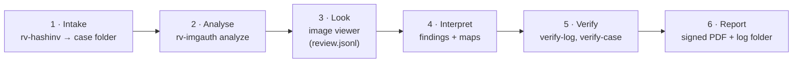

# Usage guide: from intake to a verified report

This guide follows one case end to end: intake of the evidence, analysis of the images, looking at the maps,
reading the findings, and verifying the run. Every option of every command is in
[usage-cli.md](usage-cli.md) (generated from `--help`); the desktop app is in [usage-gui.md](usage-gui.md); why each
analysis works is in [theory.md](theory.md).



## Contents

- [1. Before you start](#1-before-you-start)
- [2. Case walkthrough](#2-case-walkthrough)
- [3. Analysis options](#3-analysis-options)
- [4. Reading the outputs](#4-reading-the-outputs)
- [5. Interpreting each finding](#5-interpreting-each-finding)
- [6. Timestamps](#6-timestamps)
- [7. Signing reports](#7-signing-reports)
- [8. Verifying a run](#8-verifying-a-run)
- [9. Fingerprint database](#9-fingerprint-database)
- [10. Reference images](#10-reference-images)
- [11. Troubleshooting and exit codes](#11-troubleshooting-and-exit-codes)

## 1. Before you start

- Work on a **verified copy** (forensic image, write-blocked export or chat export), never on original media.
- Analyse the **native file** you were given (the `.jpg`/`.heic` from the phone or the export), not a screenshot
  of it or a copy re-saved by a viewer: every re-save destroys traces and adds double compression.
- Select **sha256** (or sha512) as one of the hash algorithms.
- Check the installed tool once per release ([installation.md](installation.md#7-first-run-self-test-and-sample)).
- Synchronise the workstation clock and note the source.

## 2. Case walkthrough

### 2.1 Intake with rv-hashinv into a case folder

```powershell
# 1. Intake and analysis in one step: rv-hashinv registers E0001…, then rv-imgauth analyses every image
rv-imgauth analyze -i D:\export\photos -r --case-dir E:\CASE-014 --case CASE-014 --jurisdiction co --intake hashinv

# …or in two steps
rv-hashinv scan -i D:\export\photos -r --case-dir E:\CASE-014 --case CASE-014 --jurisdiction co
rv-imgauth analyze --case-dir E:\CASE-014                       # every registered item
rv-imgauth analyze --case-dir E:\CASE-014 --evidence E0003,E0007 # only some

# 2. Whole-case check before handing over
rv-imgauth verify-case E:\CASE-014
```

Every image is re-hashed and compared with the registry **before** it is analysed: a different hash is the high
finding `EVIDENCE_HASH_MISMATCH_WITH_CASE` (the analysis still runs), a file not registered is
`EVIDENCE_NOT_IN_CASE_REGISTRY` (medium). Details: [case-folder.md](case-folder.md).

### 2.2 Standalone runs

```powershell
# One photo, default analyses (ELA, noise, copy-move, thumbnail), English reports
rv-imgauth analyze -i evidence\IMG_0042.jpg

# A folder with every map including JPEG ghosts, SHA-256 + MD5, Spanish reports
rv-imgauth analyze -i D:\evidence -r --maps ela,noise,ghosts --hash sha256,md5 --lang es --case CASE-2026-014

# Compare with known originals from the claimed phone
rv-imgauth analyze -i IMG_0042.jpg --reference ref\IMG_0040.jpg --reference ref\IMG_0041.jpg

# Large batch: noise only, no copy-move, reports only for flagged items
rv-imgauth analyze -i E:\phone-export -r --maps noise --copy-move off --item-reports flagged
```

Which files are examined as images: any file whose content starts with a JPEG, PNG, WebP or HEIF (`ftyp` heic,
heix, hevc, heim, heis, mif1, msf1) signature, or whose extension is jpg, jpeg, jpe, jfif, png, webp, heic, heif or
hif. Other files get the inventory checks only (type by signature, extension mismatch, executable, empty).

### 2.3 From the desktop app

Same engine and results: [usage-gui.md](usage-gui.md).

### Starting from RV Hub: `--case-dir` and `describe --json`

RV Hub (the Rakvor launcher) finds the installed tools, opens them on a case folder and suggests which one fits a
file. It relies on two entry points of RV ImgAuth:

- **`rv-imgauth-gui.exe --case-dir <CASE> [FILES...]`** starts the desktop app with **Case folder** already filled
  (`--case-dir=<CASE>` also works). Other arguments are pre-loaded as evidence, as when files are dropped on the
  icon. The preset is written to the run's audit log as `ui_case_dir_from_launcher` (path and `at_utc`) followed by
  `ui_case_dir_changed`. `--case-dir` without a folder is ignored: the window says so and the audit log records
  `ui_launch_argument_ignored`.
- **`rv-imgauth describe --json`** prints one JSON object (sorted keys) that RV Hub reads; it is hidden from
  `rv-imgauth --help` but listed in [usage-cli.md](usage-cli.md). It reads and writes nothing. Schema:
  [`schemas/describe.schema.json`](../schemas/describe.schema.json) (`rakvor.describe/1`, identical in every Rakvor
  tool).

| Field | Meaning |
| --- | --- |
| `schema` | `rakvor.describe/1` |
| `tool`, `title`, `version` | `rv-imgauth`, `RV ImgAuth`, the product version (`version.txt`) |
| `role` | `analysis` (examines evidence registered in the case folder) |
| `main_verb` | `analyze`: the command that does the main work |
| `accepts` | `extensions` (lower case, no dot) and content `signatures` (`format` + `match`: hex bytes at an offset); `"*"` = any file |
| `case_formats`, `log_formats` | `rakvor.case/1`; `rakvor.audit/1` = `logs/audit.jsonl`, `rakvor.review/1` = `logs/review.jsonl` |
| `cli_exe`, `gui_exe` | `rv-imgauth.exe`, `rv-imgauth-gui.exe` |
| `exit_codes` | The meaning of 0, 1, 2, 3 and 130 (the exit-code table under Troubleshooting) |

```powershell
rv-imgauth describe --json
```

## 3. Analysis options

| Option | Default | Effect |
| --- | --- | --- |
| `--maps LIST` | `ela,noise` | Maps per image: `ela` (JPEG only, `ela.png`), `noise` (`noise.png`, `noise-sigma.png`), `ghosts` (JPEG only, `ghost-q50…q90.png`, images ≤ 24 MP), or `none`. `maps/original.png` and `thumbnail-diff.png` are written whatever is selected |
| `--copy-move on\|off` | `on` | Copy-move search; `copymove.png` when a candidate is found |
| `--ela-quality Q` | `95` | Re-compression quality for ELA (1–100); recorded with the map |
| `--max-pixels N` | `100000000` | Images with more pixels are not decoded (`ANALYSIS_SKIPPED_SIZE_CAP`); range 1 000 000–120 000 000 (the image layer's hard limit) |
| `--reference FILE` | none | Known original to compare every item with; repeatable ([§10](#10-reference-images)) |
| `--fingerprints-db FILE` | none | Extra fingerprint database on top of the bundled and local ones |
| `--item-reports all\|flagged` | `all` | `flagged`: report files only for items with a finding above info |
| `--worker-timeout S` / `--worker-memory MB` | 120 / 2048 | Limits of the worker process per image (`PARSER_FAILED` when exceeded) |
| `--hash`, `--lang`, `--actor`, `--case`, `--jurisdiction`, `--progress`, `--out` | | Common Rakvor options ([usage-cli.md](usage-cli.md)) |
| `--tsa-url`, `--no-timestamp`, `--sign-cert`, `--sign-pass-env` | | Trust options ([§6](#6-timestamps), [§7](#7-signing-reports)) |
| `--case-dir`, `--evidence`, `--intake hashinv`, `--hashinv-exe` | | Case folder ([case-folder.md](case-folder.md)) |

Analyses that always run on every image: structure, metadata, (JPEG) quantization tables and fingerprint lookup,
(baseline JPEG) double compression, and the embedded-thumbnail comparison when the file has a thumbnail. HEIC
pixels are never decoded (`HEIC_PIXELS_NOT_DECODED`).

## 4. Reading the outputs

```text
<OUT>/logs/<RUN-ID>/            audit.jsonl, audit.log, hashes.csv, environment.json, timestamp-*.tsr|.json,
                                review.jsonl (only after maps were viewed in the GUI)
<OUT>/reports/<RUN-ID>/         statistics.json | .<LANG>.html | .<LANG>.pdf
  items/<NNNNN>-<NAME>/         technical.*, summary.*, custody.*
                                structure.json   marker / chunk / box tree with offsets
                                metadata.json    every tag (EXIF, XMP, IPTC, PNG text, comments)
                                maps/original.png  lossless preview of the decoded pixels (not HEIC)
                                maps/ela.png, noise.png, noise-sigma.png, ghost-qNN.png, copymove.png,
                                thumbnail-diff.png
```

Start with the **statistics report** (findings by severity and by code, image overview), then the **technical
review** of each flagged item (findings, metadata summary, XMP history, structure summary, quantization tables,
fingerprint databases, every map with its parameters, reference comparison table). The **customer summary** is the
plain-language version for the client. Every section is described in [reports.md](reports.md).

Maps are best examined in the **image viewer** of the desktop app (side by side with the original, synced zoom),
which also records what you looked at ([usage-gui.md](usage-gui.md#image-viewer)). The PNG files can be opened in
any viewer, but that viewing is not recorded.

## 5. Interpreting each finding

Each finding in the reports states what it shows and what it does not prove. The checks below are what an examiner
should do before relying on one. Severities and the full catalogue: [reports.md](reports.md#finding-codes).

| Finding | Check before relying on it |
| --- | --- |
| `EXIF_SOFTWARE_EDITOR`, `XMP_EDIT_HISTORY` | Which source named the editor; whether an innocent step (rotation, resize, export) explains it; compare the history dates with the capture date |
| `METADATA_DATES_INCONSISTENT` | Time zones (OffsetTime*), camera clock, software that rewrites DateTime on save |
| `EXIF_DIMENSIONS_MISMATCH` | Orientation, crop, resize; compare with `THUMBNAIL_MISMATCH` and the reference set |
| `METADATA_STRIPPED`, `MESSENGER_TRACES` | Obtain the file through another channel (phone, document mode, e-mail) if the original metadata matters |
| `MAKERNOTE_MISSING_FOR_MAKE` | Check reference images of the same model and firmware: some phones omit it |
| `QT_STANDARD_IJG`, `QT_NON_STANDARD`, `QT_MATCHES_*`, `QT_UNKNOWN`, `QT_INCONSISTENT_WITH_EXIF_MAKE` | Tables describe the **last encoder**. Learn originals from the claimed device (§9) and compare (§10) |
| `DOUBLE_COMPRESSION_SIGNS` | Expected after any re-save; a camera original should normally not show it — compare with known originals |
| `JPEG_GHOST_REGION` | Open the ghost map at that quality; is the dark region an object boundary or a smooth/saturated area? Compare the other qualities |
| `COPY_MOVE_CANDIDATE` | Open `copymove.png`: are the orange and blue regions repetitive texture (tiles, sky, text) or a meaningful duplicate? Check at full resolution |
| `THUMBNAIL_MISMATCH` | Open `thumbnail-diff.png`: global difference (crop, rotation, colour) or local (an object)? |
| `REFERENCE_INCONSISTENT` | Which properties differ; whether the references have the same format, model, firmware and settings |
| `JPEG_MARKER_ORDER_UNUSUAL`, `DUPLICATE_TABLES`, `PROGRESSIVE_ENCODING` | Which program writes that layout; compare with reference images |
| `DATA_AFTER_END_MARKER`, `HEIF_UNREFERENCED_DATA`, `PNG_PRIVATE_CHUNKS` | Extract and examine the extra bytes separately (offsets in `structure.json`); MPF secondary images are normal on phones |
| `PNG_CHUNK_ORDER_INVALID`, `WEBP_FLAGS_MISMATCH`, `HEIF_STRUCTURE_ANOMALY`, `FILE_STRUCTURE_DAMAGED` | Interrupted copy or byte-level edit? Compare with the source if available |
| `ELA_MAP_WRITTEN`, `NOISE_INCONSISTENCY_MAP` | Info only: say in the report which maps you examined and what you saw, never "the map proves" |
| `HEIC_PIXELS_NOT_DECODED`, `PIXELS_NOT_DECODED`, `ANALYSIS_SKIPPED_SIZE_CAP`, `COEFFICIENTS_UNAVAILABLE`, `ELA_NOT_APPLICABLE` | An analysis did not run: nothing is concluded from it; say so |
| `PARSER_FAILED` | See [§11](#11-troubleshooting-and-exit-codes) |

When the pixels of a JPEG, PNG or WebP cannot be decoded, `PIXELS_NOT_DECODED` gives the decoder's reason (also in
`technical.json` → `image.pixel_decode_error`) and no pixel analysis runs.

## 6. Timestamps

By default each run asks the TSA (`http://timestamp.digicert.com`, change with `--tsa-url`) to sign the audit chain
head just before the statistics report is written.

| Situation | What happens | What to do |
| --- | --- | --- |
| TSA reachable | `timestamp_obtained`; `timestamp-NNNNN.tsr` and `.json` in the log folder | Verify with OpenSSL (below) |
| Offline | `timestamp_pending`; the run completes; warning on the statistics report | Later: `rv-imgauth timestamp <log folder>` |
| `--no-timestamp` / `RV_NO_TIMESTAMP=1` / GUI unticked | No request | `rv-imgauth timestamp` later if needed |
| Broken chain | `rv-imgauth timestamp` refuses (exit 3) | Investigate; do not repair |

```powershell
rv-imgauth verify-log <OUT>\logs\<RUN-ID> --tsa-ca C:\certs\tsa-roots.pem
```

Without `--tsa-ca` the output says *chain not validated*. Revocation, policy OID and accuracy are not checked by
the tool; cross-check with OpenSSL:

```bash
cd <OUT>/logs/<RUN-ID>
N=00060                                                   # from the file name timestamp-00060.tsr
H=$(python -c "import json;print(json.load(open('timestamp-$N.json'))['head'])")
openssl ts -reply -in timestamp-$N.tsr -text
openssl ts -reply -in timestamp-$N.tsr -token_out -out token.der
openssl pkcs7 -inform DER -in token.der -print_certs > tsa-certs.pem
openssl ts -verify -digest "$H" -in timestamp-$N.tsr -CAfile <TSA root.pem> -untrusted tsa-certs.pem
```

The review log (`review.jsonl`) is written after the run and is **not** covered by the run's timestamp; its first
entry is anchored to `run_finished`.

## 7. Signing reports

`--sign-cert <file.p12|.pfx>` signs every PDF report (statistics, technical, summary, custody) with your own
certificate (RSA keys only). The password comes from the variable named by `--sign-pass-env` (default
`RV_SIGN_PASSWORD`) or a prompt without echo; it is never logged.

```powershell
$s = Read-Host "Certificate password" -AsSecureString
$env:RV_SIGN_PASSWORD = [Runtime.InteropServices.Marshal]::PtrToStringBSTR(
    [Runtime.InteropServices.Marshal]::SecureStringToBSTR($s))
rv-imgauth analyze -i E:\export -r --sign-cert C:\certs\examiner.p12 --case CASE-2026-014
Remove-Item Env:RV_SIGN_PASSWORD
```

## 8. Verifying a run

| Step | Command | Proves |
| --- | --- | --- |
| 1 | `rv-imgauth verify-log <log> [--tsa-ca <bundle>]` | No audit entry edited, deleted or reordered; timestamp tokens valid; `review.jsonl` intact and anchored to this run ("review entries: N") |
| 2 | `rv-imgauth verify-case <CASE>` (case folder) | Case log, registry and every run (and its review log) intact |
| 3 | `python tests/verify_chain.py <log>` (source tree) | Same chain rule, independent implementation; re-hashes the evidence in `hashes.csv` |
| 4 | OpenSSL ([§6](#6-timestamps)) | The TSA signed that head at that time |
| 5 | Script below | Every report, map and JSON output still has its audited digest |

```text
OK  209 entries, chain intact: …/logs/20261028T155038Z-ccbb83/audit.jsonl
```

Step 5 (no built-in command yet, gap G19; needs `sha256` among the run's algorithms):

```bash
python - "<OUT>/logs/<RUN-ID>" "<OUT>/reports/<RUN-ID>" <<'EOF'
import hashlib, json, pathlib, sys
log, rep = pathlib.Path(sys.argv[1]), pathlib.Path(sys.argv[2])
checked = bad = 0
for line in (log / "audit.jsonl").open(encoding="utf-8"):
    e = json.loads(line); d = e["details"]
    if e["action"] == "output_written":
        files = {d["file"]: d["hashes"]["sha256"]}
    elif e["action"] == "item_reports_written":
        files = {f'{d["folder"]}/{k}': v["sha256"] for k, v in d["files"].items()}
    elif e["action"] == "statistics_report_written":
        files = {k: v["sha256"] for k, v in d["files"].items()}
    else:
        continue
    for rel, want in files.items():
        checked += 1
        p = rep / rel
        got = hashlib.sha256(p.read_bytes()).hexdigest() if p.is_file() else "missing"
        if got != want:
            bad += 1; print("MISMATCH", rel, got)
print(f"{checked} files checked, {bad} mismatches"); sys.exit(3 if bad else 0)
EOF
```

On the sample run (15 images, every map, two references) this checks 296 files.

## 9. Fingerprint database

The quantization-table hash of every JPEG is looked up in three databases: the bundled **starter** DB, the
**local** DB learned on this workstation and an optional `--fingerprints-db` file. **The starter DB of this version
is empty** (`rakvor-starter` version 0): until you learn originals, every JPEG gives `QT_UNKNOWN` (IJG tables are
still recognised as `QT_STANDARD_IJG`).

```powershell
# 1. Make known originals yourself with the device or app (or vendor samples), then learn them
rv-imgauth fingerprints learn originals\IMG_0001.jpg originals\IMG_0002.jpg --label "Phone X camera" --category camera --case CASE-014
# 2. See what you have (version and SHA-256 of each database)
rv-imgauth fingerprints list
# 3. Disclose or share (never overwrites an existing file)
rv-imgauth fingerprints export --out CASE-014-fingerprints.json
```

Categories: `camera`, `os` (device matches → `QT_MATCHES_DEVICE`, info), `app`, `editor`, `messenger`, `library`
(→ `QT_MATCHES_EDITOR`, medium; `messenger` also adds `MESSENGER_TRACES`). Learning several files keeps only what all
of them share (table hash, chroma subsampling, Software/CreatorTool, Make/Model) and logs every change in
`fingerprints.audit.jsonl` (hash-chained). Learn only from files whose origin you can prove. Local DB:
`%LOCALAPPDATA%\Rakvor\rv-imgauth\fingerprints.local.json` (Linux/macOS
`$XDG_DATA_HOME/rakvor/rv-imgauth/`).

## 10. Reference images

`--reference` takes known originals from the claimed device (taken by you with the device, ideally same model,
firmware, app and settings, and the **same format** as the questioned image). They are read-only and their SHA-256
is recorded in the report.

- A property is compared only when every reference has the same value for it ("varies" otherwise).
- The result is "consistent" or "inconsistent with the reference set (n = …)", with a per-property table in the
  technical report.
- Use at least two references: with one, every property counts as shared.
- A PNG, WebP or HEIC item compared with JPEG references is reported inconsistent on format alone (G-IMG6).

## 11. Troubleshooting and exit codes

| Exit code | Meaning |
| :-: | --- |
| 0 | Completed; no high-severity finding |
| 1 | Runtime error (input not found, output not writable, case log locked…) |
| 2 | Usage error (unknown option, more than two hash algorithms, unsupported language; case-folder usage errors) |
| 3 | Completed with at least one high-severity finding, or a broken audit/review log or case folder |
| 130 | Cancelled with Ctrl+C (partial reports written) |

`fingerprints`, `verify-log`, `verify-case`, `timestamp`, `self-test` and `describe` have their own codes, listed in
[usage-cli.md](usage-cli.md).

| Symptom | Cause and fix |
| --- | --- |
| `PARSER_FAILED` reason `timeout` | Very large or pathological image: `--worker-timeout 600` |
| `PARSER_FAILED` reason `memory_limit` | `--worker-memory 4096` on a machine with enough RAM |
| `PARSER_FAILED` reason `crashed` / `bad_output` | Keep the file and the log; report it (it should not happen); examine manually |
| `PARSER_FAILED` "image structure not readable" | The file is not parseable as the format its signature claims |
| `ANALYSIS_SKIPPED_SIZE_CAP` | Above `--max-pixels` (pixel analyses) or above 24 MP (ghosts). Raise `--max-pixels` up to 120 000 000 |
| `COEFFICIENTS_UNAVAILABLE` | Progressive or arithmetic-coded JPEG, or damaged entropy data: no double-compression check |
| No maps for a PNG or WebP | Pixels did not decode: see the `PIXELS_NOT_DECODED` finding |
| `HEIC_PIXELS_NOT_DECODED` | By design in this version |
| `EVIDENCE_CHANGED_DURING_ANALYSIS` | Another program changed the file between the two reads: re-run on a write-protected copy |
| GUI: "Could not write this run's review log" | The run's audit log no longer verifies or the folder is read-only; the view is recorded in the next run's audit log instead |
