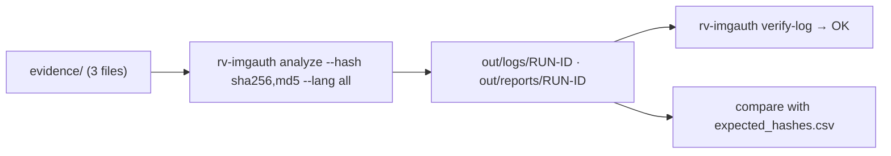

# Examples

## `sample/` — three files that exercise every report section

| File | What it demonstrates | Expected finding |
| --- | --- | --- |
| `evidence/acta.txt` | Plain text | DUPLICATE (info) |
| `evidence/acta-copia.txt` | Same content as `acta.txt` | DUPLICATE (info) |
| `evidence/foto-vacaciones.jpg` | A PDF renamed as a photo (examined as an image because of its extension) | EXTENSION_MISMATCH (medium), ANALYSIS_NOT_IMPLEMENTED (info) |

`expected_hashes.csv` holds the digests of the three files in all six algorithms, computed independently with
Python's `hashlib` and `blake3`, so you can check the tool's output. `expected_findings.json` is empty (`{}`)
until the image analyses exist; it will list the expected codes of the image analysis per file.



Run it:

```bash
examples/sample/run.sh target/release/rv-imgauth          # Linux / macOS
```

```powershell
.\examples\sample\run.ps1 -Bin .\rv-imgauth.exe          # Windows
```

Expected summary: 3 items, 0 errors, findings `high 0, medium 1, low 0, info 3`, exit code 0.
