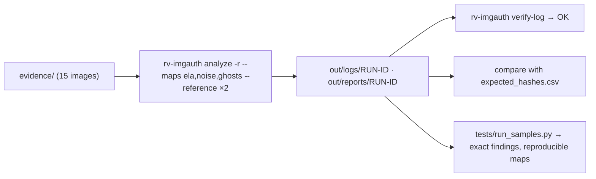

# Examples

## `sample/`: synthetic images that exercise every analysis and report section

Every image is synthetic (generated by `tests/samples/make_structure.py` and `tests/samples/make_pixels.py`
with Pillow and numpy; no real person, place or device). The run analyses the whole folder recursively with
every map and the two reference images:

```bash
rv-imgauth analyze -i examples/sample/evidence -r --maps ela,noise,ghosts \
  --reference examples/sample/evidence/reference/ref-1.jpg --reference examples/sample/evidence/reference/ref-2.jpg
```

| File | What it holds | Expected findings (exact) |
| --- | --- | --- |
| `evidence/bad-order.png` | PNG with a chunk-order violation, a private chunk and data after IEND (pixels do not decode: no maps) | DATA_AFTER_END_MARKER, PNG_CHUNK_ORDER_INVALID, PNG_PRIVATE_CHUNKS, REFERENCE_INCONSISTENT |
| `evidence/camera-original.jpg` | Synthetic camera original: EXIF Make/Model/dates, MakerNote, thumbnail, non-IJG tables | ELA_MAP_WRITTEN, NOISE_INCONSISTENCY_MAP, QT_NON_STANDARD, QT_UNKNOWN, REFERENCE_CONSISTENT |
| `evidence/crash.jpg` | Damaged 15-byte JPEG: reported, and the run goes on | COEFFICIENTS_UNAVAILABLE, FILE_STRUCTURE_DAMAGED, REFERENCE_INCONSISTENT |
| `evidence/edited-gimp.jpg` | Re-saved with IJG q=85, Software GIMP, later DateTime, XMP history | ELA_MAP_WRITTEN, EXIF_SOFTWARE_EDITOR, METADATA_DATES_INCONSISTENT, NOISE_INCONSISTENCY_MAP, QT_STANDARD_IJG, QT_UNKNOWN, REFERENCE_INCONSISTENT, XMP_EDIT_HISTORY |
| `evidence/iphone-like.heic` | Hand-built HEIF box structure (no HEVC payload): structure and metadata only | HEIC_PIXELS_NOT_DECODED, HEIF_STRUCTURE_ANOMALY, HEIF_UNREFERENCED_DATA, REFERENCE_INCONSISTENT |
| `evidence/no-metadata.jpg` | JPEG without any metadata | ELA_MAP_WRITTEN, METADATA_STRIPPED, NOISE_INCONSISTENCY_MAP, QT_STANDARD_IJG, QT_UNKNOWN, REFERENCE_INCONSISTENT |
| `evidence/photo.webp` | VP8X with the EXIF flag set but no EXIF chunk (pixels do not decode: no maps) | REFERENCE_INCONSISTENT, WEBP_FLAGS_MISMATCH |
| `evidence/pix-copy-move.jpg` | A textured patch duplicated 200 px to the right | COPY_MOVE_CANDIDATE, ELA_MAP_WRITTEN, METADATA_STRIPPED, NOISE_INCONSISTENCY_MAP, QT_STANDARD_IJG, QT_UNKNOWN, REFERENCE_INCONSISTENT |
| `evidence/pix-natural.jpg` | Clean single save at q=92 (negative control) | ELA_MAP_WRITTEN, METADATA_STRIPPED, NOISE_INCONSISTENCY_MAP, QT_STANDARD_IJG, QT_UNKNOWN, REFERENCE_INCONSISTENT |
| `evidence/pix-spliced-ghost.jpg` | A region from a q=60 save pasted into a q=90 image | ELA_MAP_WRITTEN, JPEG_GHOST_REGION, METADATA_STRIPPED, NOISE_INCONSISTENCY_MAP, QT_STANDARD_IJG, QT_UNKNOWN, REFERENCE_INCONSISTENT |
| `evidence/pix-whatsapp-like.jpg` | Stripped, 1600 px long side, q=80 | ELA_MAP_WRITTEN, METADATA_STRIPPED, NOISE_INCONSISTENCY_MAP, QT_STANDARD_IJG, QT_UNKNOWN, REFERENCE_INCONSISTENT |
| `evidence/progressive.jpg` | Progressive JPEG (no coefficient analysis) | COEFFICIENTS_UNAVAILABLE, ELA_MAP_WRITTEN, METADATA_STRIPPED, NOISE_INCONSISTENCY_MAP, PROGRESSIVE_ENCODING, QT_STANDARD_IJG, QT_UNKNOWN, REFERENCE_INCONSISTENT |
| `evidence/reference/ref-1.jpg` | Known original of the synthetic camera (reference set; also analysed) | ELA_MAP_WRITTEN, NOISE_INCONSISTENCY_MAP, QT_NON_STANDARD, QT_UNKNOWN, REFERENCE_CONSISTENT |
| `evidence/reference/ref-2.jpg` | Second known original (reference set; also analysed) | ELA_MAP_WRITTEN, NOISE_INCONSISTENCY_MAP, QT_NON_STANDARD, QT_UNKNOWN, REFERENCE_CONSISTENT |
| `evidence/screenshot.png` | PNG with tEXt Software, tIME and eXIf dates that disagree | ELA_NOT_APPLICABLE, METADATA_DATES_INCONSISTENT, NOISE_INCONSISTENCY_MAP, REFERENCE_INCONSISTENT |

`expected_findings.json` holds these codes and the options; `tests/run_samples.py <binary>` checks that each
file gives exactly them, that `verify-log` passes, that the evidence digests are unchanged and that a second run
writes byte-identical maps and structure/metadata JSON. `expected_hashes.csv` holds the digests of every file
in all six algorithms, computed independently with Python's `hashlib` and `blake3`, never by the tool.



Run it:

```bash
examples/sample/run.sh target/release/rv-imgauth          # Linux / macOS
```

```powershell
.\examples\sample\run.ps1 -Bin .\rv-imgauth.exe          # Windows
```

Expected: 15 items, 0 errors, exit code 3 (one high-severity finding: COPY_MOVE_CANDIDATE on
`pix-copy-move.jpg`). The inventory-only fixtures (text files and a PDF named `.jpg`) used by the tests are in
`tests/fixtures/inventory/`.
